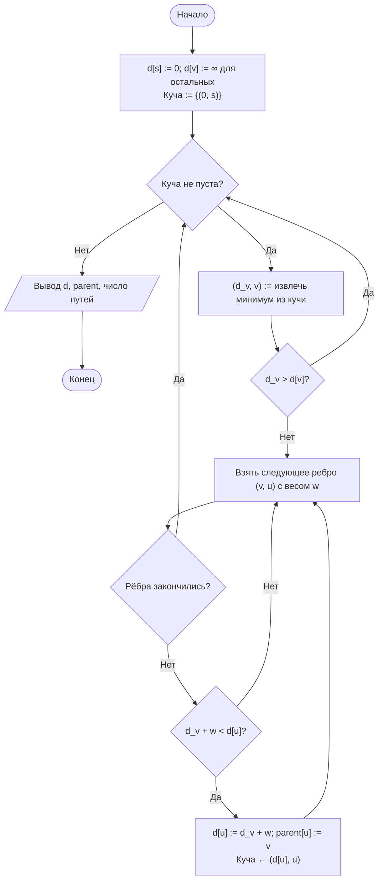
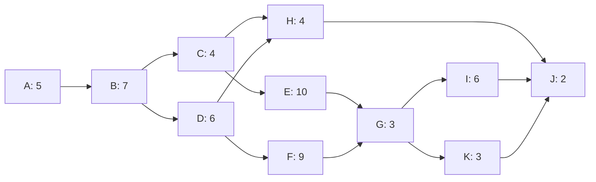
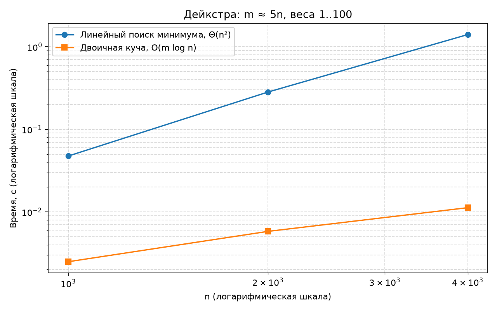

# Отчёт по лабораторной работе № 10

## Титульный лист

**Дисциплина:** Теория алгоритмов
**Направление подготовки:** 38.03.05 «Бизнес-информатика»
**Курс:** 2
**Тема:** Алгоритмы поиска кратчайших путей и расчёт критического пути сетевого графика
**Вариант:** 4
**Дополнительное задание:** К4 — число кратчайших путей между вершинами
**ФИО студента:** Дымченко Игорь Владиславович

---

## 1. Цель работы и задание варианта

**Цель:** реализовать алгоритм Дейкстры в двух вариантах, сравнить их трудоёмкость и применить топологическую сортировку к расчёту критического пути проекта.

**Задание варианта 4 (табл. 1 методички):**

- граф: разреженный, $m \approx 5n$, веса рёбер $1 \ldots 100$;
- размеры: $n = 1000,\ 2000,\ 4000$;
- проект: 11 работ;
- дополнительное задание К4: число кратчайших путей.

---

## 2. Описание алгоритмов и оценки трудоёмкости

**Алгоритм Дейкстры** поддерживает оценки $d[v]$ и на каждом шаге выбирает непросмотренную вершину с наименьшей оценкой, затем выполняет релаксацию её исходящих рёбер: $d[v] + w(v,u) < d[u]$ обновляет $d[u]$ и предка $u$. Требует неотрицательных весов.

- **Реализация 1 (линейный поиск минимума):** на каждом из $n$ шагов перебор всех $n$ вершин. Трудоёмкость $\Theta(n^2)$.
- **Реализация 2 (двоичная куча, `heapq`):** каждая успешная релаксация добавляет запись в кучу за $O(\log m)$; устаревшие записи пропускаются. Трудоёмкость $O(m \log n)$.

**К4 (число кратчайших путей).** При релаксации: если найден строго более короткий путь к $u$, то число путей $c[u]$ становится $c[v]$; если найден путь той же длины, то $c[u] \mathrel{+}= c[v]$. Это корректно, так как вершины извлекаются в порядке неубывания расстояний, и к моменту извлечения $v$ её значение $c[v]$ окончательно.

**Топологическая сортировка (Кан)** и **метод критического пути (CPM):**

$$ES_i = \max_{j \in \text{Pred}(i)} EF_j, \qquad EF_i = ES_i + t_i,$$

$$LF_i = \min_{j \in \text{Succ}(i)} LS_j, \qquad LS_i = LF_i - t_i, \qquad R_i = LS_i - ES_i.$$

Работы с $R_i = 0$ образуют критический путь. Трудоёмкость $\Theta(n + m)$.

---

## 3. Блок-схема алгоритма Дейкстры (реализация с кучей)



---

## 4. Сетевой график проекта (11 работ)

Базовый набор из табл. 2 методички дополнен работой K «Нагрузочное тестирование» (3 дня, после G); работа J теперь ожидает K.



---

## 5. Листинг программы

Файл: [main.py](main.py)

```python
"""
Лабораторная работа № 10. Вариант 4.
1. Дейкстра в двух реализациях (линейный поиск минимума и двоичная куча)
   на разреженных графах с m ≈ 5n, n = 1000, 2000, 4000, веса 1..100.
2. К4: число кратчайших путей от источника до каждой вершины.
3. Расчёт критического пути сетевого графика проекта из 11 работ
   (топологическая сортировка Кана, прямой и обратный проходы).
"""

import heapq
import os
import platform
import random
import statistics
import sys
import time
from collections import deque

import matplotlib.pyplot as plt


INF = float("inf")
SIZES = [1000, 2000, 4000]
EDGE_FACTOR = 5        # m ≈ 5n
MAX_WEIGHT = 100
REPEATS = 3
SEED = 42


def dijkstra_array(adj, s):
    """Дейкстра с линейным поиском минимума. Трудоёмкость Θ(n²)."""
    n = len(adj)
    dist = [INF] * n
    parent = [-1] * n
    used = [False] * n
    dist[s] = 0
    for _ in range(n):
        v, best = -1, INF
        for i in range(n):
            if not used[i] and dist[i] < best:
                v, best = i, dist[i]
        if v == -1:
            break
        used[v] = True
        for u, w in adj[v]:
            if dist[v] + w < dist[u]:
                dist[u] = dist[v] + w
                parent[u] = v
    return dist, parent


def dijkstra_heap(adj, s):
    """Дейкстра с двоичной кучей (heapq). Трудоёмкость O(m log n)."""
    n = len(adj)
    dist = [INF] * n
    parent = [-1] * n
    dist[s] = 0
    heap = [(0, s)]
    while heap:
        d, v = heapq.heappop(heap)
        if d > dist[v]:
            continue                      # устаревшая запись в куче
        for u, w in adj[v]:
            if d + w < dist[u]:
                dist[u] = d + w
                parent[u] = v
                heapq.heappush(heap, (dist[u], u))
    return dist, parent


def count_shortest_paths(adj, s):
    """К4: число кратчайших путей от s до каждой вершины (Дейкстра + подсчёт в порядке извлечения)."""
    n = len(adj)
    dist = [INF] * n
    count = [0] * n
    dist[s] = 0
    count[s] = 1
    heap = [(0, s)]
    settled = [False] * n
    while heap:
        d, v = heapq.heappop(heap)
        if settled[v]:
            continue
        settled[v] = True
        for u, w in adj[v]:
            nd = d + w
            if nd < dist[u]:
                dist[u] = nd
                count[u] = count[v]
                heapq.heappush(heap, (nd, u))
            elif nd == dist[u]:
                count[u] += count[v]
    return dist, count


def restore_path(parent, target):
    """Восстановление пути по массиву предков."""
    path = []
    while target != -1:
        path.append(target)
        target = parent[target]
    return path[::-1]


def generate_graph(n: int, m: int, seed: int):
    """Случайный ориентированный взвешенный граф: остовное дерево для связности плюс случайные рёбра."""
    rng = random.Random(seed)
    adj = [[] for _ in range(n)]
    for i in range(1, n):
        j = rng.randrange(i)
        adj[j].append((i, rng.randint(1, MAX_WEIGHT)))
    extra = max(0, m - (n - 1))
    for _ in range(extra):
        u, v = rng.randrange(n), rng.randrange(n)
        if u != v:
            adj[u].append((v, rng.randint(1, MAX_WEIGHT)))
    return adj


def measure(action, repeats: int = REPEATS):
    """Медиана времени action() по repeats запускам."""
    times = []
    result = None
    for _ in range(repeats):
        started = time.perf_counter()
        result = action()
        times.append(time.perf_counter() - started)
    return statistics.median(times), result


def topological_order(tasks):
    """Топологическая сортировка (алгоритм Кана). tasks: код -> (длительность, предшественники)."""
    indeg = {k: len(v[1]) for k, v in tasks.items()}
    succ = {k: [] for k in tasks}
    for k, (_, preds) in tasks.items():
        for p in preds:
            succ[p].append(k)
    queue = deque(sorted(k for k, d in indeg.items() if d == 0))
    order = []
    while queue:
        v = queue.popleft()
        order.append(v)
        for u in succ[v]:
            indeg[u] -= 1
            if indeg[u] == 0:
                queue.append(u)
    if len(order) != len(tasks):
        raise ValueError("Сетевой график содержит цикл: исходные данные некорректны")
    return order, succ


def critical_path(tasks):
    """Расчёт ES, EF, LS, LF, резервов и критических работ."""
    order, succ = topological_order(tasks)
    ES, EF = {}, {}
    for v in order:
        duration, preds = tasks[v]
        ES[v] = max((EF[p] for p in preds), default=0)
        EF[v] = ES[v] + duration
    T = max(EF.values())

    LS, LF = {}, {}
    for v in reversed(order):
        duration = tasks[v][0]
        LF[v] = min((LS[u] for u in succ[v]), default=T)
        LS[v] = LF[v] - duration

    reserve = {v: LS[v] - ES[v] for v in tasks}
    critical = [v for v in order if reserve[v] == 0]
    return T, ES, EF, LS, LF, reserve, critical


PROJECT = {
    "A": (5, []), "B": (7, ["A"]), "C": (4, ["B"]), "D": (6, ["B"]),
    "E": (10, ["C"]), "F": (9, ["D"]), "G": (3, ["E", "F"]),
    "H": (4, ["C", "D"]), "I": (6, ["G"]),
    "K": (3, ["G"]),                      # добавленная 11-я работа варианта 4
    "J": (2, ["H", "I", "K"]),
}


def check_small_graph() -> None:
    """Проверка на малом графе: сравнение реализаций, число путей, восстановление пути."""
    adj = [[] for _ in range(6)]
    for u, v, w in [(0, 1, 2), (0, 2, 2), (1, 3, 1), (2, 3, 1), (3, 4, 3), (1, 4, 6), (4, 5, 1)]:
        adj[u].append((v, w))
    d1, p1 = dijkstra_array(adj, 0)
    d2, p2 = dijkstra_heap(adj, 0)
    d3, cnt = count_shortest_paths(adj, 0)
    assert d1 == d2 == d3
    print("Малый граф: расстояния от 0:", d1)
    print("  число кратчайших путей:", cnt)
    print("  путь до 5:", " -> ".join(map(str, restore_path(p2, 5))))
    assert d1 == [0, 2, 2, 3, 6, 7]
    assert cnt[3] == 2
    assert restore_path(p2, 5) in ([0, 1, 3, 4, 5], [0, 2, 3, 4, 5])


def experiment_dijkstra():
    """Сравнение двух реализаций Дейкстры и подсчёт путей (К4) при разных n."""
    rows = []
    for n in SIZES:
        m = EDGE_FACTOR * n
        adj = generate_graph(n, m, SEED + n)
        t_arr, (d1, _) = measure(lambda: dijkstra_array(adj, 0))
        t_heap, (d2, p2) = measure(lambda: dijkstra_heap(adj, 0))
        assert d1 == d2
        _, cnt = count_shortest_paths(adj, 0)
        max_paths = max(cnt)
        rows.append({"n": n, "m": m, "t_arr": t_arr, "t_heap": t_heap, "max_paths": max_paths})
    return rows


def save_charts(rows):
    out_dir = os.path.dirname(os.path.abspath(__file__))
    ns = [r["n"] for r in rows]
    plt.figure(figsize=(8, 5))
    plt.plot(ns, [r["t_arr"] for r in rows], "o-", label="Линейный поиск минимума, Θ(n²)")
    plt.plot(ns, [r["t_heap"] for r in rows], "s-", label="Двоичная куча, O(m log n)")
    plt.xscale("log")
    plt.yscale("log")
    plt.xlabel("n (логарифмическая шкала)")
    plt.ylabel("Время, с (логарифмическая шкала)")
    plt.title("Дейкстра: m ≈ 5n, веса 1..100")
    plt.grid(True, which="both", linestyle="--", alpha=0.5)
    plt.legend()
    plt.tight_layout()
    plt.savefig(os.path.join(out_dir, "lr10_dijkstra.png"), dpi=160)
    plt.close()


def main() -> None:
    print(f"Python: {sys.version.split()[0]} ({platform.python_implementation()})")
    print(f"ОС: {platform.platform()}; логических процессоров: {os.cpu_count()}\n")

    check_small_graph()

    print("\nДейкстра: m = 5n, медиана 3 запусков")
    rows = experiment_dijkstra()
    print(f"{'n':>6}{'m':>8}{'массив, с':>13}{'куча, с':>12}{'отношение':>12}{'макс. чисел путей':>20}")
    for r in rows:
        print(f"{r['n']:>6}{r['m']:>8}{r['t_arr']:>13.4f}{r['t_heap']:>12.4f}"
              f"{r['t_arr'] / r['t_heap']:>12.1f}{r['max_paths']:>20}")
    save_charts(rows)

    print("\nКритический путь проекта (11 работ)")
    T, ES, EF, LS, LF, R, crit = critical_path(PROJECT)
    print(f"Длительность проекта: {T} дн.")
    print(f"{'Работа':>8}{'t':>5}{'ES':>5}{'EF':>5}{'LS':>5}{'LF':>5}{'Резерв':>8}{'Крит.':>7}")
    for v in sorted(PROJECT):
        print(f"{v:>8}{PROJECT[v][0]:>5}{ES[v]:>5}{EF[v]:>5}{LS[v]:>5}{LF[v]:>5}"
              f"{R[v]:>8}{'да' if R[v] == 0 else '':>7}")
    print("Критические работы:", " -> ".join(crit))
    print("\nГрафик сохранён: lr10_dijkstra.png")


if __name__ == "__main__":
    main()
```

---

## 6. Объяснение программы

1. **`dijkstra_array`** — на каждом шаге линейный перебор находит непросмотренную вершину с минимальной оценкой (Θ(n) на шаг) и релаксирует её рёбра.
2. **`dijkstra_heap`** — куча хранит пары (оценка, вершина). Устаревшие записи отбрасываются проверкой `d > dist[v]`.
3. **`count_shortest_paths`** — дополнение к куче для К4: при равенстве длин число путей суммируется, при улучшении — переписывается. Флаг `settled` исключает повторную обработку вершины.
4. **`restore_path`** — восстановление пути по массиву предков от цели к источнику с последующим разворотом.
5. **`generate_graph`** — остовное дерево из случайных рёбер гарантирует достижимость всех вершин из источника; затем добавляются случайные рёбра до $m = 5n$.
6. **`topological_order`** — алгоритм Кана; при неполном порядке выбрасывается ошибка, сигнализирующая о цикле (ДАГ нарушен).
7. **`critical_path`** — прямой проход по топологическому порядку даёт $ES$ и $EF$, обратный — $LF$ и $LS$; резерв и критический путь выводятся из них.
8. **`check_small_graph`** — проверка на графе из 6 вершин: расстояния, число путей (для вершины 3 два пути: через 1 и через 2), восстановление пути.

---

## 7. Характеристики вычислительной системы

| Параметр | Значение |
|---|---|
| Операционная система | Windows 11, версия 10.0.26200 |
| Процессор | 11th Gen Intel Core i5-1135G7 @ 2.40 GHz |
| Логические процессоры | 8 |
| Оперативная память | 16 GiB |
| Интерпретатор | CPython 3.15.0rc2 |
| Повторы замеров | 3; итоговое значение — медиана |

---

## 8. Результаты измерений

### 8.1. Проверка на малом графе

Граф: $0\to1\ (2),\ 0\to2\ (2),\ 1\to3\ (1),\ 2\to3\ (1),\ 3\to4\ (3),\ 1\to4\ (6),\ 4\to5\ (1)$.

- Расстояния от 0: $[0, 2, 2, 3, 6, 7]$. Обе реализации дали одинаковый результат.
- Число кратчайших путей: $[1, 1, 1, 2, 2, 2]$. Для вершины 3 два пути одинаковой длины 3: $0\to1\to3$ и $0\to2\to3$. Вершина 4 достигается только через 3 (длина 6), вершина 5 — путём $0\to1\to3\to4\to5$ либо $0\to2\to3\to4\to5$ (два пути длины 7), что согласуется с выводом программы.
- Восстановленный путь до 5: $0 \to 1 \to 3 \to 4 \to 5$.

### 8.2. Дейкстра: две реализации при $m = 5n$

| $n$ | $m$ | Массив, с | Куча, с | Отношение | Макс. число кратчайших путей (К4) |
|---:|---:|---:|---:|---:|---:|
| 1 000 | 5 000 | 0,0475 | 0,0025 | 19,1 | 2 |
| 2 000 | 10 000 | 0,2831 | 0,0058 | 48,7 | 3 |
| 4 000 | 20 000 | 1,4066 | 0,0112 | 125,1 | 3 |



Обе реализации давали одинаковые расстояния (проверка `assert` в программе). Число кратчайших путей до отдельных вершин достигает 2–3, то есть множественность кратчайших путей в таких графах встречается.

**Замечание о воспроизводимости.** В предварительном запуске до добавления 11-й работы отношения составляли 33,2; 102,2; 113,1 при других абсолютных значениях времени. Разброс абсолютных времён между запусками заметен (например, для $n = 1000$ массив дал 0,0321 с и 0,0475 с). Поэтому в выводах опираюсь на порядок величин и на тенденцию роста отношения, а не на точные числа.

### 8.3. Критический путь проекта (11 работ)

| Работа | $t$ | $ES$ | $EF$ | $LS$ | $LF$ | Резерв $R$ | Критическая |
|---|---:|---:|---:|---:|---:|---:|:---:|
| A | 5 | 0 | 5 | 0 | 5 | 0 | да |
| B | 7 | 5 | 12 | 5 | 12 | 0 | да |
| C | 4 | 12 | 16 | 13 | 17 | 1 | |
| D | 6 | 12 | 18 | 12 | 18 | 0 | да |
| E | 10 | 16 | 26 | 17 | 27 | 1 | |
| F | 9 | 18 | 27 | 18 | 27 | 0 | да |
| G | 3 | 27 | 30 | 27 | 30 | 0 | да |
| H | 4 | 18 | 22 | 32 | 36 | 14 | |
| I | 6 | 30 | 36 | 30 | 36 | 0 | да |
| K | 3 | 30 | 33 | 33 | 36 | 3 | |
| J | 2 | 36 | 38 | 36 | 38 | 0 | да |

**Длительность проекта: 38 дней. Критический путь: A → B → D → F → G → I → J.**

Работа K (нагрузочное тестирование) не меняет срок: её резерв 3 дня, и она может задержаться на 3 дня без влияния на проект. Работы C и E имеют резерв 1 день, работа H — 14 дней.

---

## 9. Выводы

1. Реализация Дейкстры с двоичной кучей многократно быстрее реализации с линейным поиском минимума на разреженных графах, и отношение времён растёт с $n$ (от 19 до 125 в данном эксперименте). Это соответствует оценкам $O(m \log n)$ против $\Theta(n^2)$.
2. Измеренное отношение времён (125 при $n = 4000$) заметно выше грубой оценки по числу операций $n^2 / (m \log_2 n) \approx 1{,}6 \cdot 10^7 / 2{,}4 \cdot 10^5 \approx 67$. Оценка не учитывает константы реализаций: линейный поиск — простой цикл по списку, куча — операции с накладными расходами. Точная причина не исследовалась; вывод о порядке роста опирается на тенденцию, а не на точное значение.
3. Подсчёт числа кратчайших путей (К4) выполняется той же Дейкстрой без дополнительной асимптотической стоимости. В выбранных графах число таких путей достигает 3.
4. Критический путь проекта: $T = 38$ дней, критические работы A, B, D, F, G, I, J. Прямой и обратный проходы выполняются за $\Theta(n + m)$.
5. Сокращение срока возможно только за счёт работ критического пути. Работы K, C, E, H имеют положительный резерв и не влияют на срок в пределах своих резервов.

---

## 10. Рекомендуемая литература

1. Кормен Т., Лейзерсон Ч., Ривест Р., Штайн К. Алгоритмы: построение и анализ. — 3-е изд. — М.: Вильямс, 2013. — Гл. 22, 24.
2. Седжвик Р., Уэйн К. Алгоритмы на Java. — 4-е изд. — М.: Вильямс, 2013. — Гл. 4.4.
3. Скиена С. Алгоритмы. Руководство по разработке. — 3-е изд. — СПб.: БХВ-Петербург, 2022.
4. Мазур И. И., Шапиро В. Д., Ольдерогге Н. Г. Управление проектами. — М.: Омега-Л, 2010.
5. Руководство к своду знаний по управлению проектами (PMBOK Guide). — 7-е изд. — Project Management Institute, 2021.
6. Документация Python: модуль `heapq` [Электронный ресурс]. — URL: https://docs.python.org/3/library/heapq.html

---

Выполнил: Дымченко Игорь Владиславович

Дата: ________
