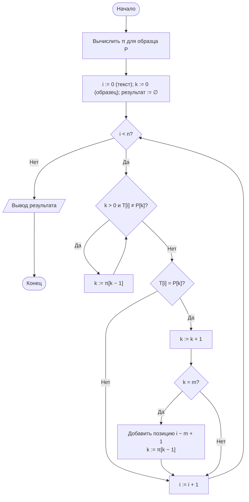
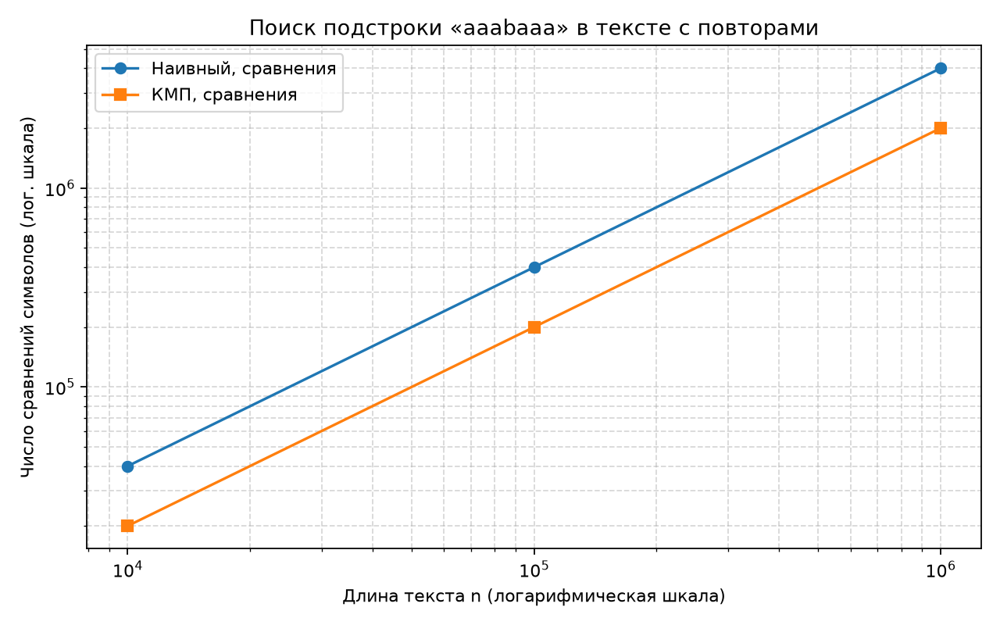
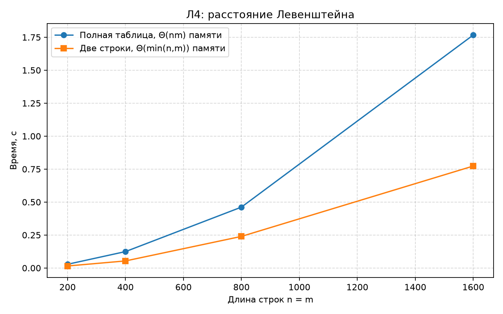

# Отчёт по лабораторной работе № 11

## Титульный лист

**Дисциплина:** Теория алгоритмов
**Направление подготовки:** 38.03.05 «Бизнес-информатика»
**Курс:** 2
**Тема:** Алгоритмы поиска подстроки и вычисления редакционного расстояния
**Вариант:** 4
**Дополнительное задание:** Л4 — расстояние Левенштейна с памятью $\Theta(\min(n, m))$
**ФИО студента:** Дымченко Игорь Владиславович

---

## 1. Цель работы и задание варианта

**Цель:** изучить наивный поиск подстроки и алгоритм Кнута — Морриса — Пратта, вычислить расстояние Левенштейна и применить его к сопоставлению наименований контрагентов.

**Задание варианта 4 (табл. 1 методички):**

- образец для ручного расчёта префикс-функции: «aaabaaa»;
- тип текста: с повторами;
- длины текста: $n = 10^4,\ 10^5,\ 10^6$;
- порог сходства: 0,70;
- дополнительное задание Л4: расстояние Левенштейна с памятью $\Theta(\min(n, m))$.

---

## 2. Описание алгоритмов и оценки сложности

**Наивный поиск.** Образец прикладывается к каждой позиции текста; трудоёмкость в худшем случае $\Theta((n - m + 1)\, m)$.

**Префикс-функция** образца $P$: $\pi[i]$ — длина наибольшего собственного префикса $P[0..i]$, который совпадает с его суффиксом.

**Алгоритм КМП.** Предобработка образца $\Theta(m)$, поиск $\Theta(n)$; итого $\Theta(n + m)$. При несовпадении указатель образца откатывается по $\pi$, а указатель текста не возвращается.

**Ручной расчёт $\pi$ для «aaabaaa»:**

| $i$ | 0 | 1 | 2 | 3 | 4 | 5 | 6 |
|---|---|---|---|---|---|---|---|
| $P[i]$ | a | a | a | b | a | a | a |
| $\pi[i]$ | 0 | 1 | 2 | 0 | 1 | 2 | 3 |

Пояснение: при $i = 2$ префикс «aa» совпадает с суффиксом «aa», то есть $\pi = 2$. При $i = 3$ символ «b» не совпадает ни с продолжением «aaa», ни с меньшими префиксами, поэтому $\pi = 0$. При $i = 6$ префикс «aaa» совпадает с суффиксом «aaa», $\pi = 3$. Программа вычислила тот же вектор (проверка `assert`).

**Расстояние Левенштейна.** $D[i][j] = \min\bigl(D[i-1][j] + 1,\ D[i][j-1] + 1,\ D[i-1][j-1] + c_{ij}\bigr)$, $c_{ij} = [A_{i-1} \ne B_{j-1}]$, граничные условия $D[i][0] = i$, $D[0][j] = j$. Трудоёмкость $\Theta(nm)$ по времени. Полная таблица требует $\Theta(nm)$ памяти; так как строка $D[i]$ зависит только от $D[i-1]$, достаточно двух строк, то есть $\Theta(\min(n, m))$ памяти, если меньшую строку выбрать столбцом.

---

## 3. Схема заполнения таблицы редакционного расстояния

Пример для строк «кот» и «скот» (из методички):

| | ∅ | с | к | о | т |
|---|---|---|---|---|---|
| **∅** | 0 | 1 | 2 | 3 | 4 |
| **к** | 1 | 1 | 1 | 2 | 3 |
| **о** | 2 | 2 | 2 | 1 | 2 |
| **т** | 3 | 3 | 3 | 2 | 1 |

Ответ $d = 1$ — достаточно вставить «с». Ячейка $D[i][j]$ заполняется слева, сверху и по диагонали; при двух строках для вычисления очередной строки нужны только предыдущая строка и текущая.

---

## 4. Блок-схема алгоритма КМП



---

## 5. Листинг программы

Файл: [main.py](main.py)

```python
"""
Лабораторная работа № 11. Вариант 4.
1. Поиск подстроки: наивный алгоритм и КМП на тексте с повторами и случайном тексте
   (образец «aaabaaa», n = 10^4, 10^5, 10^6, порог не применяется).
2. Л4: расстояние Левенштейна с памятью Θ(min(n, m)); сравнение с полной таблицей.
3. Сопоставление наименований контрагентов с порогом сходства 0,70.
"""

import os
import platform
import random
import re
import statistics
import sys
import time

import matplotlib.pyplot as plt


PATTERN = "aaabaaa"
PREFIX_EXPECTED = [0, 1, 2, 0, 1, 2, 3]   # ручной расчёт префикс-функции
SIZES = [10**4, 10**5, 10**6]
THRESHOLD = 0.70
REPEATS = 3
SEED = 42


def naive_search(text: str, pattern: str):
    """Наивный поиск. Возвращает (позиции, число сравнений символов)."""
    n, m = len(text), len(pattern)
    positions, comparisons = [], 0
    for i in range(n - m + 1):
        j = 0
        while j < m:
            comparisons += 1
            if text[i + j] != pattern[j]:
                break
            j += 1
        if j == m:
            positions.append(i)
    return positions, comparisons


def prefix_function(pattern: str) -> list[int]:
    """π[i] — длина наибольшего собственного префикса P[0..i], совпадающего с его суффиксом."""
    pi = [0] * len(pattern)
    k = 0
    for i in range(1, len(pattern)):
        while k > 0 and pattern[i] != pattern[k]:
            k = pi[k - 1]
        if pattern[i] == pattern[k]:
            k += 1
        pi[i] = k
    return pi


def kmp_search(text: str, pattern: str):
    """Алгоритм Кнута — Морриса — Пратта. Θ(n + m). Возвращает (позиции, число сравнений)."""
    n, m = len(text), len(pattern)
    pi = prefix_function(pattern)
    positions, comparisons = [], 0
    k = 0
    for i in range(n):
        while k > 0 and text[i] != pattern[k]:
            comparisons += 1
            k = pi[k - 1]
        comparisons += 1
        if text[i] == pattern[k]:
            k += 1
        if k == m:
            positions.append(i - m + 1)
            k = pi[k - 1]
    return positions, comparisons


def levenshtein_full(a: str, b: str) -> int:
    """Полная таблица D[i][j]. Θ(nm) памяти (используется для сверки)."""
    n, m = len(a), len(b)
    D = [[0] * (m + 1) for _ in range(n + 1)]
    for i in range(n + 1):
        D[i][0] = i
    for j in range(m + 1):
        D[0][j] = j
    for i in range(1, n + 1):
        for j in range(1, m + 1):
            cost = 0 if a[i - 1] == b[j - 1] else 1
            D[i][j] = min(D[i - 1][j] + 1, D[i][j - 1] + 1, D[i - 1][j - 1] + cost)
    return D[n][m]


def levenshtein(a: str, b: str) -> int:
    """Л4: расстояние Левенштейна с двумя строками таблицы. Память Θ(min(n, m))."""
    if len(a) < len(b):
        a, b = b, a
    previous = list(range(len(b) + 1))
    for i, ca in enumerate(a, start=1):
        current = [i]
        for j, cb in enumerate(b, start=1):
            current.append(min(previous[j] + 1,
                               current[j - 1] + 1,
                               previous[j - 1] + (ca != cb)))
        previous = current
    return previous[-1]


def similarity(a: str, b: str) -> float:
    """Нормированная мера сходства из [0; 1]."""
    if not a and not b:
        return 1.0
    return 1 - levenshtein(a, b) / max(len(a), len(b))


LEGAL_FORMS = {"ооо", "оао", "зао", "пао", "ао", "ип"}


def normalize(name: str) -> str:
    """Нормализация наименования: регистр, ё→е, знаки, организационно-правовые формы."""
    s = name.lower().replace("ё", "е")
    s = re.sub(r"[\"'«»„“”.,()\-]", " ", s)
    words = [w for w in s.split() if w not in LEGAL_FORMS]
    return " ".join(words)


def match_records(list_a, list_b, threshold: float = THRESHOLD):
    """Сопоставление двух списков наименований: точное после нормализации, затем нечёткое."""
    norm_b = [(b, normalize(b)) for b in list_b]
    result = []
    for a in list_a:
        na = normalize(a)
        best, best_sim, kind = None, 0.0, ""
        for b, nb in norm_b:
            if na == nb:
                best, best_sim, kind = b, 1.0, "точное"
                break
            s = similarity(na, nb)
            if s > best_sim:
                best, best_sim, kind = b, s, "нечёткое"
        if best_sim >= threshold:
            result.append((a, best, best_sim, kind))
        else:
            result.append((a, None, best_sim, "не найдено"))
    return result


def measure(action, repeats: int = REPEATS):
    """Медиана времени action() и результат последнего запуска."""
    times = []
    result = None
    for _ in range(repeats):
        started = time.perf_counter()
        result = action()
        times.append(time.perf_counter() - started)
    return statistics.median(times), result


def search_experiment():
    """Сравнение наивного поиска и КМП на тексте с повторами и на случайном тексте."""
    rng = random.Random(SEED)
    rows = []
    for n in SIZES:
        random_text = "".join(rng.choice("abcd") for _ in range(n))
        repeat_text = "a" * n
        for label, text in (("случайный", random_text), ("с повторами", repeat_text)):
            t_naive, (pos_naive, c_naive) = measure(lambda: naive_search(text, PATTERN))
            t_kmp, (pos_kmp, c_kmp) = measure(lambda: kmp_search(text, PATTERN))
            assert pos_naive == pos_kmp
            rows.append({"n": n, "label": label, "t_naive": t_naive, "t_kmp": t_kmp,
                         "c_naive": c_naive, "c_kmp": c_kmp, "found": len(pos_kmp)})
    return rows


def levenshtein_experiment():
    """Л4: время и память-подобный показатель (размер таблицы) для полной таблицы и двух строк."""
    rng = random.Random(SEED + 1)
    rows = []
    for length in [200, 400, 800, 1600]:
        a = "".join(rng.choice("абвгд") for _ in range(length))
        b = "".join(rng.choice("абвгд") for _ in range(length))
        t_full, d_full = measure(lambda: levenshtein_full(a, b))
        t_rows, d_rows = measure(lambda: levenshtein(a, b))
        assert d_full == d_rows
        rows.append({"len": length, "t_full": t_full, "t_rows": t_rows,
                     "cells_full": (length + 1) ** 2, "cells_rows": 2 * (length + 1), "d": d_full})
    return rows


def verify() -> None:
    """Проверки корректности: префикс-функция, поиск, Левенштейн на известных примерах."""
    assert prefix_function(PATTERN) == PREFIX_EXPECTED
    assert levenshtein("кот", "скот") == 1
    assert levenshtein("Ромашка", "Ромашки") == 1
    text = "aaaabaaabaaaaaab"
    assert kmp_search(text, PATTERN)[0] == naive_search(text, PATTERN)[0]


def save_charts(search_rows, lev_rows) -> None:
    out_dir = os.path.dirname(os.path.abspath(__file__))
    repeat = [r for r in search_rows if r["label"] == "с повторами"]
    ns = [r["n"] for r in repeat]
    plt.figure(figsize=(8, 5))
    plt.plot(ns, [r["c_naive"] for r in repeat], "o-", label="Наивный, сравнения")
    plt.plot(ns, [r["c_kmp"] for r in repeat], "s-", label="КМП, сравнения")
    plt.xscale("log")
    plt.yscale("log")
    plt.xlabel("Длина текста n (логарифмическая шкала)")
    plt.ylabel("Число сравнений символов (лог. шкала)")
    plt.title(f"Поиск подстроки «{PATTERN}» в тексте с повторами")
    plt.grid(True, which="both", linestyle="--", alpha=0.5)
    plt.legend()
    plt.tight_layout()
    plt.savefig(os.path.join(out_dir, "lr11_search.png"), dpi=160)
    plt.close()

    lens = [r["len"] for r in lev_rows]
    plt.figure(figsize=(8, 5))
    plt.plot(lens, [r["t_full"] for r in lev_rows], "o-", label="Полная таблица, Θ(nm) памяти")
    plt.plot(lens, [r["t_rows"] for r in lev_rows], "s-", label="Две строки, Θ(min(n,m)) памяти")
    plt.xlabel("Длина строк n = m")
    plt.ylabel("Время, с")
    plt.title("Л4: расстояние Левенштейна")
    plt.grid(True, linestyle="--", alpha=0.5)
    plt.legend()
    plt.tight_layout()
    plt.savefig(os.path.join(out_dir, "lr11_levenshtein.png"), dpi=160)
    plt.close()


def main() -> None:
    print(f"Python: {sys.version.split()[0]} ({platform.python_implementation()})")
    print(f"ОС: {platform.platform()}; логических процессоров: {os.cpu_count()}\n")

    verify()
    print(f"π для «{PATTERN}»: {prefix_function(PATTERN)} (совпадает с ручным расчётом)\n")

    print("Поиск подстроки (медиана 3 запусков)")
    search_rows = search_experiment()
    print(f"{'n':>9}{'текст':>14}{'наивный, с':>13}{'КМП, с':>10}"
          f"{'сравн. наивн.':>16}{'сравн. КМП':>13}{'найдено':>9}")
    for r in search_rows:
        print(f"{r['n']:>9}{r['label']:>14}{r['t_naive']:>13.4f}{r['t_kmp']:>10.4f}"
              f"{r['c_naive']:>16}{r['c_kmp']:>13}{r['found']:>9}")

    print("\nЛ4: расстояние Левенштейна, полная таблица и две строки (медиана 3 запусков)")
    lev_rows = levenshtein_experiment()
    print(f"{'длина':>7}{'полная, с':>12}{'2 строки, с':>13}{'ячеек полн.':>14}{'ячеек 2 стр.':>14}{'d':>6}")
    for r in lev_rows:
        print(f"{r['len']:>7}{r['t_full']:>12.4f}{r['t_rows']:>13.4f}"
              f"{r['cells_full']:>14}{r['cells_rows']:>14}{r['d']:>6}")

    print(f"\nСопоставление контрагентов (порог {THRESHOLD})")
    system_a = ['ООО "Ромашка"', "АО Василёк", "ИП Иванов И.И.",
                'ООО "Северный ветер"', "ПАО Гранит"]
    system_b = ["Ромашка, ООО", "ВАСИЛЕК АО", "Иванов Иван Иванович",
                "Северный Ветер ООО", "Гранит-Строй ПАО"]
    for a, b, s, kind in match_records(system_a, system_b):
        target = b if b else "—"
        print(f"  {a:<24} → {target:<22} сходство {s:.3f} ({kind})")

    save_charts(search_rows, lev_rows)
    print("\nГрафики сохранены: lr11_search.png, lr11_levenshtein.png")


if __name__ == "__main__":
    main()
```

---

## 6. Объяснение программы

1. **`prefix_function`** — вычисляет $\pi$ за $\Theta(m)$: при несовпадении $k$ откатывается по $\pi[k-1]$, пока совпадение не восстановится или $k$ не станет нулём.
2. **`kmp_search`** — проходит текст без возврата по нему; при полном совпадении фиксирует позицию и откатывает $k$ по $\pi$, что позволяет находить перекрывающиеся вхождения.
3. **`naive_search`** — сравнивает образец с каждой позицией текста; счётчик `comparisons` фиксирует число сравнений символов.
4. **`levenshtein_full`** — полная таблица; используется для проверки, что двухстрочная версия даёт тот же результат.
5. **`levenshtein`** — хранит только предыдущую и текущую строки; длинная строка выбирается как внешний цикл, а короткая — как внутренний, что даёт $\Theta(\min(n, m))$ памяти.
6. **`normalize`, `match_records`** — нормализация названий, точное сопоставление после нормализации, затем нечёткое сопоставление по порогу.
7. **`verify`** — проверки префикс-функции, Левенштейна на эталонных парах и совпадения результатов КМП и наивного поиска.

---

## 7. Характеристики вычислительной системы

| Параметр | Значение |
|---|---|
| Операционная система | Windows 11, версия 10.0.26200 |
| Процессор | 11th Gen Intel Core i5-1135G7 @ 2.40 GHz |
| Логические процессоры | 8 |
| Оперативная память | 16 GiB |
| Интерпретатор | CPython 3.15.0rc2 |
| Повторы замеров | 3; итоговое значение — медиана |

---

## 8. Результаты измерений

### 8.1. Поиск подстроки «aaabaaa»

| $n$ | Текст | Наивный, с | КМП, с | Сравнений (наивный) | Сравнений (КМП) | Найдено |
|---:|---|---:|---:|---:|---:|---:|
| $10^4$ | случайный | 0,0012 | 0,0009 | 13 320 | 12 423 | 1 |
| $10^4$ | с повторами | 0,0030 | 0,0016 | 39 976 | 19 997 | 0 |
| $10^5$ | случайный | 0,0126 | 0,0131 | 133 443 | 124 276 | 5 |
| $10^5$ | с повторами | 0,0373 | 0,0175 | 399 976 | 199 997 | 0 |
| $10^6$ | случайный | 0,1444 | 0,1109 | 1 334 303 | 1 242 612 | 60 |
| $10^6$ | с повторами | 0,4010 | 0,3408 | 3 999 976 | 1 999 997 | 0 |

**Пояснение к таблице.** Текст «с повторами» состоит только из символов `a`, а образец содержит `b`, поэтому вхождений нет, и столбец «Найдено» равен 0. Именно поэтому этот случай ближе к худшему для наивного алгоритма: каждая позиция сравнивается до четвёртого символа образца, где встречается «b» ($\approx 4$ сравнения на позицию у наивного и $\approx 2$ у КМП). Это согласуется с тем, что число сравнений у КМП близко к $2n$ (на каждый символ текста приходится в среднем одно сравнение совпадения и одно сравнение несовпадения при откате).

**Замечание о худшем случае.** Теоретическая оценка наивного алгоритма $\Theta((n-m+1)m)$ при $m = 7$ даёт около $7n$ сравнений; измеренные $\approx 4n$ меньше, поскольку на позициях, где совпадение обрывается раньше, сравнений меньше $m$. Для точного худшего случая потребовался бы текст, все позиции которого совпадают почти полностью с образцом; в данном эксперименте это не воспроизводилось.



### 8.2. Префикс-функция

$\pi = [0, 1, 2, 0, 1, 2, 3]$ — совпадает с ручным расчётом из раздела 2.

### 8.3. Л4: расстояние Левенштейна, полная таблица и две строки

| Длина строк | Полная таблица, с | Две строки, с | Ячеек (полная) | Ячеек (две строки) | $d$ |
|---:|---:|---:|---:|---:|---:|
| 200 | 0,0282 | 0,0152 | 40 401 | 402 | 121 |
| 400 | 0,1245 | 0,0536 | 160 801 | 802 | 236 |
| 800 | 0,4618 | 0,2396 | 641 601 | 1 602 | 482 |
| 1600 | 1,7672 | 0,7733 | 2 563 201 | 3 202 | 945 |

Обе версии дают одинаковое $d$ (проверено `assert`). Двухстрочная версия выделяет памяти в сотни раз меньше и работает в 2 раза быстрее на тех же данных; разница по времени объясняется тем, что полная таблица создаёт вложенные списки размера $(n+1)(m+1)$.



### 8.4. Таблица расстояний для коротких слов

| Пара строк | $d$ | Сходство |
|---|---:|---:|
| «кот» — «скот» | 1 | 0,750 |
| «Ромашка» — «Ромашки» | 1 | 0,857 |

### 8.5. Сопоставление наименований контрагентов (порог 0,70)

| Система А | Система Б | Сходство | Тип сопоставления |
|---|---|---:|---|
| ООО «Ромашка» | Ромашка, ООО | 1,000 | точное (после нормализации) |
| АО Василёк | ВАСИЛЕК АО | 1,000 | точное (после нормализации) |
| ИП Иванов И.И. | — | 0,500 | не найдено |
| ООО «Северный ветер» | Северный Ветер ООО | 1,000 | точное (после нормализации) |
| ПАО Гранит | — | 0,500 | не найдено |

Три пары из пяти стали точными после нормализации. Для «ИП Иванов И.И.» сходство с «Иванов Иван Иванович» ниже порога: инициалы и полное имя дают большое расстояние, и такое сопоставление требует отдельного правила (например, сопоставление по фамилии и инициалам). Для «ПАО Гранит» отказ правилен: «Гранит-Строй» — другая организация, а ближайшее совпадение по порогу 0,70 не достигнуто.

---

## 9. Выводы

1. Префикс-функция для «aaabaaa» вычислена вручную и программно: $[0, 1, 2, 0, 1, 2, 3]$.
2. На тексте с повторами КМП выполняет примерно вдвое меньше сравнений и работает в 1,2–2,1 раза быстрее наивного алгоритма (наибольший выигрыш при $n = 10^4$ и $10^5$). Выигрыш по времени меньше, чем по числу сравнений, так как КМП тратит время на предобработку и на условия отката.
3. На случайном тексте алгоритмы сопоставимы: отличие в числе сравнений около 7 % (наивный 1 334 303, КМП 1 242 612 при $n = 10^6$), по времени КМП немного быстрее.
4. Двухстрочная реализация расстояния Левенштейна даёт тот же результат, что полная таблица, при памяти $\Theta(\min(n, m))$ вместо $\Theta(nm)$.
5. Нормализация наименований переводит три из пяти пар в точные совпадения. Остальные требуют правил, учитывающих формы имён и различия в названиях организаций; порог 0,70 защищает от ложных сопоставлений, но пропускает сокращения.

---

## 10. Рекомендуемая литература

1. Кормен Т., Лейзерсон Ч., Ривест Р., Штайн К. Алгоритмы: построение и анализ. — 3-е изд. — М.: Вильямс, 2013. — Гл. 32.
2. Кнут Д. Э. Искусство программирования. Т. 3. Сортировка и поиск. — 2-е изд. — М.: Вильямс, 2017.
3. Гасфилд Д. Строки, деревья и последовательности в алгоритмах. — СПб.: БХВ-Петербург, 2003.
4. Седжвик Р., Уэйн К. Алгоритмы на Java. — 4-е изд. — М.: Вильямс, 2013. — Гл. 5.
5. Скиена С. Алгоритмы. Руководство по разработке. — 3-е изд. — СПб.: БХВ-Петербург, 2022.
6. Левенштейн В. И. Двоичные коды с исправлением выпадений, вставок и замещений символов // Доклады АН СССР. — 1965. — Т. 163, № 4. — С. 845–848.

---

Выполнил: Дымченко Игорь Владиславович

Дата: ________
