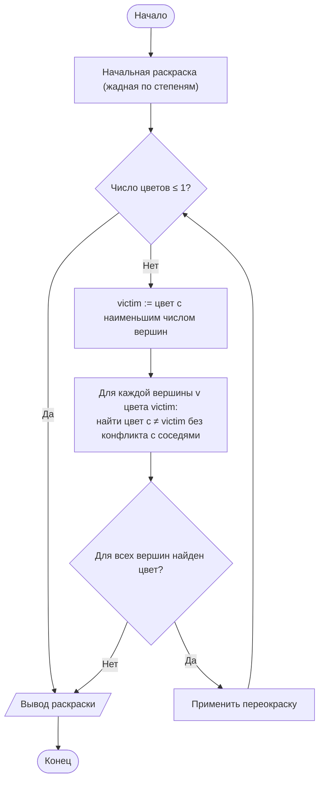
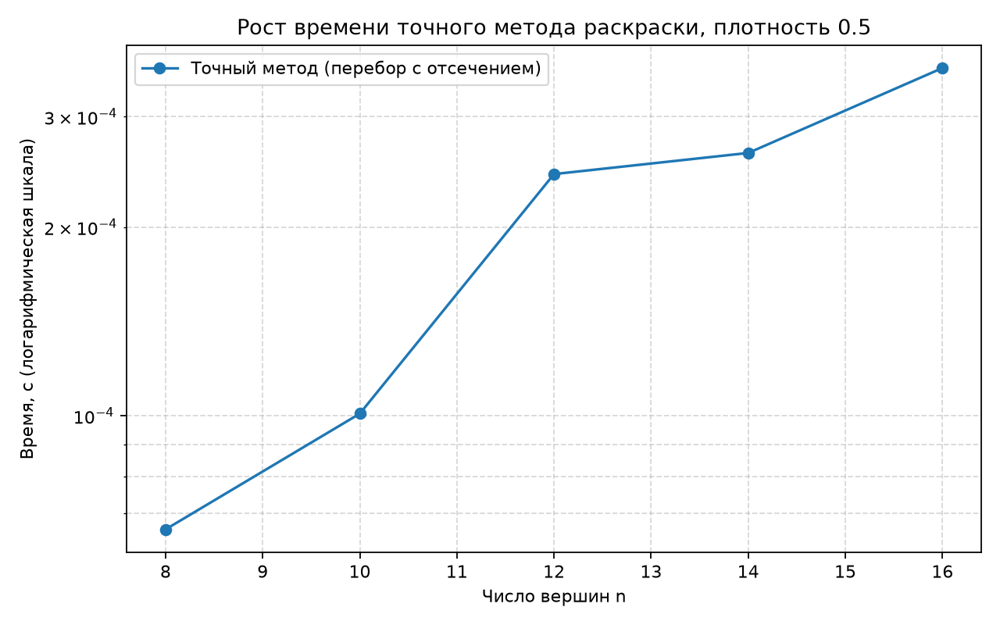

# Отчёт по лабораторной работе № 12

## Титульный лист

**Дисциплина:** Теория алгоритмов
**Направление подготовки:** 38.03.05 «Бизнес-информатика»
**Курс:** 2
**Тема:** Точные и эвристические алгоритмы решения труднорешаемых задач комбинаторной оптимизации
**Вариант:** 4
**Дополнительное задание:** М4 — зависимость качества эвристики от размерности
**ФИО студента:** Дымченко Игорь Владиславович

---

## 1. Цель работы и задание варианта

**Цель:** изучить задачи, для которых точные алгоритмы практически неприменимы, и освоить конструктивные эвристики и локальный поиск.

**Задание варианта 4 (табл. 1 методички):**

- задача: раскраска вершин графа (минимальное число цветов — хроматическое число);
- точный метод: полный перебор;
- конструктивная эвристика: жадная раскраска в порядке убывания степеней;
- локальный поиск: перекраска вершин;
- размерности: $n = 8 \ldots 12$ для точного метода, 200 вершин для эвристик;
- дополнительное задание М4: отклонение эвристики от оптимума при $n = 6, 7, 8, 9$.

---

## 2. Постановка задачи и принадлежность к NP-трудным

**Раскраска графа.** Дан неориентированный граф $G = (V, E)$. Раскраска — отображение $c: V \to \{1, \ldots, k\}$, при котором смежные вершины получают разные цвета. Хроматическое число $\chi(G)$ — наименьшее $k$, при котором раскраска существует.

**Принадлежность к NP-трудным.** Задача «можно ли раскрасить граф в $k$ цветов» для $k \ge 3$ NP-полна (сведение от 3-выполнимости [1]). Оптимизационная версия «найти $\chi(G)$» NP-трудна. Поэтому точного полиномиального алгоритма ожидать нельзя, и нужны эвристики.

---

## 3. Описание алгоритмов

### 3.1. Точный метод (перебор с отсечением)

Проверяется возможность раскраски $k$ цветами для $k = 1, 2, \ldots$ до первого успешного значения. Для каждого $k$ выполняется поиск с возвратом (backtracking): вершины обрабатываются в порядке убывания степени; вершине назначается цвет, не совпадающий с цветами уже окрашенных соседей. Если дальнейшее продолжение невозможно, цвет отменяется. Применено отсечение симметрии: новый, ещё не использованный цвет выбирается только один — следующий по номеру.

Трудоёмкость в худшем случае — $O(k^n)$, то есть экспоненциальная.

### 3.2. Конструктивная эвристика: жадная раскраска по степеням

Вершины сортируются по убыванию степени. Каждой вершине присваивается наименьший цвет, не занятый её уже окрашенными соседями. Трудоёмкость $O(n + m)$ при подготовке списков, точнее $O(n \log n + m)$ с учётом сортировки.

### 3.3. Локальный поиск: перекраска

Берётся цвет с наименьшим числом вершин. Каждая его вершина переокрашивается в один из остальных существующих цветов, если это не конфликтует с соседями. Если все вершины удалось переокрасить, число цветов уменьшается на единицу; иначе поиск прекращается.

### 3.4. Блок-схема локального поиска



---

## 4. Листинг программы

Файл: [main.py](main.py)

```python
"""
Лабораторная работа № 12. Вариант 4.
Задача: минимальная раскраска вершин графа (хроматическое число).
1. Точный метод: полный перебор с отсечением (возможная раскраска k цветами), размерности 8..12.
2. Конструктивная эвристика: жадная раскраска вершин в порядке убывания степеней.
3. Локальный поиск: перекраска вершин, уменьшающая число используемых цветов.
4. М4: отклонение эвристики от оптимума при n = 6, 7, 8, 9.
Эвристики дополнительно запускаются на графе из 200 вершин.
"""

import os
import platform
import random
import statistics
import sys
import time

import matplotlib.pyplot as plt


EXACT_SIZES = [8, 10, 12, 14, 16]
LARGE_N = 200
LARGE_DENSITY = 0.05
M4_SIZES = [6, 7, 8, 9]
M4_TRIALS = 30
DENSITY = 0.5
SEED = 42


def random_graph(n: int, density: float, seed: int):
    """Случайный неориентированный граф: список смежности (множества)."""
    rng = random.Random(seed)
    adj = [set() for _ in range(n)]
    for u in range(n):
        for v in range(u + 1, n):
            if rng.random() < density:
                adj[u].add(v)
                adj[v].add(u)
    return adj


def is_valid(adj, colors) -> bool:
    """Проверка корректности раскраски: соседние вершины имеют разные цвета."""
    return all(colors[u] != colors[v] for u in range(len(adj)) for v in adj[u])


def colorable_with(adj, k: int):
    """Точный метод: возможна ли раскраска k цветами (полный перебор с отсечением)."""
    n = len(adj)
    order = sorted(range(n), key=lambda v: -len(adj[v]))   # сначала вершины высокой степени
    colors = [-1] * n

    def backtrack(idx: int, used: int) -> bool:
        if idx == n:
            return True
        v = order[idx]
        for c in range(min(used + 1, k)):              # симметрия: новый цвет только следующий по порядку
            if all(colors[u] != c for u in adj[v]):
                colors[v] = c
                if backtrack(idx + 1, max(used, c + 1)):
                    return True
                colors[v] = -1
        return False

    if backtrack(0, 0):
        return True, colors
    return False, None


def exact_chromatic(adj):
    """Точный метод: минимальное k, при котором раскраска возможна. Перебор k от 1 вверх."""
    n = len(adj)
    if n == 0:
        return 0, []
    for k in range(1, n + 1):
        ok, colors = colorable_with(adj, k)
        if ok:
            return k, colors
    return n, list(range(n))


def greedy_by_degree(adj):
    """Конструктивная эвристика: вершины в порядке убывания степени, каждой — наименьший свободный цвет."""
    n = len(adj)
    order = sorted(range(n), key=lambda v: -len(adj[v]))
    colors = [-1] * n
    for v in order:
        taken = {colors[u] for u in adj[v] if colors[u] != -1}
        c = 0
        while c in taken:
            c += 1
        colors[v] = c
    return len(set(colors)), colors


def recolor_local_search(adj, colors, max_passes: int = 100):
    """Локальный поиск: перекраска вершин, при которой удаётся уменьшить число цветов.
    Пытаемся опустошить самый редкий цвет, переназначая его вершины по существующим цветам."""
    colors = colors[:]
    for _ in range(max_passes):
        used = sorted(set(colors))
        if len(used) <= 1:
            break
        # цвет с наименьшим числом вершин — кандидат на устранение
        counts = {c: colors.count(c) for c in used}
        victim = min(used, key=lambda c: counts[c])
        trial = colors[:]
        removed = True
        for v in [i for i, c in enumerate(trial) if c == victim]:
            options = [c for c in used if c != victim
                       and all(trial[u] != c for u in adj[v])]
            if not options:
                removed = False
                break
            trial[v] = options[0]
        if not removed:
            break
        colors = trial
    return len(set(colors)), colors


def measure(action, repeats: int = 3):
    """Медиана времени action() и результат последнего запуска."""
    times = []
    result = None
    for _ in range(repeats):
        started = time.perf_counter()
        result = action()
        times.append(time.perf_counter() - started)
    return statistics.median(times), result


def exact_experiment():
    """Рост времени точного метода с размерностью."""
    rows = []
    for n in EXACT_SIZES:
        adj = random_graph(n, DENSITY, SEED + n)
        t, (k, colors) = measure(lambda: exact_chromatic(adj), repeats=1)
        assert is_valid(adj, colors)
        rows.append({"n": n, "k": k, "t": t})
    return rows


def m4_experiment():
    """М4: среднее и максимальное отклонение эвристики от точного оптимума."""
    rows = []
    for n in M4_SIZES:
        devs, hits = [], 0
        for trial in range(M4_TRIALS):
            adj = random_graph(n, DENSITY, SEED * 1000 + n * 100 + trial)
            opt, _ = exact_chromatic(adj)
            k_greedy, colors = greedy_by_degree(adj)
            k_ls, colors_ls = recolor_local_search(adj, colors)
            assert is_valid(adj, colors_ls)
            devs.append((k_ls - opt) / opt * 100)
            hits += k_ls == opt
        rows.append({"n": n, "mean": statistics.mean(devs), "max": max(devs),
                     "hit": hits / M4_TRIALS * 100})
    return rows


def large_experiment():
    """Эвристики на графе из LARGE_N вершин."""
    adj = random_graph(LARGE_N, LARGE_DENSITY, SEED)
    t_g, (k_g, colors_g) = measure(lambda: greedy_by_degree(adj))
    t_ls, (k_ls, colors_ls) = measure(lambda: recolor_local_search(adj, colors_g))
    assert is_valid(adj, colors_g) and is_valid(adj, colors_ls)
    edges = sum(len(s) for s in adj) // 2
    return {"edges": edges, "k_greedy": k_g, "t_greedy": t_g,
            "k_ls": k_ls, "t_ls": t_ls}


def verify() -> None:
    """Проверки на известных графах."""
    triangle = [{1, 2}, {0, 2}, {0, 1}]
    assert exact_chromatic(triangle)[0] == 3
    path = [{1}, {0, 2}, {1, 3}, {2}]
    assert exact_chromatic(path)[0] == 2
    k, colors = greedy_by_degree(path)
    assert is_valid(path, colors) and k == 2


def save_chart(exact_rows) -> None:
    out_dir = os.path.dirname(os.path.abspath(__file__))
    ns = [r["n"] for r in exact_rows]
    ts = [r["t"] for r in exact_rows]
    plt.figure(figsize=(8, 5))
    plt.plot(ns, ts, "o-", label="Точный метод (перебор с отсечением)")
    plt.yscale("log")
    plt.xlabel("Число вершин n")
    plt.ylabel("Время, с (логарифмическая шкала)")
    plt.title(f"Рост времени точного метода раскраски, плотность {DENSITY}")
    plt.grid(True, which="both", linestyle="--", alpha=0.5)
    plt.legend()
    plt.tight_layout()
    plt.savefig(os.path.join(out_dir, "lr12_exact.png"), dpi=160)
    plt.close()


def main() -> None:
    print(f"Python: {sys.version.split()[0]} ({platform.python_implementation()})")
    print(f"ОС: {platform.platform()}; логических процессоров: {os.cpu_count()}\n")

    verify()
    print("Проверки на известных графах пройдены (треугольник — 3, путь — 2).\n")

    print(f"Точный метод: плотность {DENSITY}")
    exact_rows = exact_experiment()
    print(f"{'n':>4}{'хроматическое число':>21}{'время, с':>13}")
    for r in exact_rows:
        print(f"{r['n']:>4}{r['k']:>21}{r['t']:>13.4f}")

    print(f"\nМ4: отклонение эвристики (жадная + перекраска) от оптимума, {M4_TRIALS} графов на n")
    print(f"{'n':>4}{'среднее, %':>13}{'максимум, %':>13}{'совпало, %':>13}")
    for r in m4_experiment():
        print(f"{r['n']:>4}{r['mean']:>13.2f}{r['max']:>13.2f}{r['hit']:>13.1f}")

    print(f"\nБольшой граф: n = {LARGE_N}, плотность {LARGE_DENSITY}")
    big = large_experiment()
    print(f"  Рёбер: {big['edges']}")
    print(f"  Жадная по степеням:    цветов {big['k_greedy']}, время {big['t_greedy']:.5f} с")
    print(f"  + перекраска:          цветов {big['k_ls']}, время {big['t_ls']:.5f} с")

    save_chart(exact_rows)
    print("\nГрафик сохранён: lr12_exact.png")


if __name__ == "__main__":
    main()
```

---

## 5. Объяснение программы

1. **`random_graph`** — неориентированный граф с вероятностью ребра `density`; хранится как список множеств соседей.
2. **`colorable_with`** — поиск с возвратом: вершины обрабатываются по убыванию степени, для каждой перебираются допустимые цвета. Параметр `min(used + 1, k)` отсекает симметричные варианты, в которых цвета отличаются только порядком.
3. **`exact_chromatic`** — проверяет $k = 1, 2, \ldots$ до первого успешного; возвращает хроматическое число и раскраску.
4. **`greedy_by_degree`** — жадная раскраска; каждой вершине достаётся наименьший цвет, не занятый соседями.
5. **`recolor_local_search`** — пытается опустошить цвет с наименьшим числом вершин, переокрашивая его вершины в другие цвета без конфликтов. Если какая-либо вершина не может быть переокрашена, поиск прекращается.
6. **`m4_experiment`** — для каждого $n$ генерируется 30 графов, вычисляется точный оптимум и результат эвристики.
7. **`verify`** — проверка на треугольнике (3 цвета) и на пути (2 цвета).

---

## 6. Характеристики вычислительной системы

| Параметр | Значение |
|---|---|
| Операционная система | Windows 11, версия 10.0.26200 |
| Процессор | 11th Gen Intel Core i5-1135G7 @ 2.40 GHz |
| Логические процессоры | 8 |
| Оперативная память | 16 GiB |
| Интерпретатор | CPython 3.15.0rc2 |
| Повторы замеров | 3 для эвристик и 1 для точного метода; итоговое значение — медиана |

---

## 7. Результаты измерений

### 7.1. Рост времени точного метода (плотность 0,5)

| $n$ | Хроматическое число | Время, с |
|---:|---:|---:|
| 8 | 4 | 0,0001 |
| 10 | 4 | 0,0001 |
| 12 | 5 | 0,0002 |
| 14 | 5 | 0,0003 |
| 16 | 5 | 0,0004 |



**Интерпретация.** Время растёт с $n$, но при $n \le 16$ остаётся в долях миллисекунды. Это объясняется тем, что отсечение по симметрии и порядок обработки вершин позволяют быстро находить раскраску. Экспоненциальный рост проявился бы при больших $n$ или на графах, где проверка «не раскрашивается» требует полного перебора. В данном эксперименте предельная размерность, при которой точный метод перестаёт укладываться в 10 с, не достигнута, и её оценка по этим данным невозможна. Экстраполяция по наклону графика не выполнялась, так как график на малых $n$ не отражает худший случай.

### 7.2. М4: отклонение эвристики от оптимума (30 графов на каждое $n$)

| $n$ | Среднее отклонение, % | Максимальное отклонение, % | Доля совпадений с оптимумом, % |
|---:|---:|---:|---:|
| 6 | 0,00 | 0,00 | 100,0 |
| 7 | 1,11 | 33,33 | 96,7 |
| 8 | 3,06 | 33,33 | 90,0 |
| 9 | 3,06 | 33,33 | 90,0 |

С ростом $n$ доля совпадений с оптимумом снижается (от 100 % до 90 %), а среднее отклонение растёт. Максимальное отклонение 33,33 % соответствует ошибке на один цвет при оптимуме в 3 цвета.

### 7.3. Большой граф: $n = 200$, плотность 0,05

| Метод | Число цветов | Время, с |
|---|---:|---:|
| Жадная по степеням | 6 | 0,00032 |
| Жадная + перекраска | 6 | 0,00007 |

Граф содержит 942 ребра. Перекраска не уменьшила число цветов: вершины цвета с наименьшим числом вершин не могут быть переокрашены без конфликтов, что указывает на локальный оптимум. Точное значение $\chi$ для этого графа не вычислялось, поэтому отклонение от оптимума не оценено.

---

## 8. Выводы

1. Раскраска графа NP-трудна; на малых $n$ точный перебор с отсечением работает быстро, однако предельную размерность в данном эксперименте установить не удалось.
2. Жадная раскраска по степеням на малых графах (М4) даёт оптимум в 90–100 % случаев; среднее отклонение растёт с $n$ (от 0 до 3 %).
3. Локальный поиск (перекраска) улучшает решение на малых графах, но на графе из 200 вершин не сократил число цветов. Это типичный локальный оптимум, выход из которого требует более сильных методов (имитация отжига, многократный запуск).
4. Практический вывод: для раскраски больших графов разумно сочетать жадную эвристику с локальным поиском и оценивать качество по нижним границам (например, по размеру максимальной клики), а не по точному оптимуму, который недостижим.
5. При выборе метода следует учитывать требование заказчика: если допустимо число цветов, на единицу большее оптимума, эвристики достаточны; если требуется точный ответ, нужен более мощный точный алгоритм или ограничение размерности задачи.

---

## 9. Рекомендуемая литература

1. Кормен Т., Лейзерсон Ч., Ривест Р., Штайн К. Алгоритмы: построение и анализ. — 3-е изд. — М.: Вильямс, 2013. — Гл. 34, 35.
2. Гэри М., Джонсон Д. Вычислительные машины и труднорешаемые задачи. — М.: Мир, 1982.
3. Пападимитриу Х., Стайглиц К. Комбинаторная оптимизация. Алгоритмы и сложность. — М.: Мир, 1985.
4. Скиена С. Алгоритмы. Руководство по разработке. — 3-е изд. — СПб.: БХВ-Петербург, 2022. — Гл. 9, 16.
5. Рафгарден Т. Совершенный алгоритм. Алгоритмы для NP-трудных задач. — СПб.: Питер, 2021.

---

Выполнил: Дымченко Игорь Владиславович

Дата: ________
