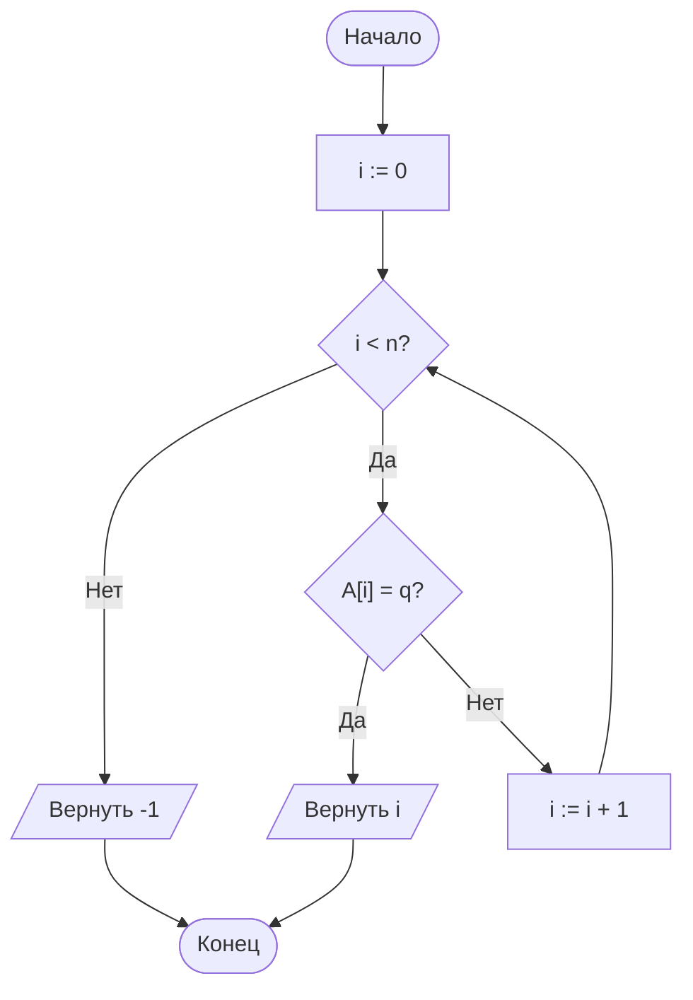
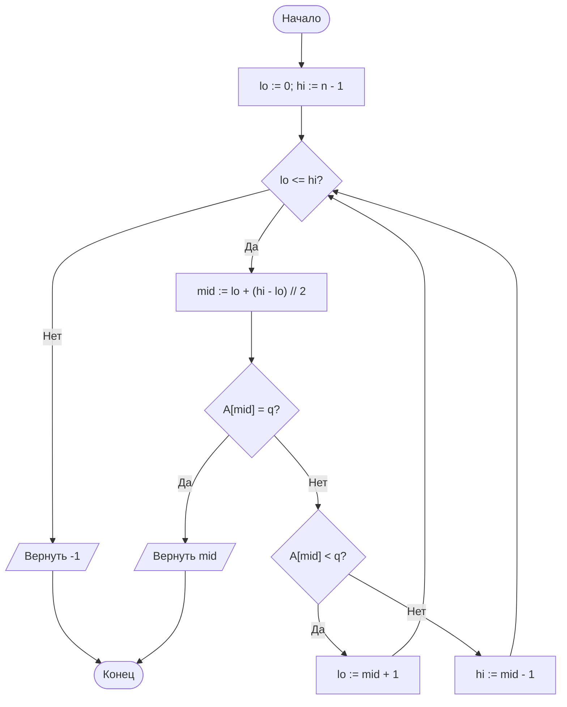
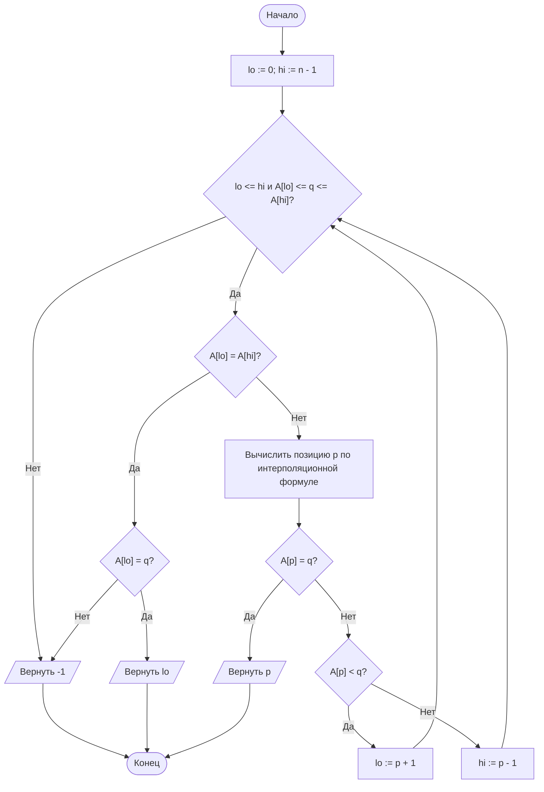
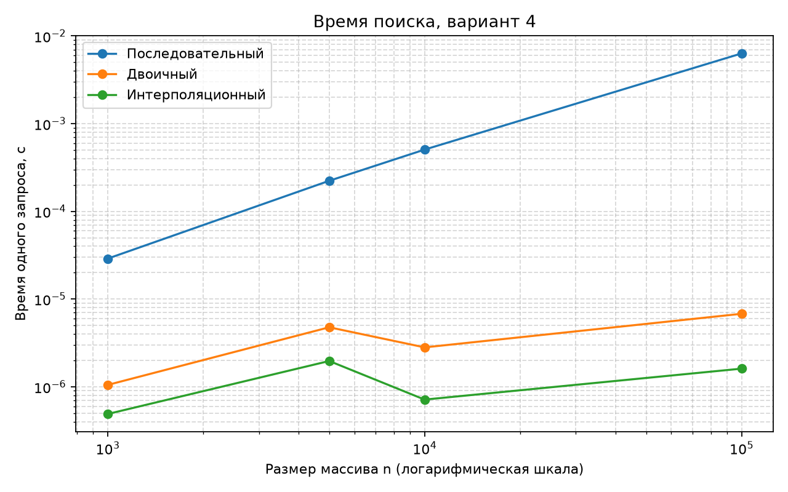
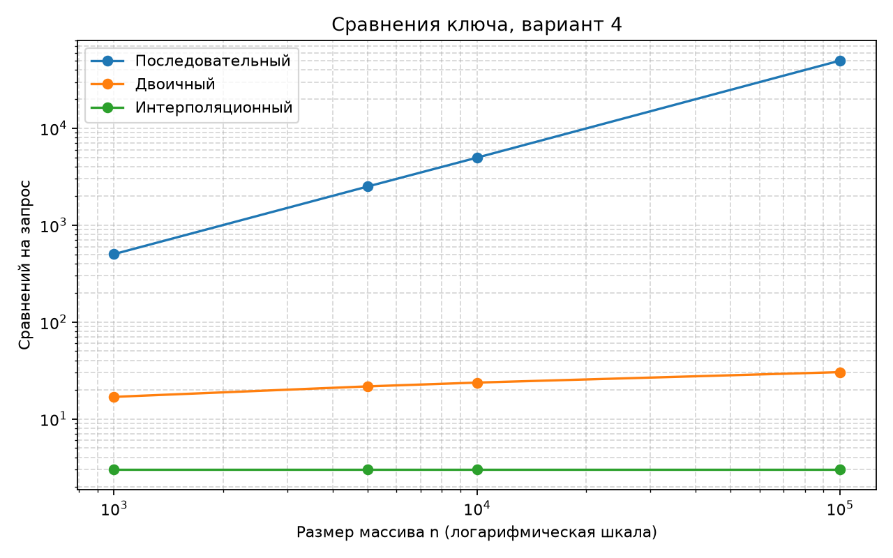
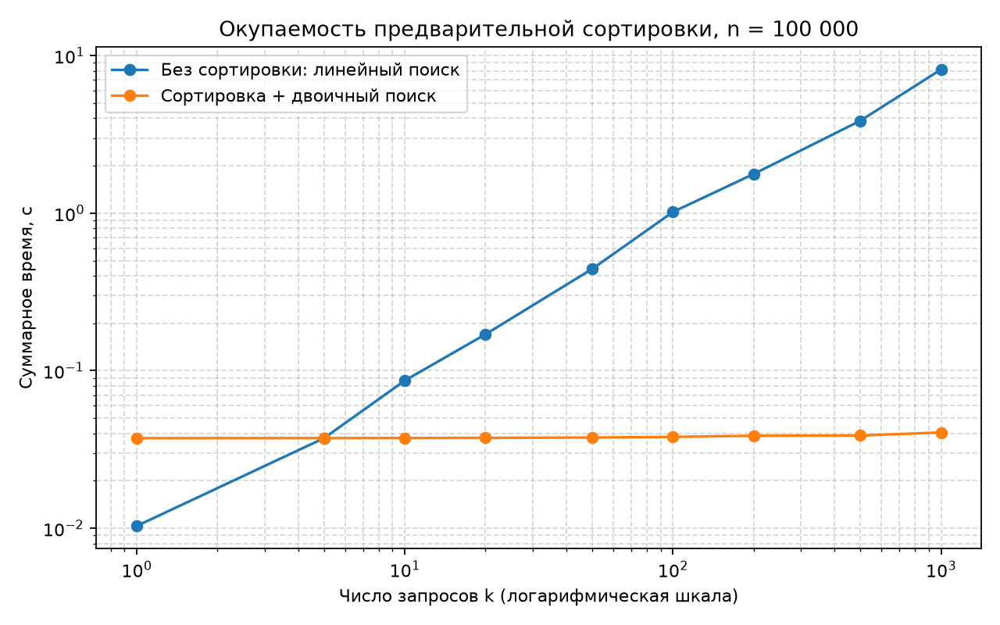

# Отчёт по лабораторной работе № 4

## Титульный лист

**Дисциплина:** Теория алгоритмов  
**Направление подготовки:** 38.03.05 «Бизнес-информатика»  
**Курс:** 2  
**Тема:** Анализ алгоритмов последовательного, двоичного и интерполяционного поиска  
**Вариант:** 4  
**Дополнительное задание:** Б4 — поиск границ диапазона и подсчёт вхождений  
**ФИО студента:** Дымченко Игорь Владиславович

---

## 1. Цель и задание

**Цель:** сравнить алгоритмы поиска по времени и числу сравнений, оценить влияние распределения ключей и определить, когда окупается сортировка перед серией запросов.

Для варианта 4 используется арифметическая прогрессия

$$A[i] = c + d i, \qquad c = 7,\ d = 3,$$

размеры массивов $n = 10^3, 5\cdot10^3, 10^4, 10^5$ и 1000 успешных запросов для каждого размера. Выполнено дополнительное задание Б4: поиск первого и последнего вхождения ключа и подсчёт количества повторений за $O(\log n)$.

## 2. Краткие теоретические сведения

**Последовательный поиск** просматривает элементы по порядку и не требует сортировки. При равновероятном успешном запросе среднее число сравнений равно $(n+1)/2$, а в худшем случае выполняется $n$ сравнений: $\Theta(n)$.

**Двоичный поиск** делит отсортированный участок пополам на каждом шаге. Его сложность — $\Theta(\log n)$.

**Интерполяционный поиск** оценивает позицию ключа по его значению:

$$p = lo + \left\lfloor\frac{(q-A[lo])(hi-lo)}{A[hi]-A[lo]}\right\rfloor.$$

На равномерных данных его ожидаемая сложность $O(\log\log n)$, но на неравномерных может вырасти до $O(n)$. В арифметической прогрессии оценка позиции точна.

**Б4.** Двоичный поиск нижней и верхней границы возвращает полуинтервал индексов $[L,R)$, содержащий все вхождения ключа. Количество повторений равно $R-L$; оба поиска занимают $O(\log n)$.

## 3. Алгоритмы

### 3.1. Последовательный поиск



### 3.2. Двоичный поиск



### 3.3. Интерполяционный поиск



### 3.4. Поиск границ (Б4)

```mermaid
flowchart TD
    A([Начало]) --> B["L := lower_bound(A, q)"]
    B --> C{"L = n или A[L] != q?"}
    C -- Да --> D[/Вернуть (-1, -1, 0)/] --> Z([Конец])
    C -- Нет --> E["R := upper_bound(A, q)"]
    E --> F["Вернуть (L, R - 1, R - L)"] --> Z
```

## 4. Листинг программы

Файл программы: [main.py](main.py). Каждый поисковый алгоритм возвращает индекс (или `-1`) и число сравнений. Времена измеряются для серии запросов; в таблицу занесена медиана трёх запусков, делённая на число запросов.

```python
"""Лабораторная работа № 4. Вариант 4, дополнительное задание Б4."""

import os
import platform
import random
import statistics
import sys
import time

import matplotlib.pyplot as plt


SIZES = [1_000, 5_000, 10_000, 100_000]
QUERY_COUNT = 1_000
REPEATS = 3
START_VALUE = 7
STEP = 3


def linear_search(values: list[int], query: int) -> tuple[int, int]:
    """Ищет ключ без требования к порядку; возвращает индекс и сравнения."""
    comparisons = 0
    for index, value in enumerate(values):
        comparisons += 1
        if value == query:
            return index, comparisons
    return -1, comparisons


def binary_search(values: list[int], query: int) -> tuple[int, int]:
    """Ищет ключ в отсортированном массиве."""
    left, right = 0, len(values) - 1
    comparisons = 0
    while left <= right:
        middle = left + (right - left) // 2
        comparisons += 1
        if values[middle] == query:
            return middle, comparisons
        comparisons += 1
        if values[middle] < query:
            left = middle + 1
        else:
            right = middle - 1
    return -1, comparisons


def interpolation_search(values: list[int], query: int) -> tuple[int, int]:
    """Ищет ключ в отсортированном массиве по оценке его позиции."""
    left, right = 0, len(values) - 1
    comparisons = 0
    while left <= right:
        comparisons += 1
        if query < values[left]:
            return -1, comparisons
        comparisons += 1
        if query > values[right]:
            return -1, comparisons
        if values[left] == values[right]:
            comparisons += 1
            return (left, comparisons) if values[left] == query else (-1, comparisons)
        position = left + (query - values[left]) * (right - left) // (
            values[right] - values[left]
        )
        comparisons += 1
        if values[position] == query:
            return position, comparisons
        comparisons += 1
        if values[position] < query:
            left = position + 1
        else:
            right = position - 1
    return -1, comparisons


def lower_bound(values: list[int], query: int) -> tuple[int, int]:
    """Возвращает позицию первого элемента, не меньшего query, и сравнения."""
    left, right = 0, len(values)
    comparisons = 0
    while left < right:
        middle = left + (right - left) // 2
        comparisons += 1
        if values[middle] < query:
            left = middle + 1
        else:
            right = middle
    return left, comparisons


def upper_bound(values: list[int], query: int) -> tuple[int, int]:
    """Возвращает позицию первого элемента, большего query, и сравнения."""
    left, right = 0, len(values)
    comparisons = 0
    while left < right:
        middle = left + (right - left) // 2
        comparisons += 1
        if values[middle] <= query:
            left = middle + 1
        else:
            right = middle
    return left, comparisons


def search_range(values: list[int], query: int) -> tuple[int, int, int, int]:
    """Возвращает первое/последнее вхождение, количество и сравнения."""
    first, first_comparisons = lower_bound(values, query)
    if first == len(values):
        return -1, -1, 0, first_comparisons
    first_comparisons += 1
    if values[first] != query:
        return -1, -1, 0, first_comparisons
    after_last, last_comparisons = upper_bound(values, query)
    last = after_last - 1
    return first, last, after_last - first, first_comparisons + last_comparisons


def make_progression(size: int) -> list[int]:
    """Создаёт вариант А: A[i] = c + d*i."""
    return [START_VALUE + STEP * index for index in range(size)]


def make_queries(values: list[int], count: int, seed: int) -> list[int]:
    """Выбирает успешные запросы с равномерным выбором индекса."""
    generator = random.Random(seed)
    return [values[generator.randrange(len(values))] for _ in range(count)]


def benchmark(search, values: list[int], queries: list[int]) -> tuple[float, float]:
    """Возвращает медиану времени на запрос и среднее число сравнений."""
    durations = []
    comparison_totals = []
    for _ in range(REPEATS):
        total_comparisons = 0
        started = time.perf_counter()
        for query in queries:
            _, comparisons = search(values, query)
            total_comparisons += comparisons
        durations.append((time.perf_counter() - started) / len(queries))
        comparison_totals.append(total_comparisons / len(queries))
    for query in queries:
        index, _ = search(values, query)
        assert index >= 0 and values[index] == query
    return statistics.median(durations), statistics.mean(comparison_totals)


def benchmark_break_even(values: list[int], queries: list[int]) -> list[tuple[int, float, float]]:
    """Сравнивает линейный поиск и сортировку с последующими двоичными запросами."""
    unsorted_values = values.copy()
    random.Random(len(values)).shuffle(unsorted_values)
    query_counts = [1, 5, 10, 20, 50, 100, 200, 500, QUERY_COUNT]
    results = []
    sort_durations = []
    sorted_values = sorted(unsorted_values)
    for _ in range(REPEATS):
        started = time.perf_counter()
        sorted(unsorted_values)
        sort_durations.append(time.perf_counter() - started)
    sort_time = statistics.median(sort_durations)

    for count in query_counts:
        selected_queries = queries[:count]
        linear_durations = []
        binary_durations = []
        for _ in range(REPEATS):
            started = time.perf_counter()
            for query in selected_queries:
                linear_search(unsorted_values, query)
            linear_durations.append(time.perf_counter() - started)

            started = time.perf_counter()
            for query in selected_queries:
                binary_search(sorted_values, query)
            binary_durations.append(time.perf_counter() - started)
        for query in selected_queries:
            linear_index, _ = linear_search(unsorted_values, query)
            binary_index, _ = binary_search(sorted_values, query)
            assert linear_index >= 0 and unsorted_values[linear_index] == query
            assert binary_index >= 0 and sorted_values[binary_index] == query
        sorted_strategy_time = sort_time + statistics.median(binary_durations)
        results.append((count, statistics.median(linear_durations), sorted_strategy_time))
    return results


def compare_distributions(size: int = 10_000) -> list[tuple[str, float, float]]:
    """Сравнивает интерполяционный поиск на прогрессии и степенных ключах."""
    generator = random.Random(404)
    uniform_values = make_progression(size)
    skewed_sample = [int(1_000_000 * generator.random() ** 3) for _ in range(size)]
    skewed_values = sorted(set(skewed_sample))
    rows = []
    for label, values in (("Арифметическая прогрессия", uniform_values), ("Степенное распределение", skewed_values)):
        queries = (
            make_queries(values, QUERY_COUNT, 405)
            if label == "Арифметическая прогрессия"
            else [generator.choice(skewed_sample) for _ in range(QUERY_COUNT)]
        )
        elapsed, comparisons = benchmark(interpolation_search, values, queries)
        rows.append((label, elapsed, comparisons))
    return rows


def save_charts(sizes: list[int], timings: dict[str, list[float]], comparisons: dict[str, list[float]], break_even: list[tuple[int, float, float]]) -> None:
    """Сохраняет графики времени, сравнений и окупаемости сортировки."""
    output_dir = os.path.dirname(os.path.abspath(__file__))
    for filename, series, ylabel, title in (
        ("lr4_time.png", timings, "Время одного запроса, с", "Время поиска, вариант 4"),
        ("lr4_comparisons.png", comparisons, "Сравнений на запрос", "Сравнения ключа, вариант 4"),
    ):
        plt.figure(figsize=(8, 5))
        for name, values in series.items():
            plt.plot(sizes, values, marker="o", label=name)
        plt.xscale("log")
        plt.yscale("log")
        plt.xlabel("Размер массива n (логарифмическая шкала)")
        plt.ylabel(ylabel)
        plt.title(title)
        plt.grid(True, which="both", linestyle="--", alpha=0.5)
        plt.legend()
        plt.tight_layout()
        plt.savefig(os.path.join(output_dir, filename), dpi=160)
        plt.close()

    query_counts = [row[0] for row in break_even]
    plt.figure(figsize=(8, 5))
    plt.plot(query_counts, [row[1] for row in break_even], marker="o", label="Без сортировки: линейный поиск")
    plt.plot(query_counts, [row[2] for row in break_even], marker="o", label="Сортировка + двоичный поиск")
    plt.xscale("log")
    plt.yscale("log")
    plt.xlabel("Число запросов k (логарифмическая шкала)")
    plt.ylabel("Суммарное время, с")
    plt.title("Окупаемость предварительной сортировки, n = 100 000")
    plt.grid(True, which="both", linestyle="--", alpha=0.5)
    plt.legend()
    plt.tight_layout()
    plt.savefig(os.path.join(output_dir, "lr4_breakeven.png"), dpi=160)
    plt.close()


def main() -> None:
    algorithms = {
        "Последовательный": linear_search,
        "Двоичный": binary_search,
        "Интерполяционный": interpolation_search,
    }
    timings = {name: [] for name in algorithms}
    comparisons = {name: [] for name in algorithms}

    print(f"Python: {sys.version.split()[0]} ({platform.python_implementation()})")
    print(f"ОС: {platform.platform()}; CPU: {platform.processor()}; логических процессоров: {os.cpu_count()}")
    print("Вариант 4: A[i] = c + d*i, c = 7, d = 3; 1000 успешных запросов")
    print("\nСреднее время одного запроса и сравнения")
    print(f"{'n':>9} | {'Алгоритм':<20} | {'мкс/запрос':>12} | {'сравнений':>12}")
    print("-" * 66)

    for size in SIZES:
        values = make_progression(size)
        queries = make_queries(values, QUERY_COUNT, 100 + size)
        for name, search in algorithms.items():
            elapsed, average_comparisons = benchmark(search, values, queries)
            timings[name].append(elapsed)
            comparisons[name].append(average_comparisons)
            print(f"{size:>9} | {name:<20} | {elapsed * 1e6:>12.3f} | {average_comparisons:>12.2f}")

    print("\nБ4: поиск диапазона повторяющегося ключа")
    duplicate_values = [1, 2, 2, 2, 4, 7, 7, 9]
    first, last, count, range_comparisons = search_range(duplicate_values, 2)
    assert (first, last, count) == (1, 3, 3)
    print(f"A = {duplicate_values}, q = 2: первое = {first}, последнее = {last}, количество = {count}, сравнений = {range_comparisons}")
    print(f"Несуществующий ключ q = 3: {search_range(duplicate_values, 3)}")

    largest_values = make_progression(SIZES[-1])
    largest_queries = make_queries(largest_values, QUERY_COUNT, 100 + SIZES[-1])
    break_even = benchmark_break_even(largest_values, largest_queries)
    print("\nОкупаемость сортировки для n = 100 000")
    print(f"{'k':>7} | {'без сортировки, с':>20} | {'сортировка + поиск, с':>24}")
    print("-" * 58)
    for count, linear_time, sorted_time in break_even:
        print(f"{count:>7} | {linear_time:>20.6f} | {sorted_time:>24.6f}")

    print("\nИнтерполяционный поиск для разных распределений, n = 10 000")
    for label, elapsed, average_comparisons in compare_distributions():
        print(f"{label}: {elapsed * 1e6:.3f} мкс/запрос, {average_comparisons:.2f} сравнений")

    save_charts(SIZES, timings, comparisons, break_even)
    print("\nГрафики сохранены: lr4_time.png, lr4_comparisons.png, lr4_breakeven.png")


if __name__ == "__main__":
    main()
```

## 5. Объяснение программы

1. `linear_search` проходит массив слева направо и считает каждое сравнение `value == query`.
2. `binary_search` работает только по отсортированному массиву. После сравнения со средним элементом оставляет нужную половину диапазона. Счётчик включает проверки равенства и порядка.
3. `interpolation_search` ограничивает поиск текущими крайними значениями, оценивает позицию ключа по формуле и сужает границы. Проверки краёв защищают от выхода за интервал, а случай равных крайних значений предотвращает деление на ноль.
4. `lower_bound` находит первый индекс со значением не меньше ключа, `upper_bound` — первый индекс со значением больше ключа. `search_range` проверяет наличие ключа и вычисляет последнюю позицию и число повторений.
5. `make_progression` строит исходные данные варианта. `make_queries` с фиксированным seed формирует воспроизводимую последовательность успешных запросов.
6. `benchmark` измеряет целую серию запросов через `perf_counter`, проверяет каждый найденный индекс и усредняет время и сравнения. Несколько запусков уменьшают влияние случайных колебаний таймера.
7. `benchmark_break_even` перемешивает копию массива и сравнивает затраты на линейные запросы без сортировки с полной стоимостью сортировки и последующих двоичных запросов.
8. `compare_distributions` проводит дополнительный контрольный эксперимент на степенном наборе, чтобы показать зависимость интерполяции от распределения.
9. `save_charts` строит графики времени, сравнений и окупаемости с логарифмической шкалой. `main` запускает эксперименты, печатает таблицы, проверяет Б4 и сохраняет графики.

## 6. Характеристики вычислительной системы

| Параметр | Значение |
|---|---|
| Операционная система | Windows 11, версия 10.0.26200 |
| Процессор | 11th Gen Intel Core i5-1135G7 @ 2.40 GHz |
| Логические процессоры | 8 |
| Оперативная память | 16 GiB |
| Интерпретатор | CPython 3.15.0rc2 |
| Число запросов | 1000 на размер массива |
| Повторы измерений | 3; итоговое время — медиана, делённая на число запросов |

## 7. Результаты измерений

### 7.1. Среднее время одного запроса

Время указано в микросекундах. Используются успешные запросы с равномерным выбором индекса арифметической прогрессии.

| $n$ | Последовательный, мкс | Двоичный, мкс | Интерполяционный, мкс |
|---:|---:|---:|---:|
| 1 000 | 28,939 | 1,050 | 0,490 |
| 5 000 | 223,272 | 4,771 | 1,968 |
| 10 000 | 506,327 | 2,814 | 0,715 |
| 100 000 | 6 320,683 | 6,799 | 1,610 |



### 7.2. Среднее число сравнений

| $n$ | Последовательный | Двоичный | Интерполяционный |
|---:|---:|---:|---:|
| 1 000 | 501,85 | 16,87 | 3,00 |
| 5 000 | 2 503,61 | 21,65 | 3,00 |
| 10 000 | 4 970,40 | 23,69 | 3,00 |
| 100 000 | 49 878,52 | 30,38 | 3,00 |

В реализации двоичного поиска отдельно считаются сравнение на равенство и сравнение порядка. Поэтому число операций сравнения может быть примерно вдвое больше числа шагов, оцениваемых через $\log_2 n$.



### 7.3. Окупаемость сортировки

Время включает весь процесс: для первой стратегии — линейные поиски в перемешанном массиве, для второй — сортировку и затем двоичные поиски.

| $k$ | Без сортировки, с | Сортировка + поиск, с |
|---:|---:|---:|
| 1 | 0,010328 | 0,037290 |
| 5 | 0,037309 | 0,037316 |
| 10 | 0,086494 | 0,037361 |
| 20 | 0,170192 | 0,037440 |
| 50 | 0,442451 | 0,037623 |
| 100 | 1,017056 | 0,037971 |
| 200 | 1,771339 | 0,038609 |
| 500 | 3,860454 | 0,038746 |
| 1 000 | 8,162538 | 0,040524 |



В этом запуске точка окупаемости находится между 5 и 10 запросами. Стоимость сортировки замерялась отдельно, а затем складывалась с временем двоичных запросов. Положение порога зависит от процессора и реализации алгоритмов.

### 7.4. Влияние распределения ключей

При $n = 10\,000$ интерполяционный поиск на прогрессии потребовал в среднем 3,00 сравнения. На степенном распределении $\lfloor 10^6u^3\rfloor$ среднее составило 130,13 сравнения и 20,748 мкс на запрос. Это показывает, что малая оценка $O(\log\log n)$ применима не ко всяким данным.

### 7.5. Результат Б4

Для массива `[1, 2, 2, 2, 4, 7, 7, 9]` и ключа `2` алгоритм вернул первое вхождение с индексом 1, последнее с индексом 3 и количество 3. Для отсутствующего ключа `3` результат: `(-1, -1, 0)`. Границы находятся двоичным поиском, поэтому асимптотическая сложность — $O(\log n)$.

## 8. Выводы

1. Результаты подтверждают оценки алгоритмов: линейный поиск растёт пропорционально размеру массива, а двоичный — логарифмически.
2. На арифметической прогрессии интерполяция находит позицию почти напрямую и в эксперименте использовала три сравнения для всех размеров.
3. На степенном распределении число сравнений интерполяционного поиска стало существенно выше, поэтому его преимущество зависит от равномерности ключей.
4. Для массива из 100 000 элементов сортировка и двоичный поиск в данном измерении стали быстрее линейного поиска примерно между 5 и 10 запросами.
5. Поиск первого и последнего вхождений через нижнюю и верхнюю границы корректно обрабатывает повторы и отсутствующий ключ за $O(\log n)$.

**Общий вывод:** выбор поиска зависит от структуры данных и числа запросов. Если данные уже упорядочены и равномерны, интерполяционный поиск особенно эффективен; при большом числе запросов предварительная сортировка также быстро окупается.

## 9. Рекомендуемая литература

1. Вирт Н. Алгоритмы и структуры данных. Новая версия для Оберона. — М.: ДМК Пресс, 2016.
2. Кнут Д. Э. Искусство программирования. Т. 3. Сортировка и поиск. — 2-е изд. — М.: Вильямс, 2017.
3. Кормен Т., Лейзерсон Ч., Ривест Р., Штейн К. Алгоритмы: построение и анализ. — 3-е изд. — М.: Вильямс, 2013.
4. Документация Python: модуль `bisect` [Электронный ресурс].