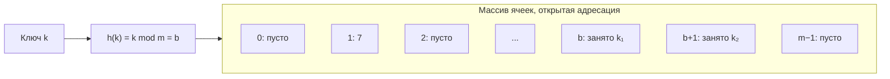
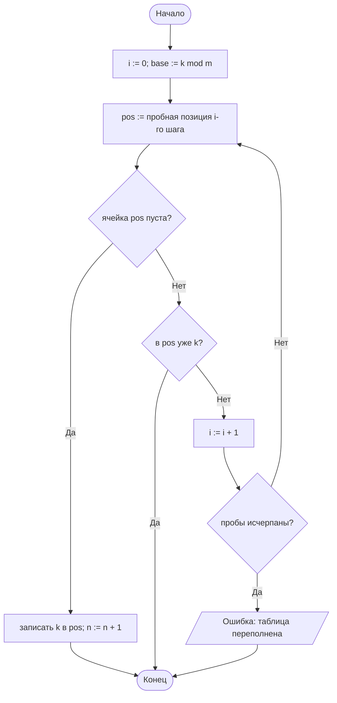
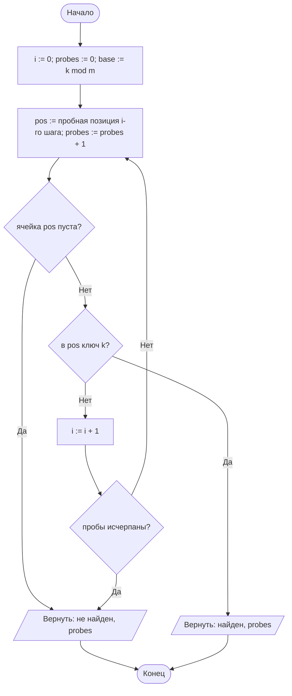
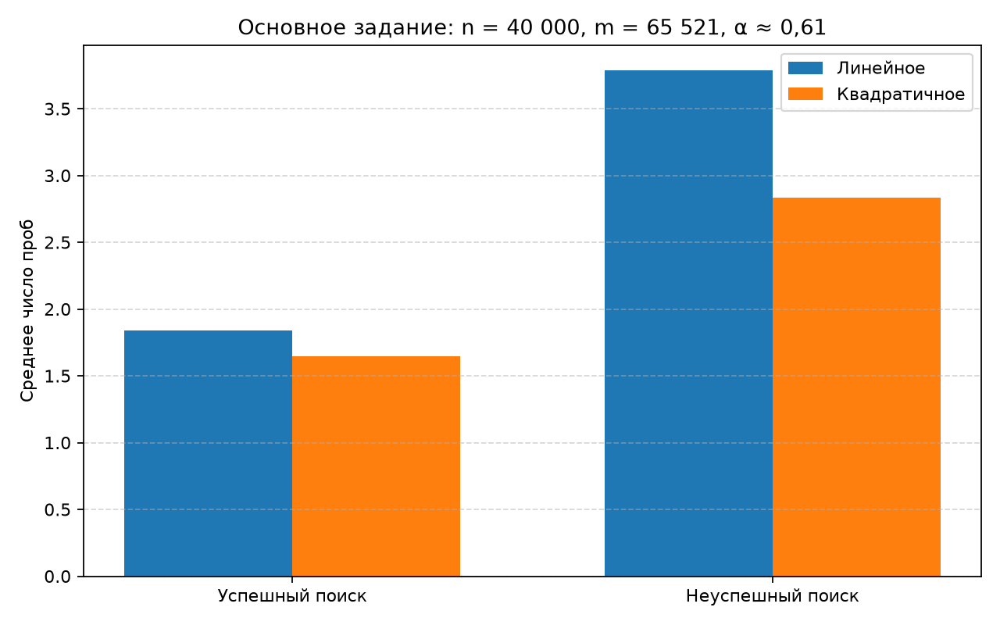
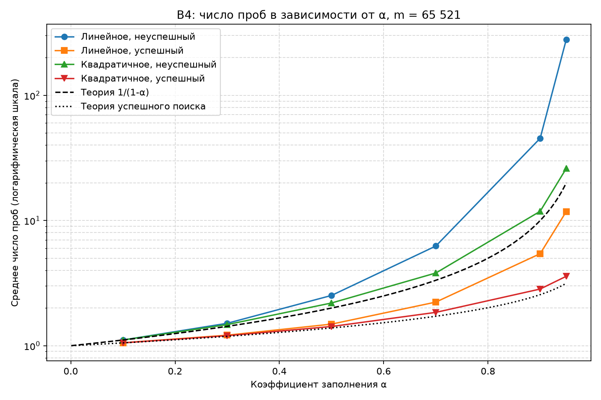

# Отчёт по лабораторной работе № 5

## Титульный лист

**Дисциплина:** Теория алгоритмов
**Направление подготовки:** 38.03.05 «Бизнес-информатика»
**Курс:** 2
**Тема:** Хеширование и экспериментальное исследование методов разрешения коллизий
**Вариант:** 4
**Дополнительное задание:** В4 — зависимость числа проб от коэффициента заполнения α
**ФИО студента:** Дымченко Игорь Владиславович

---

## 0. Краткий обзор теории

- **Хеш-функция** $h(k)$ отображает ключи в индексы таблицы размера $m$. Если ключей больше, чем ячеек, возможны **коллизии** — $h(k_1) = h(k_2)$ при $k_1 \ne k_2$.
- **Метод деления:** $h(k) = k \bmod m$. Размер $m$ берётся простым, иначе теряются старшие разряды ключа.
- **Открытая адресация:** все элементы лежат в самом массиве. При занятой ячейке проверяется следующая по правилу пробирования:
  - линейное: $h_i(k) = (h(k) + i) \bmod m$ — ведёт к первичной кластеризации;
  - квадратичное: $h_i(k) = (h(k) + c_1 i + c_2 i^2) \bmod m$ — кластеризация слабее.
- **Коэффициент заполнения** $\alpha = n/m$. Для открытой адресации обязательно $\alpha < 1$.
- **Теоретическая оценка** (равномерное хеширование) для неуспешного поиска: $\frac{1}{1-\alpha}$; для успешного: $\frac{1}{\alpha}\ln\frac{1}{1-\alpha}$.

---

## 1. Цель и задание варианта

**Цель:** реализовать хеш-таблицу с открытой адресацией и экспериментально сравнить линейное и квадратичное пробирование.

**Задание варианта 4 (табл. 1):**

- тип ключей — целые случайные;
- хеш-функция — метод деления, $m = 65\,521$ (простое);
- разрешение коллизий — линейное и квадратичное пробирование;
- $n = 40\,000$ элементов, $\alpha \approx 0{,}610$.

**Дополнительное задание В4:** построить зависимость числа проб от $\alpha \in \{0{,}1;\ 0{,}3;\ 0{,}5;\ 0{,}7;\ 0{,}9;\ 0{,}95\}$ и наложить теоретическую кривую $\frac{1}{1-\alpha}$.

---

## 2. Описание хеш-функции и способов разрешения коллизий

**Хеш-функция:** $h(k) = k \bmod 65\,521$. Число $65\,521$ — наибольшее простое число, меньшее $2^{16}$.

**Линейное пробирование:** проверяются ячейки $h(k), h(k)+1, \dots$ по модулю $m$. Все $m$ ячеек достижимы.

**Квадратичное пробирование:** используется последовательность $h_i(k) = \left(h(k) + \frac{i(i+1)}{2}\right) \bmod m$, то есть $c_1 = c_2 = \tfrac{1}{2}$.

Для простого $m$ квадратичная фаза при $i < \frac{m+1}{2}$ даёт $\frac{m+1}{2}$ различных позиций. Остальные позиции она не покрывает. При $\alpha = 0{,}61$ таблица без резерва не смогла бы вставить все ключи, поэтому после квадратичной фазы выполняется **линейный резерв**: проверяются все ячейки подряд от $h(k)$. Это отмечено в листинге комментарием.

**Поиск:** пробы идут по той же последовательности. Поиск прекращается при нахождении ключа или при пустой ячейке, так как пустая ячейка означает, что ключа дальше нет.

**Удаление** в работе не реализовано: в варианте 4 дополнительное задание В3 не назначено.

---

## 3. Схема структуры данных и алгоритм

Таблица — массив из $m$ ячеек. Ячейка содержит ключ либо пусто (`None`).



### 3.1. Вставка



### 3.2. Поиск



---

## 4. Листинг программы

Файл: [main.py](main.py)

```python
"""
Лабораторная работа № 5. Вариант 4.
Хеш-таблица с открытой адресацией: линейное и квадратичное пробирование,
метод деления h(k) = k mod m (m — простое число).
Дополнительное задание В4: зависимость числа проб от коэффициента заполнения α.
"""

import math
import os
import platform
import random
import statistics
import sys
import time

import matplotlib.pyplot as plt


M = 65_521            # размер таблицы (простое число)
N = 40_000            # число ключей варианта 4
QUERY_COUNT = 10_000  # число запросов каждого типа
REPEATS = 3           # повторы замеров, берётся медиана
ALPHAS = [0.1, 0.3, 0.5, 0.7, 0.9, 0.95]
KEY_RANGE = 10_000_000
METHOD_NAMES = {"linear": "Линейное", "quadratic": "Квадратичное"}


class OpenAddressingTable:
    """Хеш-таблица с открытой адресацией. method: 'linear' или 'quadratic'."""

    def __init__(self, m: int = M, method: str = "linear"):
        if method not in METHOD_NAMES:
            raise ValueError("Неизвестный способ пробирования")
        self.m = m
        self.method = method
        self.slots = [None] * m
        self.n = 0

    def _h(self, key: int) -> int:
        """Метод деления: h(k) = k mod m."""
        return key % self.m

    def probe_sequence(self, key: int):
        """Генерирует позиции проб для ключа."""
        base = self._h(key)
        if self.method == "linear":
            for i in range(self.m):
                yield (base + i) % self.m
            return
        # Квадратичная фаза: слагаемые T_i = i(i+1)/2 при i < (m+1)/2
        # различны по модулю простого m, то есть дают (m+1)/2 разных позиций.
        for i in range((self.m + 1) // 2):
            yield (base + i * (i + 1) // 2) % self.m
        # Линейный резерв: квадратичная фаза не покрывает все ячейки простого m,
        # поэтому после неё проверяются все ячейки подряд, чтобы вставка не терялась.
        for i in range(self.m):
            yield (base + i) % self.m

    def insert(self, key: int) -> int:
        """Вставляет ключ и возвращает число проб."""
        probes = 0
        for pos in self.probe_sequence(key):
            probes += 1
            stored = self.slots[pos]
            if stored is None:
                self.slots[pos] = key
                self.n += 1
                return probes
            if stored == key:
                return probes
        raise RuntimeError("Таблица переполнена")

    def search(self, key: int) -> tuple[bool, int]:
        """Ищет ключ; возвращает (найден ли он, число проб)."""
        probes = 0
        for pos in self.probe_sequence(key):
            probes += 1
            stored = self.slots[pos]
            if stored is None:
                return False, probes
            if stored == key:
                return True, probes
        return False, probes


def make_keys(count: int, seed: int) -> list[int]:
    """Уникальные случайные целые ключи из диапазона [0; KEY_RANGE)."""
    return random.Random(seed).sample(range(KEY_RANGE), count)


def missing_keys(count: int, seed: int) -> list[int]:
    """Ключи из диапазона, который не пересекается с хранимыми ключами."""
    rng = random.Random(seed)
    return [rng.randrange(KEY_RANGE, 2 * KEY_RANGE) for _ in range(count)]


def build_table(method: str, keys: list[int]):
    """Вставляет ключи; возвращает таблицу, время вставки и среднее число проб."""
    table = OpenAddressingTable(M, method)
    insert_probes = 0
    started = time.perf_counter()
    for key in keys:
        insert_probes += table.insert(key)
    elapsed = time.perf_counter() - started
    return table, elapsed, insert_probes / len(keys)


def search_stats(table: OpenAddressingTable, queries: list[int]) -> tuple[float, float]:
    """Возвращает медиану времени на запрос (с) и среднее число проб."""
    durations = []
    probes = 0.0
    for _ in range(REPEATS):
        total = 0
        started = time.perf_counter()
        for query in queries:
            _, query_probes = table.search(query)
            total += query_probes
        durations.append((time.perf_counter() - started) / len(queries))
        probes = total / len(queries)
    return statistics.median(durations), probes


def probes_only(table: OpenAddressingTable, queries: list[int]) -> float:
    """Среднее число проб без замера времени."""
    return sum(table.search(query)[1] for query in queries) / len(queries)


def verify(table: OpenAddressingTable, present: list[int], absent: list[int]) -> None:
    """Проверяет корректность: хранимые ключи находятся, отсутствующие — нет."""
    assert all(table.search(key)[0] for key in present)
    assert not any(table.search(key)[0] for key in absent)


def main_experiment() -> list[dict]:
    """Основное задание варианта 4: линейное и квадратичное пробирование."""
    keys = make_keys(N, seed=42)
    successful = random.Random(43).choices(keys, k=QUERY_COUNT)
    unsuccessful = missing_keys(QUERY_COUNT, seed=44)
    rows = []
    for method in ("linear", "quadratic"):
        insert_times = []
        for _ in range(REPEATS):
            table, elapsed, insert_probes = build_table(method, keys)
            insert_times.append(elapsed)
        verify(table, successful, unsuccessful)
        succ_time, succ_probes = search_stats(table, successful)
        unsucc_time, unsucc_probes = search_stats(table, unsuccessful)
        rows.append({
            "method": method,
            "insert_time": statistics.median(insert_times),
            "insert_probes": insert_probes,
            "succ_time": succ_time,
            "succ_probes": succ_probes,
            "unsucc_time": unsucc_time,
            "unsucc_probes": unsucc_probes,
        })
    return rows


def alpha_experiment() -> list[dict]:
    """Дополнительное задание В4: число проб в зависимости от α."""
    rng = random.Random(77)
    rows = []
    for alpha in ALPHAS:
        n = round(alpha * M)
        keys = rng.sample(range(KEY_RANGE), n)
        successful = rng.choices(keys, k=QUERY_COUNT)
        unsuccessful = [rng.randrange(KEY_RANGE, 2 * KEY_RANGE) for _ in range(QUERY_COUNT)]
        row = {"alpha": alpha, "n": n}
        for method in ("linear", "quadratic"):
            table, _, _ = build_table(method, keys)
            verify(table, successful, unsuccessful)
            row[f"{method}_succ"] = probes_only(table, successful)
            row[f"{method}_unsucc"] = probes_only(table, unsuccessful)
        rows.append(row)
    return rows


def save_charts(main_rows: list[dict], alpha_rows: list[dict]) -> None:
    """Сохраняет график В4 и столбчатую диаграмму основного задания."""
    out_dir = os.path.dirname(os.path.abspath(__file__))
    alphas = [row["alpha"] for row in alpha_rows]

    plt.figure(figsize=(9, 6))
    plt.plot(alphas, [r["linear_unsucc"] for r in alpha_rows], "o-", label="Линейное, неуспешный")
    plt.plot(alphas, [r["linear_succ"] for r in alpha_rows], "s-", label="Линейное, успешный")
    plt.plot(alphas, [r["quadratic_unsucc"] for r in alpha_rows], "^-", label="Квадратичное, неуспешный")
    plt.plot(alphas, [r["quadratic_succ"] for r in alpha_rows], "v-", label="Квадратичное, успешный")
    grid = [i / 1000 for i in range(1, 951)]
    plt.plot(grid, [1 / (1 - a) for a in grid], "k--", label="Теория 1/(1-α)")
    plt.plot(grid, [math.log(1 / (1 - a)) / a for a in grid], "k:", label="Теория успешного поиска")
    plt.yscale("log")
    plt.xlabel("Коэффициент заполнения α")
    plt.ylabel("Среднее число проб (логарифмическая шкала)")
    plt.title("В4: число проб в зависимости от α, m = 65 521")
    plt.grid(True, which="both", linestyle="--", alpha=0.5)
    plt.legend()
    plt.tight_layout()
    plt.savefig(os.path.join(out_dir, "lr5_alpha.png"), dpi=160)
    plt.close()

    linear, quadratic = main_rows
    x = [0, 1]
    width = 0.35
    plt.figure(figsize=(8, 5))
    plt.bar([i - width / 2 for i in x], [linear["succ_probes"], linear["unsucc_probes"]], width, label="Линейное")
    plt.bar([i + width / 2 for i in x], [quadratic["succ_probes"], quadratic["unsucc_probes"]], width, label="Квадратичное")
    plt.xticks(x, ["Успешный поиск", "Неуспешный поиск"])
    plt.ylabel("Среднее число проб")
    plt.title("Основное задание: n = 40 000, m = 65 521, α ≈ 0,61")
    plt.grid(axis="y", linestyle="--", alpha=0.5)
    plt.legend()
    plt.tight_layout()
    plt.savefig(os.path.join(out_dir, "lr5_main_probes.png"), dpi=160)
    plt.close()


def main() -> None:
    print(f"Python: {sys.version.split()[0]} ({platform.python_implementation()})")
    print(f"ОС: {platform.platform()}; логических процессоров: {os.cpu_count()}")
    print(f"Вариант 4: целые случайные ключи, метод деления, m = {M}, n = {N}, α = {N / M:.3f}\n")

    main_rows = main_experiment()
    print(f"{'Пробирование':<14} | {'вставка, с':>11} | {'проб/вставку':>12} | {'успеш., мкс':>11} | "
          f"{'проб':>7} | {'неуспеш., мкс':>13} | {'проб':>7}")
    print("-" * 94)
    for row in main_rows:
        print(f"{METHOD_NAMES[row['method']]:<14} | {row['insert_time']:>11.4f} | {row['insert_probes']:>12.2f} | "
              f"{row['succ_time'] * 1e6:>11.3f} | {row['succ_probes']:>7.2f} | "
              f"{row['unsucc_time'] * 1e6:>13.3f} | {row['unsucc_probes']:>7.2f}")

    print("\nВ4: зависимость числа проб от α")
    alpha_rows = alpha_experiment()
    print(f"{'α':>5} | {'n':>6} | {'лин. успеш.':>11} | {'лин. неуспеш.':>13} | "
          f"{'квадр. успеш.':>13} | {'квадр. неуспеш.':>15} | {'1/(1-α)':>8}")
    print("-" * 96)
    for row in alpha_rows:
        print(f"{row['alpha']:>5.2f} | {row['n']:>6} | {row['linear_succ']:>11.2f} | "
              f"{row['linear_unsucc']:>13.2f} | {row['quadratic_succ']:>13.2f} | "
              f"{row['quadratic_unsucc']:>15.2f} | {1 / (1 - row['alpha']):>8.2f}")

    save_charts(main_rows, alpha_rows)
    print("\nГрафики сохранены: lr5_alpha.png, lr5_main_probes.png")


if __name__ == "__main__":
    main()
```

---

## 5. Объяснение программы

1. **`OpenAddressingTable`** — таблица на списке из $m$ ячеек. Метод `_h` реализует метод деления $k \bmod m$.
2. **`probe_sequence`** — генератор пробных позиций. Для линейного способа перебираются все $m$ ячеек от $h(k)$. Для квадратичного сначала используются позиции $h(k) + i(i+1)/2$ при $i < (m+1)/2$, затем линейный резерв, гарантирующий полный перебор.
3. **`insert`** — идёт по пробам до первой пустой ячейки или до совпадения ключа (повтор не записывается). Возвращает число проб.
4. **`search`** — идёт по тем же пробам. Пустая ячейка означает, что ключа нет; возвращает пару (найден, число проб).
5. **`make_keys`, `missing_keys`** — генерируют хранимые ключи из $[0; 10^7)$ и заведомо отсутствующие ключи из $[10^7; 2\cdot10^7)$, поэтому неуспешные запросы не пересекаются с данными.
6. **`build_table`** — вставляет ключи и измеряет время вставки. **`search_stats`** — возвращает медиану времени на запрос (по трём повторам) и среднее число проб.
7. **`verify`** — проверяет корректность: все хранимые ключи находятся, отсутствующие не находятся.
8. **`main_experiment`** — основное задание варианта 4 при $n = 40\,000$, $m = 65\,521$.
9. **`alpha_experiment`** — В4: для каждого $\alpha$ создаётся таблица с $n = \alpha m$ ключами, измеряются пробы для успешных и неуспешных запросов.
10. **`save_charts`** — строит график В4 (логарифмическая шкала) с теоретическими кривыми и столбчатую диаграмму основного задания.

---

## 6. Характеристики вычислительной системы

| Параметр | Значение |
|---|---|
| Операционная система | Windows 11, версия 10.0.26200 |
| Процессор | 11th Gen Intel Core i5-1135G7 @ 2.40 GHz |
| Логические процессоры | 8 |
| Оперативная память | 16 GiB |
| Интерпретатор | CPython 3.15.0rc2 |
| Повторы замеров | 3; итоговое значение — медиана |

---

## 7. Результаты измерений

### 7.1. Основное задание: $n = 40\,000$, $m = 65\,521$, $\alpha \approx 0{,}610$

| Пробирование | Вставка, с | Проб на вставку | Успешный поиск, мкс | Проб (успешный) | Неуспешный поиск, мкс | Проб (неуспешный) |
|---|---:|---:|---:|---:|---:|---:|
| Линейное | 0,0506 | 1,80 | 1,419 | 1,84 | 1,515 | 3,79 |
| Квадратичное | 0,0498 | 1,62 | 1,332 | 1,64 | 1,411 | 2,83 |

Теоретические оценки при $\alpha = 0{,}61$ (равномерное хеширование):

- линейное, неуспешный: $\frac{1}{2}\left(1 + \frac{1}{(1-\alpha)^2}\right) \approx 3{,}79$ — совпадает с измеренным значением;
- линейное, успешный: $\frac{1}{2}\left(1 + \frac{1}{1-\alpha}\right) \approx 1{,}78$ — измерено $1{,}84$;
- квадратичное, неуспешный: $\frac{1}{1-\alpha} \approx 2{,}57$ — измерено $2{,}83$;
- квадратичное, успешный: $\frac{1}{\alpha}\ln\frac{1}{1-\alpha} \approx 1{,}54$ — измерено $1{,}64$;



### 7.2. Дополнительное задание В4: зависимость числа проб от α

| α | n | Линейное, успешный | Линейное, неуспешный | Квадратичное, успешный | Квадратичное, неуспешный | $1/(1-\alpha)$ |
|---:|---:|---:|---:|---:|---:|---:|
| 0,10 | 6 552 | 1,05 | 1,11 | 1,05 | 1,11 | 1,11 |
| 0,30 | 19 656 | 1,21 | 1,51 | 1,20 | 1,48 | 1,43 |
| 0,50 | 32 760 | 1,49 | 2,52 | 1,42 | 2,19 | 2,00 |
| 0,70 | 45 865 | 2,23 | 6,26 | 1,85 | 3,81 | 3,33 |
| 0,90 | 58 969 | 5,43 | 45,38 | 2,84 | 11,85 | 10,00 |
| 0,95 | 62 245 | 11,78 | 278,67 | 3,59 | 26,03 | 20,00 |



---

## 8. Результат дополнительного задания В4

При малых $\alpha$ все варианты дают близкие значения около 1–1,5 пробы, что согласуется с теорией. С ростом $\alpha$ линейное пробирование резко ухудшается: при $\alpha = 0{,}95$ неуспешный поиск требует около 279 проб, тогда как $1/(1-\alpha) = 20$. Это ожидаемо: линейное пробирование не соответствует модели равномерного хеширования, а первичная кластеризация растягивает длинные занятые участки. Формула $\frac{1}{2}\left(1+\frac{1}{(1-\alpha)^2}\right)$ при $\alpha = 0{,}95$ даёт около 201 — порядок совпадает с измерением.

Квадратичное пробирование ближе к теоретической кривой $\frac{1}{1-\alpha}$: при $\alpha = 0{,}95$ оно требует около 26 проб против 20 по теории. Расхождение объясняется тем, что квадратичная фаза для простого $m$ охватывает только половину таблицы, и часть проб уходит в линейный резерв.

---

## 9. Выводы

1. Метод деления с простым $m = 65\,521$ даёт при $\alpha = 0{,}61$ хорошее распределение: среднее число проб на вставку — около 1,6–1,8.
2. Квадратичное пробирование в эксперименте выполняет меньше проб, чем линейное, особенно при неуспешном поиске: 2,83 против 3,79 при $\alpha = 0{,}61$.
3. Измеренные значения при $\alpha \le 0{,}5$ совпадают с теорией. Для линейного пробирования при больших $\alpha$ реальная трудоёмкость значительно выше простой кривой $\frac{1}{1-\alpha}$, поэтому её нельзя использовать для оценки линейного способа.
4. Для квадратичного пробирования при простом $m$ необходим линейный резерв: без него часть ячеек недостижима и вставка при $\alpha > 0{,}5$ не гарантирована.
5. Практический вывод: таблицу следует расширять до достижения $\alpha \approx 0{,}75$, как и требуется в рехешировании, иначе время поиска быстро растёт.

Дополнительные задания В1–В3, В5–В7 в варианте 4 не назначены и не выполнялись.

---

## 10. Рекомендуемая литература

1. Кормен Т., Лейзерсон Ч., Ривест Р., Штайн К. Алгоритмы: построение и анализ. — 3-е изд. — М.: Вильямс, 2013. — Гл. 11.
2. Кнут Д. Э. Искусство программирования. Т. 3. Сортировка и поиск. — 2-е изд. — М.: Вильямс, 2017.
3. Седжвик Р., Уэйн К. Алгоритмы на Java. — 4-е изд. — М.: Вильямс, 2013. — Гл. 3.4.
4. Документация Python: встроенные типы, `dict` [Электронный ресурс]. — URL: https://docs.python.org/3/library/stdtypes.html#dict

---

Выполнил: Дымченко Игорь Владиславович

Дата: ________
