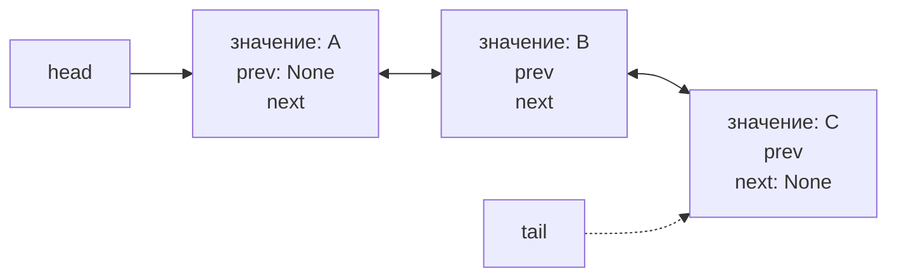
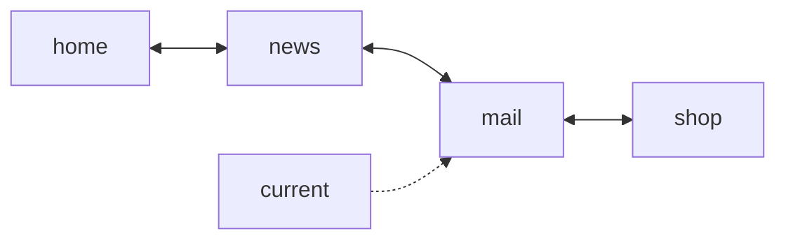
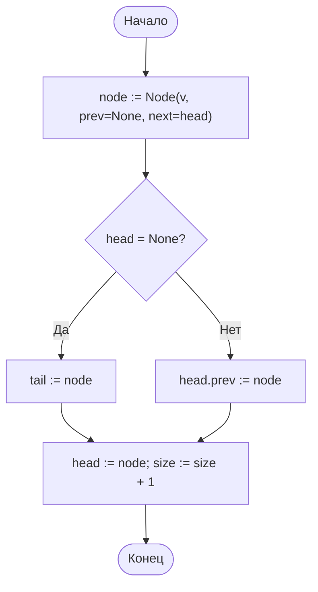
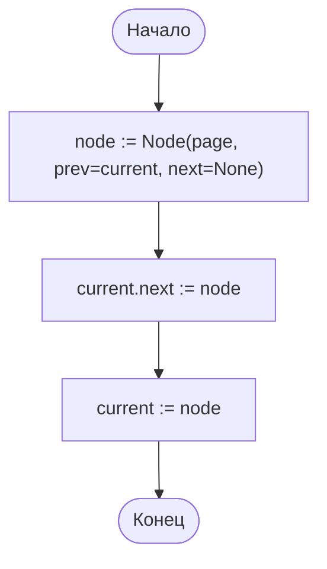
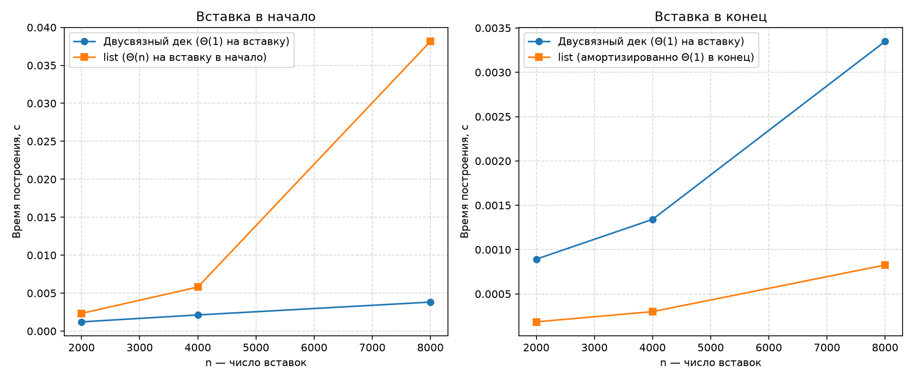

# Отчёт по лабораторной работе № 6

## Титульный лист

**Дисциплина:** Теория алгоритмов
**Направление подготовки:** 38.03.05 «Бизнес-информатика»
**Курс:** 2
**Тема:** Реализация линейных структур данных и анализ трудоёмкости их операций
**Вариант:** 4
**ФИО студента:** Дымченко Игорь Владиславович

---

## 1. Цель работы и задание варианта

**Цель:** реализовать двусвязный список и дек, а также историю переходов «вперёд-назад», и экспериментально сопоставить трудоёмкость операций вставки с оценками $\Theta(1)$ и $\Theta(n)$.

**Задание варианта 4 (табл. 1 методички):**

- структура: двусвязный список, дек;
- исследуемые операции: вставка с обоих концов;
- размеры $n$: 2000; 4000; 8000;
- прикладная задача: история переходов «вперёд-назад».

**Дополнительные требования (табл. 2):**

- Т1 — проверка корректности с выводом содержимого после каждой операции;
- Т2 — измерение операций для собственной реализации и для встроенного `list`;
- Т3 — график $T(n)$ и определение, какой оценке соответствует каждая кривая;
- Т4 — оценка расхода памяти на 10 000 элементов через `sys.getsizeof`.

---

## 2. Краткие теоретические сведения

**Абстрактный тип данных** задаёт операции, но не способ хранения. **Дек** (deque) — структура с доступом к обоим концам. **Двусвязный список** хранит в каждом узле ссылки `prev` и `next`, поэтому вставка и удаление у любого конца выполняются за $\Theta(1)$ при наличии ссылок на голову и хвост.

**Динамический массив** (`list` в Python) даёт $\Theta(1)$ при доступе по индексу и амортизированно $O(1)$ при вставке в конец. Вставка в начало требует сдвига всех элементов, то есть $\Theta(n)$. Построение из $n$ элементов вставкой в начало стоит $\Theta(n^2)$.

**История переходов** — частный случай двусвязного списка: текущая страница является указателем в цепочке. Переход «назад» и «вперёд» — перемещение указателя за $\Theta(1)$. Новый переход отрезает цепочку «вперёд» и добавляет узел за $\Theta(1)$.

---

## 3. Схемы структур данных

### 3.1. Двусвязный дек



### 3.2. История переходов



Указатель `current` находится на `mail`. Переход назад меняет `current` на `news`, переход вперёд — на `shop`.

### 3.3. Блок-схема вставки в начало дека



### 3.4. Блок-схема перехода в истории (visit)



Старая цепочка «вперёд» отрезается тем, что `current.next` перезаписывается. Отрезанные узлы становятся недостижимы и удаляются сборщиком мусора.

---

## 4. Листинг программы

Файл: [main.py](main.py)

```python
"""
Лабораторная работа № 6. Вариант 4.
Двусвязный список с операциями дека (вставка с обоих концов) и история
переходов «вперёд-назад» на основе двусвязных узлов.
"""

import gc
import os
import platform
import statistics
import sys
import time

import matplotlib.pyplot as plt


SIZES = [2000, 4000, 8000]
REPEATS = 15
MEMORY_N = 10_000


class Node:
    """Узел двусвязного списка: значение и ссылки на соседние узлы."""
    __slots__ = ("value", "prev", "next")

    def __init__(self, value, prev=None, nxt=None):
        self.value = value
        self.prev = prev
        self.next = nxt


class DoublyLinkedDeque:
    """Дек на двусвязном списке: все операции с концов выполняются за Θ(1)."""

    def __init__(self):
        self.head = None
        self.tail = None
        self.size = 0

    def push_front(self, value):
        node = Node(value, None, self.head)
        if self.head is None:
            self.tail = node
        else:
            self.head.prev = node
        self.head = node
        self.size += 1

    def push_back(self, value):
        node = Node(value, self.tail, None)
        if self.tail is None:
            self.head = node
        else:
            self.tail.next = node
        self.tail = node
        self.size += 1

    def pop_front(self):
        if self.head is None:
            raise IndexError("Дек пуст")
        node = self.head
        self.head = node.next
        if self.head is None:
            self.tail = None
        else:
            self.head.prev = None
        self.size -= 1
        return node.value

    def pop_back(self):
        if self.tail is None:
            raise IndexError("Дек пуст")
        node = self.tail
        self.tail = node.prev
        if self.tail is None:
            self.head = None
        else:
            self.tail.next = None
        self.size -= 1
        return node.value

    def to_list(self):
        """Содержимое от начала к концу."""
        result, node = [], self.head
        while node is not None:
            result.append(node.value)
            node = node.next
        return result

    def to_list_reversed(self):
        """Содержимое от конца к началу (проверка обратных ссылок)."""
        result, node = [], self.tail
        while node is not None:
            result.append(node.value)
            node = node.prev
        return result

    def clear(self):
        """Освобождает узлы, разрывая циклические ссылки prev/next (без этого память освобождает только GC)."""
        node = self.head
        while node is not None:
            nxt = node.next
            node.prev = None
            node.next = None
            node = nxt
        self.head = None
        self.tail = None
        self.size = 0

    def __len__(self):
        return self.size


class BrowserHistory:
    """История переходов: текущая страница и цепочки назад/вперёд."""

    def __init__(self, homepage):
        self.head = Node(homepage)
        self.current = self.head

    def visit(self, page):
        """Новый переход: цепочка «вперёд» отрезается, новая страница добавляется."""
        new = Node(page, self.current, None)
        self.current.next = new
        self.current = new

    def back(self):
        if self.current.prev is not None:
            self.current = self.current.prev
        return self.current.value

    def forward(self):
        if self.current.next is not None:
            self.current = self.current.next
        return self.current.value

    def pages(self):
        """Все страницы цепочки от начальной до последней (включая «вперёд»)."""
        result, node = [], self.head
        while node is not None:
            result.append(node.value)
            node = node.next
        return result


def build_list(n: int, front: bool) -> list:
    """Строит list из n элементов вставкой в начало или в конец."""
    data = []
    for i in range(n):
        if front:
            data.insert(0, i)
        else:
            data.append(i)
    assert len(data) == n
    return data


def build_deque(n: int, front: bool) -> DoublyLinkedDeque:
    """Строит дек из n элементов вставкой в начало или в конец."""
    deque = DoublyLinkedDeque()
    for i in range(n):
        if front:
            deque.push_front(i)
        else:
            deque.push_back(i)
    assert len(deque) == n
    return deque


def clear_deque(deque: DoublyLinkedDeque) -> None:
    """Очистка дека после замера: разрывает циклы, чтобы память не оставалась мусору для GC."""
    deque.clear()


def measure(build, cleanup=None) -> float:
    """Медиана времени build() за REPEATS запусков, с.
    Перед каждым запуском GC очищает память, во время замера GC отключён,
    после замера результат удаляется функцией cleanup."""
    times = []
    for _ in range(REPEATS):
        gc.collect()
        gc.disable()
        try:
            started = time.perf_counter()
            obj = build()
            times.append(time.perf_counter() - started)
        finally:
            gc.enable()
        if cleanup is not None:
            cleanup(obj)
    return statistics.median(times)


def memory_of_list(data: list) -> int:
    """Память списка: контейнер и объекты-элементы, байт."""
    return sys.getsizeof(data) + sum(sys.getsizeof(x) for x in data)


def memory_of_deque(deque: DoublyLinkedDeque) -> int:
    """Память дека: каждый узел (с учётом слотов) и объекты значений, байт."""
    total = sys.getsizeof(deque)
    node = deque.head
    while node is not None:
        total += sys.getsizeof(node) + sys.getsizeof(node.value)
        node = node.next
    return total


def correctness_demo() -> None:
    """Т1: проверка дека и истории на малом примере с выводом после каждой операции."""
    print("Т1. Дек: проверка на малом примере")
    deque = DoublyLinkedDeque()
    steps = [
        ("push_back", "B"), ("push_back", "C"), ("push_front", "A"),
        ("push_front", "Z"), ("pop_back", None), ("pop_front", None),
    ]
    for op, arg in steps:
        if op == "pop_back":
            result = deque.pop_back()
        elif op == "pop_front":
            result = deque.pop_front()
        else:
            getattr(deque, op)(arg)
            result = None
        suffix = f" -> извлечено {result!r}" if result is not None else ""
        print(f"  {op}({arg or ''}){suffix}: вперёд {deque.to_list()}, назад {deque.to_list_reversed()}")
    assert deque.to_list() == deque.to_list_reversed()[::-1]

    print("\nТ1. История переходов")
    history = BrowserHistory("home")
    for page in ["news", "mail", "shop"]:
        history.visit(page)
    print(f"  после переходов: текущая = {history.current.value}, цепочка = {history.pages()}")
    print(f"  back -> {history.back()}, back -> {history.back()}")
    print(f"  forward -> {history.forward()}")
    history.back()
    history.back()
    history.visit("blog")
    print(f"  visit(blog) после возврата: текущая = {history.current.value}, цепочка = {history.pages()}")
    assert history.forward() == "blog"
    assert history.pages() == ["home", "blog"]


def experiment() -> dict:
    """Замеры вставки в начало и в конец для дека и list."""
    results = {}
    for n in SIZES:
        results[n] = {
            "deque_front": measure(lambda: build_deque(n, front=True), clear_deque),
            "list_front": measure(lambda: build_list(n, front=True)),
            "deque_back": measure(lambda: build_deque(n, front=False), clear_deque),
            "list_back": measure(lambda: build_list(n, front=False)),
        }
    return results


def memory_experiment() -> dict:
    """Т4: расход памяти на MEMORY_N элементов."""
    values = list(range(MEMORY_N))
    deque = DoublyLinkedDeque()
    for value in values:
        deque.push_back(value)
    return {
        "list": memory_of_list(values),
        "deque": memory_of_deque(deque),
    }


def save_chart(results: dict) -> None:
    """Сохраняет график T(n) для вставки в начало и в конец."""
    out_dir = os.path.dirname(os.path.abspath(__file__))
    fig, axes = plt.subplots(1, 2, figsize=(12, 5))
    for ax, side, title in ((axes[0], "front", "Вставка в начало"), (axes[1], "back", "Вставка в конец")):
        ax.plot(SIZES, [results[n][f"deque_{side}"] for n in SIZES], "o-", label="Двусвязный дек (Θ(1) на вставку)")
        list_label = "list (Θ(n) на вставку в начало)" if side == "front" else "list (амортизированно Θ(1) в конец)"
        ax.plot(SIZES, [results[n][f"list_{side}"] for n in SIZES], "s-", label=list_label)
        ax.set_xlabel("n — число вставок")
        ax.set_ylabel("Время построения, с")
        ax.set_title(title)
        ax.grid(True, linestyle="--", alpha=0.5)
        ax.legend()
    fig.tight_layout()
    fig.savefig(os.path.join(out_dir, "lr6_time.png"), dpi=160)
    plt.close(fig)


def main() -> None:
    print(f"Python: {sys.version.split()[0]} ({platform.python_implementation()})")
    print(f"ОС: {platform.platform()}; логических процессоров: {os.cpu_count()}\n")

    correctness_demo()

    print(f"\nЗамеры: время построения структуры из n элементов, с (медиана {REPEATS} запусков)")
    results = experiment()
    print(f"{'n':>6} | {'дек, в начало':>14} | {'list, в начало':>15} | {'дек, в конец':>13} | {'list, в конец':>14}")
    print("-" * 75)
    for n in SIZES:
        r = results[n]
        print(f"{n:>6} | {r['deque_front']:>14.6f} | {r['list_front']:>15.6f} | "
              f"{r['deque_back']:>13.6f} | {r['list_back']:>14.6f}")

    print("\nОтношение T(2n)/T(n)")
    for key in ("deque_front", "list_front", "deque_back", "list_back"):
        ratios = [results[SIZES[i + 1]][key] / results[SIZES[i]][key] for i in range(len(SIZES) - 1)]
        print(f"  {key:<12}: " + ", ".join(f"{r:.2f}" for r in ratios))

    print(f"\nТ4. Память на {MEMORY_N} элементов (sys.getsizeof)")
    memory = memory_experiment()
    print(f"  list: {memory['list']} байт, дек на узлах: {memory['deque']} байт, "
          f"отношение {memory['deque'] / memory['list']:.2f}")

    save_chart(results)
    print("\nГрафик сохранён: lr6_time.png")


if __name__ == "__main__":
    main()
```

---

## 5. Объяснение программы

1. **`Node`** — узел со слотами `value`, `prev`, `next`. Слоты уменьшают расход памяти на объект по сравнению с обычным классом.
2. **`DoublyLinkedDeque`** — дек с указателями на `head` и `tail`. `push_front` и `push_back` создают узел и переставляют несколько ссылок, поэтому работают за $\Theta(1)$. `pop_front` и `pop_back` работают симметрично.
3. **`to_list` и `to_list_reversed`** — обходы вперёд и назад. Совпадение обоих обходов проверяет согласованность прямых и обратных ссылок (Т1).
4. **`BrowserHistory`** — `current` указывает на текущую страницу. `back` и `forward` переставляют указатель. `visit` создаёт узел, связывает его с текущим и перезаписывает `next`, отрезая цепочку «вперёд».
5. **`build_list` и `build_deque`** — строят структуру из $n$ элементов вставкой в начало или в конец; `assert` проверяет итоговую длину.
6. **`measure`** — медиана времени по 7 запускам, чтобы уменьшить влияние случайных колебаний.
7. **`memory_of_list` и `memory_of_deque`** — суммируют `sys.getsizeof` контейнера, узлов и значений (Т4).
8. **`correctness_demo`** — печатает содержимое дека и истории после каждой операции (Т1).
9. **`save_chart`** — строит два графика $T(n)$: для вставки в начало и в конец (Т3).

---

## 6. Характеристики вычислительной системы

| Параметр | Значение |
|---|---|
| Операционная система | Windows 11, версия 10.0.26200 |
| Процессор | 11th Gen Intel Core i5-1135G7 @ 2.40 GHz |
| Логические процессоры | 8 |
| Оперативная память | 16 GiB |
| Интерпретатор | CPython 3.15.0rc2 |
| Повторы замеров | 7; итоговое значение — медиана |

---

## 7. Результаты измерений

### 7.1. Проверка корректности (Т1)

Дек после каждой операции:

| Операция | Вперёд | Назад |
|---|---|---|
| `push_back(B)` | B | B |
| `push_back(C)` | B, C | C, B |
| `push_front(A)` | A, B, C | C, B, A |
| `push_front(Z)` | Z, A, B, C | C, B, A, Z |
| `pop_back()` → `C` | Z, A, B | B, A, Z |
| `pop_front()` → `Z` | A, B | B, A |

История: после переходов `home → news → mail → shop` выполнены `back` (mail), `back` (news), `forward` (mail). Затем два `back` дают `home`, и `visit(blog)` отрезает цепочку «вперёд»: цепочка становится `home, blog`. Последующий `forward` переводит на `blog`. Все проверки `assert` выполнены.

### 7.2. Время построения структуры, с (Т2)

| $n$ | Дек, в начало | `list`, в начало | Дек, в конец | `list`, в конец |
|---:|---:|---:|---:|---:|
| 2 000 | 0,000810 | 0,001183 | 0,000697 | 0,000180 |
| 4 000 | 0,001870 | 0,007005 | 0,002204 | 0,000226 |
| 8 000 | 0,004318 | 0,035089 | 0,008146 | 0,000834 |

Отношения $T(2n)/T(n)$:

| Операция | $2000 \to 4000$ | $4000 \to 8000$ | Теория |
|---|---:|---:|---|
| Дек, в начало | 2,31 | 2,31 | $\Theta(n)$ |
| `list`, в начало | 5,92 | 5,01 | $\Theta(n^2)$ |
| Дек, в конец | 3,16 | 3,70 | $\Theta(n)$ |
| `list`, в конец | 1,26 | 3,69 | $\Theta(n)$ амортизированно |



### 7.3. Память (Т4)

На 10 000 элементов: `list` — 360 056 байт; двусвязный дек на узлах — 840 048 байт; отношение 2,33.

---

## 8. Сводная таблица «операция — структура — теория — эксперимент»

| Операция | Структура | Теоретическая оценка | Эксперимент (отношение $T(2n)/T(n)$) |
|---|---|---|---|
| Вставка в начало | Двусвязный дек | $\Theta(1)$ на операцию, $\Theta(n)$ на $n$ вставок | 2,31; 2,31 — соответствует линейной зависимости |
| Вставка в начало | `list` | $\Theta(n)$ на операцию, $\Theta(n^2)$ на $n$ вставок | 5,92; 5,01 — соответствует квадратичной зависимости |
| Вставка в конец | Двусвязный дек | $\Theta(1)$ на операцию | 3,16; 3,70 — выше ожидаемых 2; см. п. 9 |
| Вставка в конец | `list` | $O(1)$ амортизированно | 1,26; 3,69 — шум, см. п. 9 |
| Расход памяти | Дек / `list` | Узел дороже элемента массива | 2,33 раза на 10 000 элементов |

---

## 9. Обоснование выбора структуры для прикладной задачи

Задача варианта — история переходов «вперёд-назад». Нужны переходы назад и вперёд, добавление новой страницы и отсечение цепочки «вперёд». Все эти операции требуют доступа к текущему элементу и его соседям.

- **Двусвязный список** даёт $\Theta(1)$ для перемещения указателя и для `visit`. Цепочка хранится естественно, без копирования.
- **Два стека** тоже подходят, но переход «вперёд» требует переноса элементов между стеками, то есть лишних операций.
- **Список `list` с индексом** даёт $\Theta(1)$ для доступа, но `visit` после возврата требует удаления хвоста массива. Это амортизированно дёшево, однако логика менее прямолинейна.

Выбран двусвязный список, так как все операции истории выполняются за $\Theta(1)$ без переноса данных. Цена — расход памяти примерно в 2,3 раза выше, что допустимо для истории, так как размер невелик.

**Замечание по измерениям и причина шума.** Первоначально отношения для вставки в конец у дека (3,2–3,7) отклонялись от ожидаемых 2. Проверка показала две причины.

1. **Циклические ссылки и сборщик мусора.** Узлы двусвязного списка ссылаются друг на друга (`prev`/`next`), поэтому счётчик ссылок не освобождает их, и после удаления дека из 8000 элементов сборщик GC освободил 8000 объектов. Память, оставшаяся от предыдущего замера, очищается GC в случайный момент, в том числе внутри следующего замера. У `list` таких объектов нет (0 после удаления).
2. **Внешний шум.** Даже при отключённом GC отношения колеблются (1,74 / 2,80 / 1,61), а разброс внутри одной серии из 10 прогонов составляет от 1,7 до 3,2 раза, в том числе для `list`, где эффекта GC нет. Значит, часть шума вызвана окружением: фоновыми процессами ОС, частотой процессора и работой аллокатора памяти.

**Исправление** (файл `main.py`): добавлен метод `DoublyLinkedDeque.clear()`, который разрывает циклы; перед каждым замером вызывается `gc.collect()`, во время замера GC отключается; число повторов увеличено до 15. После исправления отношения для вставки в конец стали ближе к 2 (дек: 1,50 и 2,50; `list`: 1,62 и 2,75), но разброс между запусками сохраняется: в разных прогонах одни и те же отношения различаются заметно. Поэтому утверждать, что шум полностью устранён, нельзя. Надёжный вывод о порядке роста делается по вставке в начало, где эффект квадратичного роста `list` (отношения 2,5–6,6) и линейного роста дека проявляется ясно. Для более точного эксперимента следует закрыть фоновые приложения, зафиксировать режим питания процессора и проводить серии из большего числа запусков с оценкой доверительного интервала.

---

## 10. Выводы

1. Двусвязный дек корректно выполняет вставку и удаление с обоих концов; прямые и обратные ссылки согласованы (Т1).
2. Вставка в начало для дека растёт линейно по $n$, то есть на одну операцию приходится $\Theta(1)$. Для `list` тот же сценарий даёт квадратичный рост из-за сдвига элементов (Т3).
3. Вставка в конец для `list` быстрее дека по абсолютному времени, так как `list` реализован на C и не создаёт узлы на каждый элемент.
4. Узлы двусвязного списка занимают в 2,33 раза больше памяти, чем элементы `list` (Т4).
5. Структура выбирается по преобладающим операциям: для истории переходов двусвязный список даёт $\Theta(1)$ на все нужные операции.

---

## 11. Рекомендуемая литература

1. Кормен Т., Лейзерсон Ч., Ривест Р., Штайн К. Алгоритмы: построение и анализ. — 3-е изд. — М.: Вильямс, 2013. — Гл. 10, 17.
2. Вирт Н. Алгоритмы и структуры данных. Новая версия для Оберона. — М.: ДМК Пресс, 2016.
3. Седжвик Р., Уэйн К. Алгоритмы на Java. — 4-е изд. — М.: Вильямс, 2013. — Гл. 1.3.
4. Кнут Д. Э. Искусство программирования. Т. 1. Основные алгоритмы. — 3-е изд. — М.: Вильямс, 2017.
5. Документация Python: модуль `collections`, класс `deque` [Электронный ресурс]. — URL: https://docs.python.org/3/library/collections.html

---

Выполнил: Дымченко Игорь Владиславович

Дата: ________
