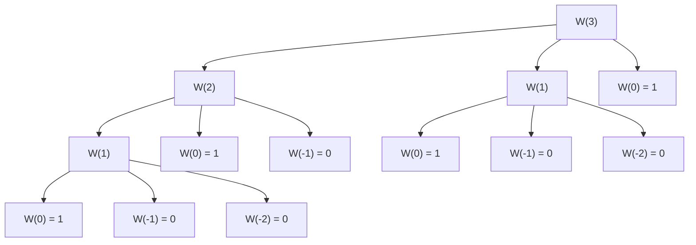
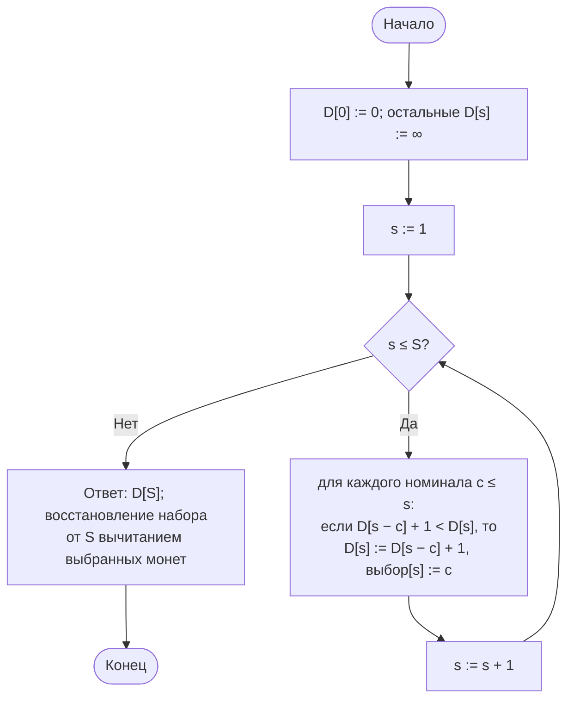
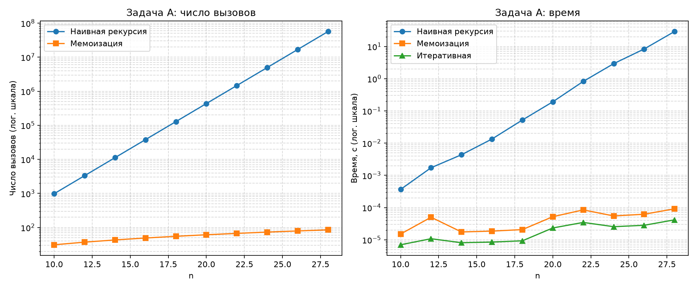
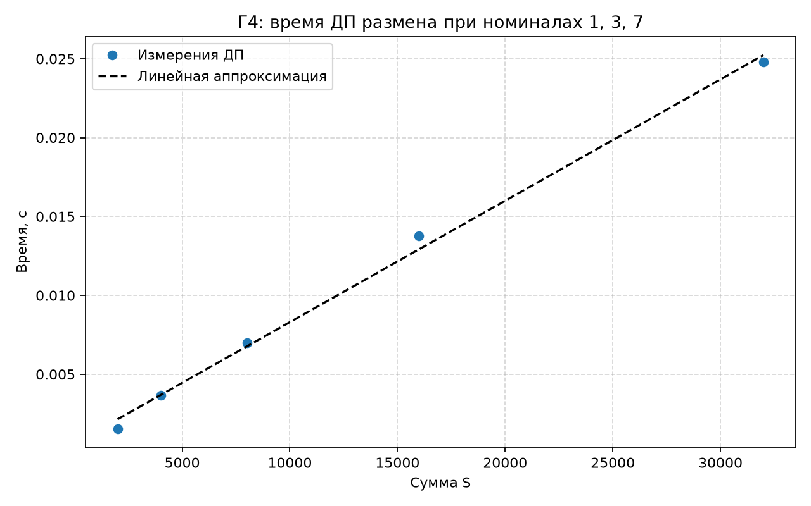

# Отчёт по лабораторной работе № 7

## Титульный лист

**Дисциплина:** Теория алгоритмов
**Направление подготовки:** 38.03.05 «Бизнес-информатика»
**Курс:** 2
**Тема:** Рекурсивные алгоритмы и динамическое программирование в задачах комбинаторной оптимизации
**Вариант:** 4
**Дополнительное задание:** Г4 — зависимость времени ДП от суммы $S$ при фиксированном числе номиналов
**ФИО студента:** Дымченко Игорь Владиславович

---

## 1. Цель работы и задание варианта

**Цель:** изучить динамическое программирование как способ устранения повторных вычислений и сопоставить три реализации одной задачи: наивную рекурсию, мемоизацию и итеративное решение.

**Задание варианта 4 (табл. 1 методички):**

- **Задача А:** число способов подняться по лестнице с шагами 1, 2, 3; параметр $n$ от 10 до 28; три реализации с подсчётом числа вызовов.
- **Задача Б:** размен суммы $S = 200$ номиналами 1, 3, 7 методом ДП с восстановлением набора монет.
- **Дополнительное задание Г4:** исследовать зависимость времени ДП от $S$ при фиксированном $N$ и пояснить псевдополиномиальность.

---

## 2. Рекуррентные соотношения

### 2.1. Задача А: лестница с шагами 1, 2, 3

$$W(n) = W(n-1) + W(n-2) + W(n-3), \qquad W(0) = 1,\quad W(n) = 0 \text{ при } n < 0.$$

- $W(n)$ — число способов подняться на $n$-ю ступеньку;
- слагаемое $W(n-s)$ соответствует последнему шагу длины $s \in \{1, 2, 3\}$;
- $W(0) = 1$ — базовый случай: один способ оказаться на нулевой ступеньке (ничего не делать);
- $W(n) = 0$ при $n < 0$ — шаг «за пределы» лестницы не даёт способа.

Наивная рекурсия имеет трудоёмкость $\Theta(\lambda^n)$, где $\lambda \approx 1{,}839$ — действительный корень уравнения $x^3 = x^2 + x + 1$. Мемоизация и итеративная версия выполняют $\Theta(n)$ операций.

### 2.2. Задача Б: размен суммы

$$D[0] = 0, \qquad D[s] = 1 + \min_{c_j \le s} D[s - c_j], \quad s = 1, \ldots, S.$$

- $D[s]$ — минимальное число монет для суммы $s$;
- $c_j$ — номинал монеты; минимум берётся по всем номиналам, не превышающим $s$;
- $1 + D[s - c_j]$ — выбрана монета $c_j$, оставшаяся сумма $s - c_j$ набирается оптимально;
- $D[0] = 0$ — пустой набор для нулевой суммы.

Трудоёмкость $\Theta(kS)$, где $k$ — число номиналов. Для $k = 3$ это $\Theta(S)$.

---

## 3. Дерево рекурсии

Дерево наивной рекурсии $W(3)$ содержит 13 вызовов. Повторяющихся подзадач здесь ещё мало: $W(1)$ встречается 2 раза, $W(0)$ — 4 раза. Для $n = 3$ дерево полностью помещается на схеме, поэтому оно и приведено.



Подзадача $W(1)$ встречается в дереве дважды (узлы N3 и N9), $W(0)$ — четырежды (узлы N4, N7, N10 и N13). Число узлов растёт по закону $T(n) = 1 + T(n-1) + T(n-2) + T(n-3)$, поэтому при $n = 28$ оно достигает десятков миллионов; мемоизация сводит вычисления к $3n + 1$ вызовам.

---

## 4. Схема заполнения таблицы ДП (размен суммы)



---

## 5. Листинг программы

Файл: [main.py](main.py)

```python
"""
Лабораторная работа № 7. Вариант 4.
Задача А: число способов подняться по лестнице с шагами 1, 2, 3 — три реализации
          (наивная рекурсия, мемоизация, итеративное ДП).
Задача Б: размен суммы S = 200 номиналами 1, 3, 7 методом динамического программирования
          с восстановлением набора монет.
Г4: зависимость времени ДП от суммы S при фиксированном числе номиналов.
"""

import os
import platform
import statistics
import sys
import time

import matplotlib.pyplot as plt
import numpy as np


STEPS = (1, 2, 3)
SIZES_A = list(range(10, 29, 2))          # n = 10, 12, ..., 28
NAIVE_LIMIT_SECONDS = 10.0                # ориентир из методички
REPEATS = 5

COINS = (1, 3, 7)
S_TARGET = 200
S_SWEEP = [2000, 4000, 8000, 16000, 32000]  # Г4: фиксированы номиналы, меняется S

calls = 0  # счётчик вызовов рекурсивных функций


def stairs_naive(n: int) -> int:
    """Наивная рекурсия: W(n) = W(n-1) + W(n-2) + W(n-3). Время растёт экспоненциально."""
    global calls
    calls += 1
    if n == 0:
        return 1
    if n < 0:
        return 0
    return sum(stairs_naive(n - s) for s in STEPS)


def stairs_memo(n: int, cache: dict | None = None) -> int:
    """Нисходящее ДП: каждая подзадача вычисляется один раз и кэшируется."""
    global calls
    calls += 1
    if cache is None:
        cache = {}
    if n == 0:
        return 1
    if n < 0:
        return 0
    if n in cache:
        return cache[n]
    cache[n] = sum(stairs_memo(n - s, cache) for s in STEPS)
    return cache[n]


def stairs_iter(n: int) -> int:
    """Восходящее ДП: таблица ways[i] заполняется по возрастанию i."""
    ways = [0] * (n + 1)
    ways[0] = 1
    for i in range(1, n + 1):
        ways[i] = sum(ways[i - s] for s in STEPS if i - s >= 0)
    return ways[n]


def coin_change_dp(coins: tuple, amount: int):
    """
    Размен суммы минимальным числом монет.
    D[s] = 1 + min(D[s - c]) по номиналам c <= s, D[0] = 0.
    Возвращает (число монет, отсортированный список монет) либо (-1, []).
    """
    inf = float("inf")
    best = [0] + [inf] * amount
    choice = [0] * (amount + 1)
    for s in range(1, amount + 1):
        for c in coins:
            if c <= s and best[s - c] + 1 < best[s]:
                best[s] = best[s - c] + 1
                choice[s] = c
    if best[amount] == inf:
        return -1, []
    # восстановление: идём от суммы, вычитая выбранный номинал
    result, s = [], amount
    while s > 0:
        result.append(choice[s])
        s -= choice[s]
    return best[amount], sorted(result, reverse=True)


def coin_enumerate(amount: int) -> int:
    """Независимая проверка перебором для номиналов (1, 3, 7): перебор количеств монет."""
    best = None
    for c7 in range(amount // 7 + 1):
        for c3 in range((amount - 7 * c7) // 3 + 1):
            c1 = amount - 7 * c7 - 3 * c3
            count = c1 + c3 + c7
            if best is None or count < best:
                best = count
    return best


def tree_mermaid(n: int) -> tuple[str, int]:
    """Строит дерево вызовов наивной рекурсии в формате Mermaid; возвращает (текст, число узлов)."""
    lines = ["flowchart TD"]
    counter = [0]

    def walk(k: int, parent: str | None = None) -> None:
        counter[0] += 1
        name = f"N{counter[0]}"
        if k == 0:
            label = "W(0) = 1"
        elif k < 0:
            label = f"W({k}) = 0"
        else:
            label = f"W({k})"
        lines.append(f'    {name}["{label}"]')
        if parent is not None:
            lines.append(f"    {parent} --> {name}")
        if k > 0:
            for s in STEPS:
                walk(k - s, name)

    walk(n)
    return "\n".join(lines), counter[0]


def measure(action, repeats: int = REPEATS):
    """Медиана времени action() по repeats запускам; возвращает (время, результат последнего запуска)."""
    times = []
    result = None
    for _ in range(repeats):
        started = time.perf_counter()
        result = action()
        times.append(time.perf_counter() - started)
    return statistics.median(times), result


def count_calls(func, n: int):
    """Запускает рекурсивную функцию и возвращает (результат, число вызовов)."""
    global calls
    calls = 0
    result = func(n)
    return result, calls


def experiment_stairs() -> list[dict]:
    """Задача А: три реализации для n из SIZES_A. Наивную версию прекращаем при превышении лимита."""
    rows = []
    naive_running = True
    for n in SIZES_A:
        row = {"n": n}
        if naive_running:
            t_naive, (value_naive, calls_naive) = measure(lambda: count_calls(stairs_naive, n), repeats=1)
            row.update(naive_time=t_naive, naive_calls=calls_naive)
            if t_naive > NAIVE_LIMIT_SECONDS:
                naive_running = False
        else:
            value_naive = None
            row.update(naive_time=None, naive_calls=None)

        t_memo, (value_memo, calls_memo) = measure(lambda: count_calls(stairs_memo, n))
        t_iter, value_iter = measure(lambda: stairs_iter(n))
        assert value_memo == value_iter
        if value_naive is not None:
            assert value_naive == value_iter
        row.update(memo_time=t_memo, memo_calls=calls_memo, iter_time=t_iter, value=value_iter)
        rows.append(row)
    return rows


def experiment_coins() -> list[dict]:
    """Задача Б и Г4: ДП для размена; время как функция S при фиксированных номиналах."""
    for s in range(1, 61):
        assert coin_change_dp(COINS, s)[0] == coin_enumerate(s), f"несовпадение при S={s}"
    count, coins = coin_change_dp(COINS, S_TARGET)
    assert sum(coins) == S_TARGET and len(coins) == count

    rows = []
    for s in S_SWEEP:
        elapsed, _ = measure(lambda: coin_change_dp(COINS, s))
        rows.append({"S": s, "time": elapsed})
    return rows, count, coins


def linear_fit(xs: list[int], ys: list[float]):
    """Линейная регрессия y = a x + b; возвращает (a, b, R^2)."""
    x = np.array(xs, dtype=float)
    y = np.array(ys, dtype=float)
    slope, intercept = np.polyfit(x, y, 1)
    pred = slope * x + intercept
    ss_res = float(((y - pred) ** 2).sum())
    ss_tot = float(((y - y.mean()) ** 2).sum())
    return float(slope), float(intercept), 1 - ss_res / ss_tot


def save_charts(stairs_rows: list[dict], sweep_rows: list[dict]) -> None:
    """Сохраняет графики: число вызовов и время (задача А) и линейность ДП (Г4)."""
    out_dir = os.path.dirname(os.path.abspath(__file__))

    ns = [r["n"] for r in stairs_rows if r["naive_calls"] is not None]
    fig, axes = plt.subplots(1, 2, figsize=(12, 5))
    axes[0].plot(ns, [r["naive_calls"] for r in stairs_rows if r["naive_calls"] is not None],
                 "o-", label="Наивная рекурсия")
    axes[0].plot([r["n"] for r in stairs_rows], [r["memo_calls"] for r in stairs_rows],
                 "s-", label="Мемоизация")
    axes[0].set_yscale("log")
    axes[0].set_xlabel("n")
    axes[0].set_ylabel("Число вызовов (лог. шкала)")
    axes[0].set_title("Задача А: число вызовов")
    axes[0].grid(True, which="both", linestyle="--", alpha=0.5)
    axes[0].legend()

    axes[1].plot(ns, [r["naive_time"] for r in stairs_rows if r["naive_calls"] is not None],
                 "o-", label="Наивная рекурсия")
    axes[1].plot([r["n"] for r in stairs_rows], [r["memo_time"] for r in stairs_rows],
                 "s-", label="Мемоизация")
    axes[1].plot([r["n"] for r in stairs_rows], [r["iter_time"] for r in stairs_rows],
                 "^-", label="Итеративная")
    axes[1].set_yscale("log")
    axes[1].set_xlabel("n")
    axes[1].set_ylabel("Время, с (лог. шкала)")
    axes[1].set_title("Задача А: время")
    axes[1].grid(True, which="both", linestyle="--", alpha=0.5)
    axes[1].legend()
    fig.tight_layout()
    fig.savefig(os.path.join(out_dir, "lr7_stairs.png"), dpi=160)
    plt.close(fig)

    xs = [r["S"] for r in sweep_rows]
    ys = [r["time"] for r in sweep_rows]
    slope, intercept, _ = linear_fit(xs, ys)
    plt.figure(figsize=(8, 5))
    plt.plot(xs, ys, "o", label="Измерения ДП")
    plt.plot(xs, [slope * x + intercept for x in xs], "k--", label="Линейная аппроксимация")
    plt.xlabel("Сумма S")
    plt.ylabel("Время, с")
    plt.title("Г4: время ДП размена при номиналах 1, 3, 7")
    plt.grid(True, linestyle="--", alpha=0.5)
    plt.legend()
    plt.tight_layout()
    plt.savefig(os.path.join(out_dir, "lr7_coins_sweep.png"), dpi=160)
    plt.close()


def main() -> None:
    print(f"Python: {sys.version.split()[0]} ({platform.python_implementation()})")
    print(f"ОС: {platform.platform()}; логических процессоров: {os.cpu_count()}\n")

    tree_text, tree_nodes = tree_mermaid(3)
    out_dir = os.path.dirname(os.path.abspath(__file__))
    with open(os.path.join(out_dir, "lr7_tree.mmd"), "w", encoding="utf-8") as f:
        f.write(tree_text + "\n")
    print(f"Дерево рекурсии для n = 3: {tree_nodes} узлов (сохранено в lr7_tree.mmd)\n")

    print("Задача А: лестница с шагами 1, 2, 3")
    stairs_rows = experiment_stairs()
    print(f"{'n':>3} | {'наивная, с':>11} | {'вызовов':>11} | {'мемо, с':>10} | {'вызовов':>7} | "
          f"{'итер., с':>10} | {'ответ':>10}")
    print("-" * 85)
    for r in stairs_rows:
        naive_t = f"{r['naive_time']:.4f}" if r["naive_time"] is not None else "не изм."
        naive_c = str(r["naive_calls"]) if r["naive_calls"] is not None else "—"
        print(f"{r['n']:>3} | {naive_t:>11} | {naive_c:>11} | {r['memo_time']:>10.6f} | "
              f"{r['memo_calls']:>7} | {r['iter_time']:>10.6f} | {r['value']:>10}")

    print(f"\nЗадача Б: размен S = {S_TARGET}, номиналы {COINS}")
    sweep_rows_base, count, coins = experiment_coins()
    print(f"Минимум монет: {count}; набор: {coins}; проверка перебором для S = 1..60 пройдена")

    print("\nГ4: зависимость времени ДП от S (номиналы фиксированы)")
    print(f"{'S':>7} | {'время, с':>10}")
    print("-" * 22)
    for r in sweep_rows_base:
        print(f"{r['S']:>7} | {r['time']:>10.6f}")
    slope, intercept, r2 = linear_fit([r["S"] for r in sweep_rows_base], [r["time"] for r in sweep_rows_base])
    print(f"Линейная регрессия: T(S) ≈ {slope:.3e} * S + {intercept:.3e}, R² = {r2:.4f}")

    save_charts(stairs_rows, sweep_rows_base)
    print("\nГрафики сохранены: lr7_stairs.png, lr7_coins_sweep.png")


if __name__ == "__main__":
    main()
```

---

## 6. Объяснение программы

1. **`stairs_naive`** — прямое воплощение рекуррентного соотношения. Глобальный счётчик `calls` фиксирует число вызовов.
2. **`stairs_memo`** — тот же рецепт, но результат каждого $W(n)$ сохраняется в словаре `cache`. Повторный запрос берётся из кэша, поэтому каждая подзадача вычисляется один раз.
3. **`stairs_iter`** — восходящая форма: массив `ways` заполняется от $W(0)$ до $W(n)$. Рекурсии нет, поэтому нет и ограничения на глубину стека.
4. **`coin_change_dp`** — таблица `best` хранит $D[s]$, массив `choice` — последний выбранный номинал для суммы $s$. Восстановление идёт от $S$ вычитанием `choice[s]`, пока сумма не станет нулём.
5. **`coin_enumerate`** — независимая проверка перебором всех пар «количество монет 7 и 3» с остатком в монетах 1. Она сверяет ответ ДП для $S = 1 \ldots 60$.
6. **`tree_mermaid`** — строит дерево вызовов наивной рекурсии для $n = 3$ и подсчитывает узлы (13).
7. **`experiment_stairs`** — измеряет три реализации. Наивная версия запускается одним разом; когда её время превышает 10 с, для больших $n$ она не выполняется.
8. **`experiment_coins`** — запускает ДП для $S = 200$ и для серии сумм Г4; `linear_fit` выполняет линейную регрессию методом наименьших квадратов и вычисляет $R^2$.

---

## 7. Характеристики вычислительной системы

| Параметр | Значение |
|---|---|
| Операционная система | Windows 11, версия 10.0.26200 |
| Процессор | 11th Gen Intel Core i5-1135G7 @ 2.40 GHz |
| Логические процессоры | 8 |
| Оперативная память | 16 GiB |
| Интерпретатор | CPython 3.15.0rc2 |
| Повторы замеров | 5 (итоговое значение — медиана); наивная версия — 1 запуск на $n$ |

---

## 8. Результаты измерений

### 8.1. Задача А: три реализации лестницы

| $n$ | Наивная, с | Вызовов (наивная) | Мемоизация, с | Вызовов (мемо) | Итеративная, с | Ответ $W(n)$ |
|---:|---:|---:|---:|---:|---:|---:|
| 10 | 0,0004 | 979 | 0,000015 | 31 | 0,000007 | 274 |
| 12 | 0,0017 | 3 313 | 0,000050 | 37 | 0,000011 | 927 |
| 14 | 0,0044 | 11 209 | 0,000018 | 43 | 0,000008 | 3 136 |
| 16 | 0,0134 | 37 921 | 0,000019 | 49 | 0,000009 | 10 609 |
| 18 | 0,0521 | 128 287 | 0,000021 | 55 | 0,000009 | 35 890 |
| 20 | 0,1918 | 433 993 | 0,000052 | 61 | 0,000023 | 121 415 |
| 22 | 0,8237 | 1 468 189 | 0,000085 | 67 | 0,000035 | 410 744 |
| 24 | 2,9292 | 4 966 849 | 0,000055 | 73 | 0,000026 | 1 389 537 |
| 26 | 8,3471 | 16 802 731 | 0,000062 | 79 | 0,000028 | 4 700 770 |
| 28 | 29,1953 | 56 843 233 | 0,000092 | 85 | 0,000042 | 15 902 591 |

**Порог 10 с.** Наивная версия при $n = 26$ работает 8,3 с, при $n = 28$ — 29,2 с. Граница ~10 с лежит между ними; $n = 27$ не измерялось, поэтому точное значение не установлено. Для $n = 28$ лимит был превышен, и далее наивная версия не запускалась.

**Экспонента по наклону.** Из строк $n = 20$ и $n = 28$: $\frac{56\,843\,233}{433\,993} \approx 131$, поэтому основание $\lambda \approx 131^{1/8} \approx 1{,}84$. Это совпадает с действительным корнем $x^3 = x^2 + x + 1$ (около $1{,}839$), то есть с оценкой $\Theta(\lambda^n)$.

**Мемоизация.** Число вызовов равно $3n + 1$ во всех строках таблицы (например, $n = 28$: $85$). Время мемоизированной и итеративной версий остаётся на уровне десятков микросекунд.



### 8.2. Задача Б: размен суммы $S = 200$, номиналы 1, 3, 7

- Минимальное число монет: **30**.
- Набор монет: 28 монет по 7, одна монета 3 и одна монета 1. Проверка: $28 \cdot 7 + 3 + 1 = 196 + 4 = 200$.
- Результат ДП совпал с независимым перебором для всех $S = 1 \ldots 60$.

Жадный выбор (сначала самые крупные монеты) для этих данных дал бы тот же набор, однако в общем случае жадный алгоритм может не давать минимума; именно поэтому для размена нужен ДП.

### 8.3. Г4: зависимость времени ДП от $S$ при номиналах 1, 3, 7

| $S$ | Время, с |
|---:|---:|
| 2 000 | 0,001558 |
| 4 000 | 0,003655 |
| 8 000 | 0,006984 |
| 16 000 | 0,013763 |
| 32 000 | 0,024796 |

Линейная регрессия по этим точкам: $T(S) \approx 7{,}69 \cdot 10^{-7}\, S + 6{,}1 \cdot 10^{-4}$ с, $R^2 = 0{,}9963$.



**Вывод по Г4.** При фиксированном $k = 3$ время растёт линейно по $S$: удвоение $S$ даёт почти двукратное увеличение времени (отношения 2,35; 1,91; 1,97; 1,80). Трудоёмкость $\Theta(kS)$ действительно линейна по числовому значению $S$.

**Псевдополиномиальность.** Формально $\Theta(kS)$ — полиномиально по величине $S$. Но в записи входа число $S$ занимает $\log_2 S$ битов. Поэтому по длине входа трудоёмкость $\Theta(2^{\log_2 S})$ растёт экспоненциально. Задача размена относится к NP-трудным, а ДП эффективно лишь при умеренных $S$. Линейность на графике подтверждает именно зависимость от значения, а не от длины записи.

---

## 9. Выводы

1. Наивная рекурсия для лестницы растёт экспоненциально с основанием $\approx 1{,}84$: при $n = 28$ она выполняет свыше $5{,}6 \cdot 10^7$ вызовов и занимает около 29 с. Порог 10 с для этой реализации лежит между $n = 26$ и $n = 28$.
2. Мемоизация снижает число вызовов до $3n + 1$ и устраняет экспоненту. Это подтверждает, что причина роста — повторные вычисления подзадач.
3. Итеративная версия самая быстрая и использует $O(n)$ памяти для таблицы; при необходимости её можно сократить до $O(1)$ хранением трёх последних значений.
4. Размен суммы $S = 200$ с номиналами 1, 3, 7 решён точно: минимум 30 монет, набор восстановлен и проверен перебором.
5. Время ДП линейно по $S$ при фиксированном числе номиналов (Г4, $R^2 = 0{,}996$), что соответствует оценке $\Theta(kS)$; при этом алгоритм остаётся псевдополиномиальным.

---

## 10. Рекомендуемая литература

1. Кормен Т., Лейзерсон Ч., Ривест Р., Штайн К. Алгоритмы: построение и анализ. — 3-е изд. — М.: Вильямс, 2013. — Гл. 15.
2. Рафгарден Т. Совершенный алгоритм. Жадные алгоритмы и динамическое программирование. — СПб.: Питер, 2020.
3. Скиена С. Алгоритмы. Руководство по разработке. — 3-е изд. — СПб.: БХВ-Петербург, 2022. — Гл. 10.
4. Левитин А. Алгоритмы. Введение в разработку и анализ. — М.: Вильямс, 2006.
5. Документация Python: модуль `functools` [Электронный ресурс]. — URL: https://docs.python.org/3/library/functools.html

---

Выполнил: Дымченко Игорь Владиславович

Дата: ________
