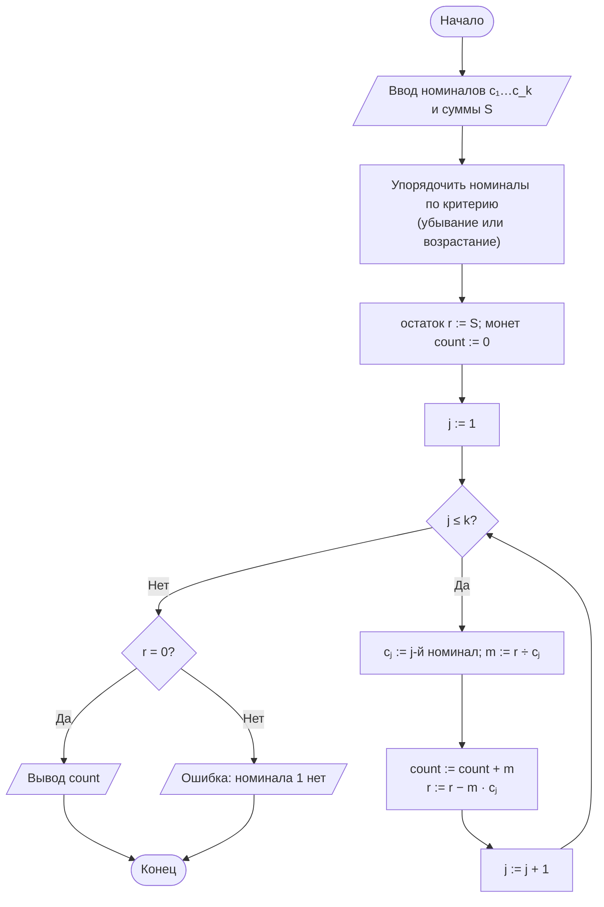
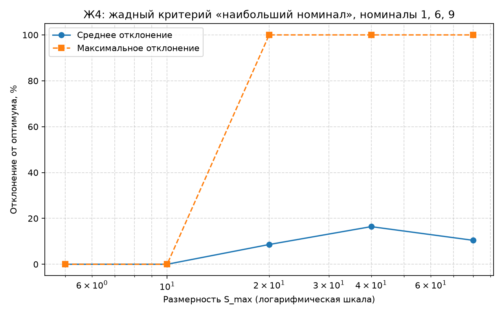
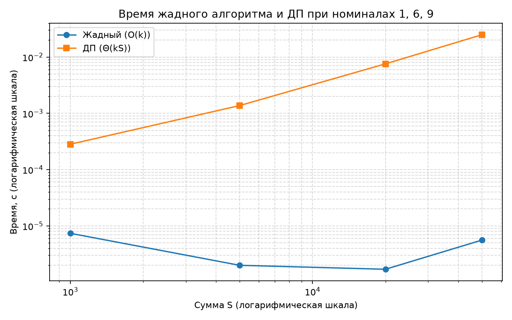

# Отчёт по лабораторной работе № 8

## Титульный лист

**Дисциплина:** Теория алгоритмов
**Направление подготовки:** 38.03.05 «Бизнес-информатика»
**Курс:** 2
**Тема:** Жадные алгоритмы и экспериментальная оценка качества приближённых решений
**Вариант:** 4
**Дополнительное задание:** Ж4 — зависимость отклонения жадного решения от размерности задачи
**ФИО студента:** Дымченко Игорь Владиславович

---

## 1. Цель работы и задание варианта

**Цель:** изучить жадную стратегию, установить условия её оптимальности и экспериментально оценить отклонение жадного решения от оптимального.

**Задание варианта 4 (табл. 1 методички):**

- задача: размен суммы;
- номиналы: 1, 6, 9; сумма $S \le 150$;
- жадный критерий 1: наибольший номинал;
- жадный критерий 2: наименьший номинал;
- дополнительное задание Ж4: исследовать зависимость отклонения от размерности задачи.

**Интерпретация Ж4.** Для размена суммы размерность задана верхней границей суммы $S_{\max}$. Значения $S_{\max} \in \{5, 10, 20, 40, 80\}$, для каждого значения выбираются 300 случайных сумм из $[1; S_{\max}]$.

---

## 2. Описание задачи и алгоритмов

### 2.1. Постановка задачи

Дана система номиналов $c_1, \ldots, c_k$, в которой есть номинал 1, и сумма $S$. Требуется набрать $S$ минимальным числом монет.

### 2.2. Жадный алгоритм

Номиналы упорядочиваются по выбранному критерию. Каждый номинал берётся максимально возможное число раз, после чего переходят к следующему. Число монет вычисляется операцией деления с остатком $k = \lfloor r / c \rfloor$, поэтому трудоёмкость равна $\Theta(k)$ при $k$ номиналах (сортировка номиналов не учитывается, так как их мало).

- **Критерий 1 (наибольший номинал):** номиналы идут по убыванию.
- **Критерий 2 (наименьший номинал):** номиналы идут по возрастанию. Для системы с единицей такой критерий всегда набирает сумму единицами, то есть даёт $S$ монет. Он включён как заведомо слабый критерий для сравнения.

### 2.3. Точное решение (ДП)

$$D[0] = 0, \qquad D[s] = 1 + \min_{c_j \le s} D[s - c_j].$$

Трудоёмкость $\Theta(kS)$. Набор монет восстанавливается обратным проходом по таблице выбора.

### 2.4. Условия оптимальности

Для произвольной системы номиналов жадность не оптимальна. Для системы $\{1, 6, 9\}$ это видно на примере $S = 12$, разобранном в разделе 6. Для «канонических» систем вида $\{1, 5, 10, 25\}$ жадный критерий оптимален, однако система $\{1, 6, 9\}$ к таким не относится, поэтому её оптимальность проверяется только экспериментально или по контрпримерам.

---

## 3. Блок-схема жадного алгоритма



---

## 4. Листинг программы

Файл: [main.py](main.py)

```python
"""
Лабораторная работа № 8. Вариант 4.
Размен суммы номиналами 1, 6, 9 (S <= 150): два жадных критерия
(наибольший номинал, наименьший номинал) против точного решения методом ДП.
Ж4: зависимость среднего отклонения жадного решения от размерности задачи.
Размерность для размена суммы понимается как верхняя граница суммы S_max.
"""

import os
import platform
import random
import statistics
import sys
import time

import matplotlib.pyplot as plt


COINS = (1, 6, 9)
S_MAX = 150
TRIALS = 500
SEED = 2024
DIMENSIONS = [5, 10, 20, 40, 80]   # Ж4: размерность S_max
DIM_TRIALS = 300
TIMING_SUMS = [1000, 5000, 20000, 50000]


def coin_dp(coins, amount):
    """Точное решение ДП: возвращает (минимум монет, отсортированный набор)."""
    inf = float("inf")
    best = [0] + [inf] * amount
    choice = [0] * (amount + 1)
    for s in range(1, amount + 1):
        for c in coins:
            if c <= s and best[s - c] + 1 < best[s]:
                best[s] = best[s - c] + 1
                choice[s] = c
    result, s = [], amount
    while s > 0:
        result.append(choice[s])
        s -= choice[s]
    return int(best[amount]), sorted(result, reverse=True)


def greedy_coins(coins, amount, largest_first=True):
    """Жадный размен: номиналы обходятся в заданном порядке, каждый берётся максимально возможное число раз."""
    order = sorted(coins, reverse=largest_first)
    remain, chosen = amount, []
    for c in order:
        k = remain // c
        chosen += [c] * k
        remain -= k * c
    assert remain == 0, "система номиналов должна содержать 1"
    return len(chosen), sorted(chosen, reverse=True)


def greedy_count(coins, amount, largest_first=True):
    """Только число монет жадного размена без построения списка (для замера времени)."""
    order = sorted(coins, reverse=largest_first)
    remain, count = amount, 0
    for c in order:
        k = remain // c
        count += k
        remain -= k * c
    return count


def deviation(greedy: int, optimum: int) -> float:
    """Относительное отклонение жадного решения от оптимума, %."""
    return (greedy - optimum) / optimum * 100


def random_sums(seed: int, count: int, s_max: int) -> list[int]:
    """Случайные суммы S из [1; s_max]."""
    rng = random.Random(seed)
    return [rng.randint(1, s_max) for _ in range(count)]


def experiment():
    """Серия из TRIALS случайных сумм: отклонения и доля точных совпадений."""
    sums = random_sums(SEED, TRIALS, S_MAX)
    criteria = {"Наибольший номинал": True, "Наименьший номинал": False}
    dev = {name: [] for name in criteria}
    hits = {name: 0 for name in criteria}
    for s in sums:
        opt, _ = coin_dp(COINS, s)
        for name, largest in criteria.items():
            g, _ = greedy_coins(COINS, s, largest)
            dev[name].append(deviation(g, opt))
            if g == opt:
                hits[name] += 1
    return dev, hits


def dimension_experiment():
    """Ж4: среднее и максимальное отклонение жадного критерия «наибольший номинал» при разных S_max."""
    rows = []
    for s_max in DIMENSIONS:
        sums = random_sums(SEED + s_max, DIM_TRIALS, s_max)
        devs = []
        for s in sums:
            opt, _ = coin_dp(COINS, s)
            g, _ = greedy_coins(COINS, s, True)
            devs.append(deviation(g, opt))
        rows.append((s_max, statistics.mean(devs), max(devs)))
    return rows


def timing_experiment():
    """Время жадного алгоритма и ДП при росте суммы S (номиналы фиксированы)."""
    rows = []
    for s in TIMING_SUMS:
        started = time.perf_counter()
        greedy_count(COINS, s, True)
        t_greedy = time.perf_counter() - started
        started = time.perf_counter()
        coin_dp(COINS, s)
        t_dp = time.perf_counter() - started
        rows.append((s, t_greedy, t_dp))
    return rows


def save_charts(dim_rows, timing_rows):
    """Сохраняет график зависимости отклонения от размерности и график времени."""
    out_dir = os.path.dirname(os.path.abspath(__file__))

    xs = [r[0] for r in dim_rows]
    plt.figure(figsize=(8, 5))
    plt.plot(xs, [r[1] for r in dim_rows], "o-", label="Среднее отклонение")
    plt.plot(xs, [r[2] for r in dim_rows], "s--", label="Максимальное отклонение")
    plt.xscale("log")
    plt.xlabel("Размерность S_max (логарифмическая шкала)")
    plt.ylabel("Отклонение от оптимума, %")
    plt.title("Ж4: жадный критерий «наибольший номинал», номиналы 1, 6, 9")
    plt.grid(True, which="both", linestyle="--", alpha=0.5)
    plt.legend()
    plt.tight_layout()
    plt.savefig(os.path.join(out_dir, "lr8_dimension.png"), dpi=160)
    plt.close()

    ss = [r[0] for r in timing_rows]
    plt.figure(figsize=(8, 5))
    plt.plot(ss, [r[1] for r in timing_rows], "o-", label="Жадный (O(k))")
    plt.plot(ss, [r[2] for r in timing_rows], "s-", label="ДП (Θ(kS))")
    plt.xscale("log")
    plt.yscale("log")
    plt.xlabel("Сумма S (логарифмическая шкала)")
    plt.ylabel("Время, с (логарифмическая шкала)")
    plt.title("Время жадного алгоритма и ДП при номиналах 1, 6, 9")
    plt.grid(True, which="both", linestyle="--", alpha=0.5)
    plt.legend()
    plt.tight_layout()
    plt.savefig(os.path.join(out_dir, "lr8_timing.png"), dpi=160)
    plt.close()


def main():
    print(f"Python: {sys.version.split()[0]} ({platform.python_implementation()})")
    print(f"ОС: {platform.platform()}; логических процессоров: {os.cpu_count()}\n")

    print(f"Контрпример: номиналы {COINS}, S = 12")
    g_big, chosen_big = greedy_coins(COINS, 12, True)
    g_small, chosen_small = greedy_coins(COINS, 12, False)
    opt, chosen_opt = coin_dp(COINS, 12)
    print(f"  Наибольший номинал: {chosen_big}, монет {g_big}, отклонение {deviation(g_big, opt):.1f} %")
    print(f"  Наименьший номинал: {chosen_small}, монет {g_small}, отклонение {deviation(g_small, opt):.1f} %")
    print(f"  Оптимум (ДП): {chosen_opt}, монет {opt}\n")

    dev, hits = experiment()
    print(f"Серия из {TRIALS} случайных сумм S из [1; {S_MAX}]:")
    print(f"{'Критерий':<22}{'среднее, %':>12}{'медиана, %':>12}{'максимум, %':>13}{'совпало, %':>12}")
    for name, d in dev.items():
        print(f"{name:<22}{statistics.mean(d):>12.2f}{statistics.median(d):>12.2f}"
              f"{max(d):>13.2f}{hits[name] / TRIALS * 100:>12.1f}")

    print(f"\nЖ4: зависимость отклонения (наибольший номинал) от размерности S_max, {DIM_TRIALS} сумм на точку")
    print(f"{'S_max':>7}{'среднее, %':>13}{'максимум, %':>13}")
    dim_rows = dimension_experiment()
    for s_max, mean_dev, max_dev in dim_rows:
        print(f"{s_max:>7}{mean_dev:>13.2f}{max_dev:>13.2f}")

    print("\nСравнение времени")
    timing_rows = timing_experiment()
    print(f"{'S':>7}{'жадный, с':>14}{'ДП, с':>12}{'отношение':>12}")
    for s, t_g, t_dp in timing_rows:
        print(f"{s:>7}{t_g:>14.6f}{t_dp:>12.4f}{t_dp / t_g:>12.1f}")

    save_charts(dim_rows, timing_rows)
    print("\nГрафики сохранены: lr8_dimension.png, lr8_timing.png")


if __name__ == "__main__":
    main()
```

---

## 5. Объяснение программы

1. **`coin_dp`** — точное решение ДП. Таблица `best` хранит минимум монет, `choice` — последний выбранный номинал. Восстановление набора идёт от $S$ вычитанием `choice[s]`.
2. **`greedy_coins`** — жадный алгоритм. Номиналы сортируются по критерию, для каждого берётся `remain // c` монет. Список монет строится только для отчёта.
3. **`greedy_count`** — та же логика без списка; используется для замера времени, чтобы не измерять построение списка длиной $S$.
4. **`deviation`** — относительное отклонение $(g - \text{opt}) / \text{opt} \cdot 100\%$.
5. **`experiment`** — серия из 500 случайных сумм из $[1; 150]$: для каждой считаются оптимум и оба жадных решения, накапливаются отклонения и число точных совпадений.
6. **`dimension_experiment`** — Ж4: для каждого $S_{\max}$ генерируются 300 сумм и вычисляются среднее и максимальное отклонение критерия «наибольший номинал».
7. **`timing_experiment`** — сравнение времени жадного алгоритма и ДП при росте $S$.
8. **`save_charts`** — строит график Ж4 и график времени.

---

## 6. Разбор контрпримера вручную

Система номиналов $\{1, 6, 9\}$, сумма $S = 12$.

**Жадный критерий «наибольший номинал»:**

- берём 9: остаток $12 - 9 = 3$;
- номинал 6 больше остатка 3, пропускаем;
- берём 1 три раза: остаток $3 - 3 = 0$.

Итого: $9 + 1 + 1 + 1$, **4 монеты**.

**Оптимум:** $6 + 6 = 12$, **2 монеты**. Проверка ДП по формуле $D[12] = 1 + \min(D[11], D[6], D[3]) = 1 + \min(D[11], 1, 3) = 2$, где $D[6] = 1$ (одна монета 6); вариант с монетой 9 даёт $1 + D[3] = 4$.

**Отклонение:** $(4 - 2)/2 \cdot 100\% = 100\%$.

Ошибка возникает потому, что самая крупная монета 9 «перекрывает» путь к сумме, которая кратна 6. Жадный выбор на первом шаге локально выгоден, но глобально не оптимален — нарушается свойство жадного выбора.

**Критерий «наименьший номинал»** на той же сумме даёт $1 \cdot 12$, то есть 12 монет, отклонение $500\%$.

---

## 7. Результаты измерений

### 7.1. Серия из 500 случайных сумм, $S \in [1; 150]$

| Критерий | Среднее отклонение, % | Медиана, % | Максимум, % | Доля точных совпадений, % |
|---|---:|---:|---:|---:|
| Наибольший номинал | 7,84 | 0,00 | 100,00 | 66,8 |
| Наименьший номинал | 649,74 | 693,33 | 800,00 | 2,2 |

Критерий «наибольший номинал» совпадает с оптимумом примерно в две трети случаев, но на отдельных суммах даёт ошибку до 100 %. Критерий «наименьший номинал» практически не применим: при системе с единицей он набирает сумму единицами.

### 7.2. Ж4: зависимость отклонения от размерности $S_{\max}$

| $S_{\max}$ | Среднее отклонение, % | Максимальное отклонение, % |
|---:|---:|---:|
| 5 | 0,00 | 0,00 |
| 10 | 0,00 | 0,00 |
| 20 | 8,61 | 100,00 |
| 40 | 16,40 | 100,00 |
| 80 | 10,44 | 100,00 |



**Интерпретация.** При $S_{\max} \le 10$ жадный алгоритм оптимален на всех суммах: ошибка возникает только при суммах $S \ge 12$, где жадный выбор 9 может мешать (например, $S = 12$). Начиная с $S_{\max} = 20$ появляются суммы с ошибкой 100 %, а среднее отклонение растёт до $S_{\max} = 40$. При $S_{\max} = 80$ среднее немного снижается. Причина не проверялась; предположительно, доля «трудных» сумм в большем диапазоне меняется немонотонно из-за арифметики номиналов $\{1, 6, 9\}$. Для подтверждения нужен отдельный эксперимент с большим числом повторов. Зависимость от размерности в данной серии немонотонна.

### 7.3. Сравнение времени

| $S$ | Жадный, с | ДП, с | Отношение |
|---:|---:|---:|---:|
| 1 000 | 0,000007 | 0,0003 | 38 |
| 5 000 | 0,000002 | 0,0014 | 687 |
| 20 000 | 0,000002 | 0,0076 | 4 451 |
| 50 000 | 0,000006 | 0,0249 | 4 442 |



Жадный алгоритм работает за число операций, пропорциональное числу номиналов, и практически не зависит от $S$. ДП растёт линейно по $S$. Ответ жадного алгоритма получается почти мгновенно, однако без гарантии точности.

---

## 8. Выводы

1. Жадный критерий «наибольший номинал» для системы $\{1, 6, 9\}$ даёт точный ответ примерно в 67 % случаев; среднее отклонение составляет 7,8 %, максимальное — 100 %. Гарантированной точности он не имеет.
2. Контрпример $S = 12$ показывает, что жадный выбор крупнейшей монеты может блокировать оптимальную комбинацию $6 + 6$.
3. Критерий «наименьший номинал» непригоден: отклонение достигает сотен процентов. Качество жадного алгоритма определяется критерием упорядочивания, а не самой стратегией.
4. Ж4: зависимость от размерности немонотонна; при малых суммах жадность точна, при $S_{\max} \ge 20$ появляются существенные ошибки.
5. По времени жадный алгоритм на порядки быстрее ДП при больших $S$, поэтому при очень больших суммах приближённое решение может оказаться единственно возможным. Для системы $\{1, 6, 9\}$ его применять без проверки нельзя: точный ДП при $S \le 150$ занимает доли миллисекунды.
6. Рекомендация: для систем номиналов без гарантии канонической оптимальности жадный размен использовать только с предварительной проверкой на контрпримерах или с ДП, если сумма умеренна.

---

## 9. Рекомендуемая литература

1. Кормен Т., Лейзерсон Ч., Ривест Р., Штайн К. Алгоритмы: построение и анализ. — 3-е изд. — М.: Вильямс, 2013. — Гл. 16.
2. Рафгарден Т. Совершенный алгоритм. Жадные алгоритмы и динамическое программирование. — СПб.: Питер, 2020.
3. Скиена С. Алгоритмы. Руководство по разработке. — 3-е изд. — СПб.: БХВ-Петербург, 2022.
4. Левитин А. Алгоритмы. Введение в разработку и анализ. — М.: Вильямс, 2006. — Гл. 9.
5. Пападимитриу Х., Стайглиц К. Комбинаторная оптимизация. Алгоритмы и сложность. — М.: Мир, 1985.

---

Выполнил: Дымченко Игорь Владиславович

Дата: ________
