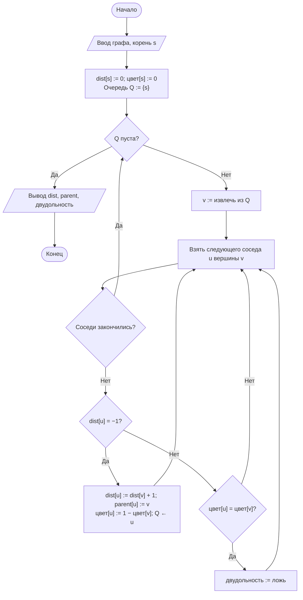
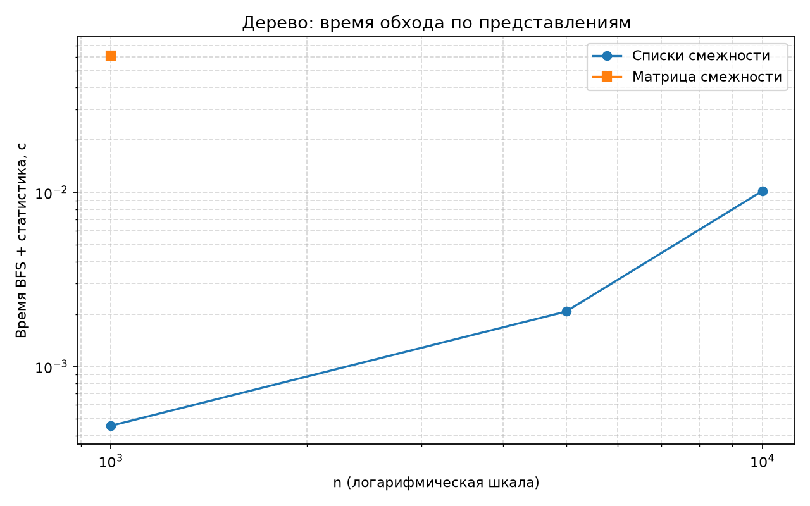

# Отчёт по лабораторной работе № 9

## Титульный лист

**Дисциплина:** Теория алгоритмов
**Направление подготовки:** 38.03.05 «Бизнес-информатика»
**Курс:** 2
**Тема:** Способы представления графов и алгоритмы обхода в ширину и в глубину
**Вариант:** 4
**Дополнительное задание:** И4 — проверка двудольности раскраской в два цвета при BFS
**ФИО студента:** Дымченко Игорь Владиславович

---

## 1. Цель работы и задание варианта

**Цель:** реализовать представления графа и обход в ширину, сопоставить их расход времени и памяти.

**Задание варианта 4 (табл. 2 методички):**

- тип графа: дерево ($m = n - 1$, связный, неориентированный);
- размеры: $n = 1000,\ 5000,\ 10\,000$;
- задача: высота дерева и число листьев;
- дополнительное задание И4: проверка двудольности при BFS с объяснением.

---

## 2. Представления графа и их оценки

| Представление | Память | Проверка ребра | Перебор соседей | Полный обход |
|---|---|---|---|---|
| Матрица смежности | $\Theta(n^2)$ | $\Theta(1)$ | $\Theta(n)$ | $\Theta(n^2)$ |
| Списки смежности | $\Theta(n + m)$ | $\Theta(\deg v)$ | $\Theta(\deg v)$ | $\Theta(n + m)$ |

Для дерева $m = n - 1 = \Theta(n)$, поэтому списки смежности требуют $\Theta(n)$ памяти, а матрица — $\Theta(n^2)$. Разрыв растёт с $n$.

**Обход в ширину (BFS).** Используется очередь. Вершины посещаются по уровням; расстояние от корня $d[u] = d[v] + 1$ для первой обнаружившей вершину $v$. Трудоёмкость $\Theta(n + m)$ для списков.



---

## 3. Листинг программы

Файл: [main.py](main.py)

```python
"""
Лабораторная работа № 9. Вариант 4.
Тип графа: дерево (m = n - 1, связный, неориентированный).
Задача: высота дерева (от корня 0) и число листьев.
Доп. И4: проверка двудольности раскраской в два цвета при BFS.
Сравнение представлений: матрица смежности и списки смежности.
"""

import os
import platform
import random
import statistics
import sys
import time
from collections import deque

import matplotlib.pyplot as plt


SIZES = [1000, 5000, 10_000]
MATRIX_MAX_N = 1000   # матрица на n = 5000 и 10 000 занимает сотни мегабайт, поэтому её не строим
REPEATS = 5
SEED = 42


class MatrixGraph:
    """Граф на матрице смежности. Память Θ(n²)."""

    def __init__(self, n: int):
        self.n = n
        self.matrix = [[0] * n for _ in range(n)]

    def add_edge(self, u: int, v: int) -> None:
        self.matrix[u][v] = 1
        self.matrix[v][u] = 1

    def neighbors(self, v: int) -> list[int]:
        row = self.matrix[v]
        return [u for u in range(self.n) if row[u]]


class ListGraph:
    """Граф на списках смежности. Память Θ(n + m)."""

    def __init__(self, n: int):
        self.n = n
        self.adj = [[] for _ in range(n)]

    def add_edge(self, u: int, v: int) -> None:
        self.adj[u].append(v)
        self.adj[v].append(u)

    def neighbors(self, v: int) -> list[int]:
        return self.adj[v]


def random_tree(n: int, seed: int) -> list[tuple[int, int]]:
    """Случайное дерево на n вершинах: каждая новая вершина присоединяется к случайной предыдущей."""
    rng = random.Random(seed)
    return [(i, rng.randrange(i)) for i in range(1, n)]


def build(cls, n: int, edges: list[tuple[int, int]]):
    graph = cls(n)
    for u, v in edges:
        graph.add_edge(u, v)
    return graph


def bfs(graph, start: int):
    """BFS: возвращает (расстояния, предки, цвета для проверки двудольности, конфликт)."""
    n = graph.n
    dist = [-1] * n
    parent = [-1] * n
    color = [-1] * n
    dist[start] = 0
    color[start] = 0
    bipartite = True
    queue = deque([start])
    while queue:
        v = queue.popleft()
        for u in graph.neighbors(v):
            if dist[u] == -1:
                dist[u] = dist[v] + 1
                parent[u] = v
                color[u] = 1 - color[v]
                queue.append(u)
            elif color[u] == color[v]:
                bipartite = False
    return dist, parent, color, bipartite


def tree_statistics(graph, root: int = 0):
    """Высота дерева (макс. расстояние от корня) и число листьев (степень 1, кроме корня при n > 1)."""
    dist, _, _, _ = bfs(graph, root)
    height = max(dist)
    n = graph.n
    if n == 1:
        leaves = 1
    else:
        leaves = sum(1 for v in range(n) if len(graph.neighbors(v)) == 1 and v != root)
    return height, leaves


def measure(action, repeats: int = REPEATS):
    """Медиана времени action() по repeats запускам; возвращает (время, результат последнего запуска)."""
    times = []
    result = None
    for _ in range(repeats):
        started = time.perf_counter()
        result = action()
        times.append(time.perf_counter() - started)
    return statistics.median(times), result


def check_small_example() -> None:
    """Т1-подобная проверка на малом дереве и на цикле (проверка двудольности)."""
    edges = [(0, 1), (0, 2), (1, 3), (1, 4), (2, 5)]
    g = build(ListGraph, 6, edges)
    dist, parent, _, bip = bfs(g, 0)
    height, leaves = tree_statistics(g, 0)
    print("Малое дерево: рёбра", edges)
    print(f"  расстояния от 0: {dist}; предки: {parent}")
    print(f"  высота = {height}, листья = {leaves}, двудольно = {bip}")

    odd_cycle = build(ListGraph, 3, [(0, 1), (1, 2), (2, 0)])
    _, _, _, bip_cycle = bfs(odd_cycle, 0)
    print(f"Цикл из 3 вершин: двудольно = {bip_cycle} (ожидается False)")
    assert bip is True and height == 2 and leaves == 3 and bip_cycle is False


def experiment():
    """Сравнение представлений: время BFS, высота, листья, двудольность."""
    rows = []
    for n in SIZES:
        edges = random_tree(n, SEED + n)
        gl = build(ListGraph, n, edges)
        t_list, (height, leaves) = measure(lambda: tree_statistics(gl, 0))
        _, _, _, bip = bfs(gl, 0)
        assert bip is True, "дерево обязано быть двудольным"

        t_matrix = None
        if n <= MATRIX_MAX_N:
            gm = build(MatrixGraph, n, edges)
            t_matrix, (h_m, l_m) = measure(lambda: tree_statistics(gm, 0))
            assert (h_m, l_m) == (height, leaves)

        rows.append({"n": n, "height": height, "leaves": leaves, "bipartite": bip,
                     "t_list": t_list, "t_matrix": t_matrix})
    return rows


def save_chart(rows) -> None:
    out_dir = os.path.dirname(os.path.abspath(__file__))
    ns = [r["n"] for r in rows]
    plt.figure(figsize=(8, 5))
    plt.plot(ns, [r["t_list"] for r in rows], "o-", label="Списки смежности")
    matrix_pts = [(r["n"], r["t_matrix"]) for r in rows if r["t_matrix"] is not None]
    plt.plot([p[0] for p in matrix_pts], [p[1] for p in matrix_pts], "s-", label="Матрица смежности")
    plt.xscale("log")
    plt.yscale("log")
    plt.xlabel("n (логарифмическая шкала)")
    plt.ylabel("Время BFS + статистика, с")
    plt.title("Дерево: время обхода по представлениям")
    plt.grid(True, which="both", linestyle="--", alpha=0.5)
    plt.legend()
    plt.tight_layout()
    plt.savefig(os.path.join(out_dir, "lr9_time.png"), dpi=160)
    plt.close()


def main() -> None:
    print(f"Python: {sys.version.split()[0]} ({platform.python_implementation()})")
    print(f"ОС: {platform.platform()}; логических процессоров: {os.cpu_count()}\n")

    check_small_example()

    print("\nДерево: высота, листья, двудольность и время BFS (медиана 5 запусков)")
    rows = experiment()
    print(f"{'n':>7}{'высота':>9}{'листья':>9}{'двудольно':>12}{'списки, с':>13}{'матрица, с':>13}")
    for r in rows:
        matrix = f"{r['t_matrix']:.6f}" if r["t_matrix"] is not None else "не строилась"
        print(f"{r['n']:>7}{r['height']:>9}{r['leaves']:>9}{str(r['bipartite']):>12}"
              f"{r['t_list']:>13.6f}{matrix:>13}")

    save_chart(rows)
    print("\nГрафик сохранён: lr9_time.png")


if __name__ == "__main__":
    main()
```

---

## 4. Объяснение программы

1. **`MatrixGraph` и `ListGraph`** имеют одинаковый интерфейс (`add_edge`, `neighbors`), поэтому алгоритмы работают с обоими представлениями без изменений.
2. **`bfs`** — обход в ширину с очередью `deque`. Одновременно вычисляет расстояния, предков и двухцветную раскраску: соседу назначается цвет, противоположный цвету текущей вершины. Если сосед уже посещён и имеет тот же цвет, найден нечётный цикл, и граф не двудольный (И4).
3. **`tree_statistics`** — высота дерева равна максимальному расстоянию от корня. Листья — вершины степени 1, кроме корня.
4. **`random_tree`** — случайное дерево: вершина $i$ присоединяется к случайной вершине из $0 \ldots i-1$. Так получается связный граф без циклов с $m = n - 1$ рёбрами.
5. **`check_small_example`** — проверка на малом дереве (расстояния и предки сверены вручную) и на цикле из трёх вершин, который должен быть не двудольным.
6. **`experiment`** — замеры для списков на всех $n$ и для матрицы только при $n \le 1000$.

---

## 5. Характеристики вычислительной системы

| Параметр | Значение |
|---|---|
| Операционная система | Windows 11, версия 10.0.26200 |
| Процессор | 11th Gen Intel Core i5-1135G7 @ 2.40 GHz |
| Логические процессоры | 8 |
| Оперативная память | 16 GiB |
| Интерпретатор | CPython 3.15.0rc2 |
| Повторы замеров | 5; итоговое значение — медиана |

---

## 6. Результаты измерений

### 6.1. Проверка на малом дереве

Рёбра: $(0,1), (0,2), (1,3), (1,4), (2,5)$.

- Расстояния от вершины 0: $[0, 1, 1, 2, 2, 2]$; предки: $[-, 0, 0, 1, 1, 2]$.
- Высота 2 (наибольшее расстояние), листья 3 (вершины 3, 4, 5).
- Дерево двудольно. Цикл из трёх вершин двудольным не является (раскраска конфликтует), что подтверждено проверкой.

### 6.2. Дерево при $n = 1000, 5000, 10\,000$

| $n$ | Высота | Листья | Двудольно | Списки, с | Матрица, с |
|---:|---:|---:|:---:|---:|---:|
| 1 000 | 14 | 514 | да | 0,000456 | 0,061176 |
| 5 000 | 22 | 2 516 | да | 0,002068 | не строилась |
| 10 000 | 20 | 4 956 | да | 0,010173 | не строилась |



**Почему матрица не строилась при $n \ge 5000$.** Матрица требует $n^2 = 25 \cdot 10^6$ ячеек при $n = 5000$ и $10^8$ при $n = 10\,000$. В Python каждая ячейка — объект-ссылка на целое число; такие матрицы занимают сотни мегабайт, и замер на них не имеет практического смысла. Поэтому сравнение ограничено $n = 1000$.

**Соотношение.** При $n = 1000$ матрица медленнее списков примерно в 134 раза ($0{,}061 / 0{,}000456$). Для дерева это согласуется с оценками $\Theta(n^2)$ и $\Theta(n + m)$.

---

## 7. Результат решения задачи варианта (И4 и задача дерева)

- **Высота дерева:** 14 (при $n = 1000$), 22 ($n = 5000$), 20 ($n = 10\,000$). Значения получены для одного случайного дерева с фиксированным seed; зависимость от $n$ по трём точкам не установлена.
- **Число листьев:** 514, 2516, 4956. Их доля составляет около половины вершин, что характерно для случайных деревьев.
- **Двудольность (И4).** Двудольный граф — граф, вершины которого можно раскрасить в два цвета так, что рёбра соединяют разноцветные вершины. Дерево всегда двудольно, поскольку не содержит циклов. Раскраска при BFS одновременно проверяет это свойство: конфликт цветов на ребре означает нечётный цикл.

**Связь с распределением ресурсов.** Двудольность соответствует задачам разделения на две группы с запретом связей внутри группы, например, распределение исполнителей и заказов по двум отделам, когда связь допускается только между отделами. Если граф не двудольный, такое разделение невозможно.

---

## 8. Выводы

1. Списки смежности для дерева требуют $\Theta(n)$ памяти и обходятся за $\Theta(n)$ времени. Матрица требует $\Theta(n^2)$ памяти и на $n = 1000$ работает в сотни раз медленнее.
2. Обход в ширину даёт кратчайшие пути по числу рёбер и заодно раскраску; это позволяет одним обходом решать несколько задач.
3. Двудольность дерева подтверждена: раскраска при BFS не выявила конфликтов. На цикле нечётной длины конфликт обнаруживается.
4. Рекомендация по выбору представления: для деревьев и разреженных графов предпочтительны списки смежности. Матрица оправдана только для плотных графов небольшого размера.
5. Высота дерева и число листьев вычисляются тем же обходом за $\Theta(n + m)$.

---

## 9. Рекомендуемая литература

1. Кормен Т., Лейзерсон Ч., Ривест Р., Штайн К. Алгоритмы: построение и анализ. — 3-е изд. — М.: Вильямс, 2013. — Гл. 22.
2. Седжвик Р., Уэйн К. Алгоритмы на Java. — 4-е изд. — М.: Вильямс, 2013. — Гл. 4.
3. Скиена С. Алгоритмы. Руководство по разработке. — 3-е изд. — СПб.: БХВ-Петербург, 2022. — Гл. 7.
4. Харари Ф. Теория графов. — М.: УРСС, 2018.
5. Новиков Ф. А. Дискретная математика. — 3-е изд. — СПб.: Питер, 2019.

---

Выполнил: Дымченко Игорь Владиславович

Дата: ________
